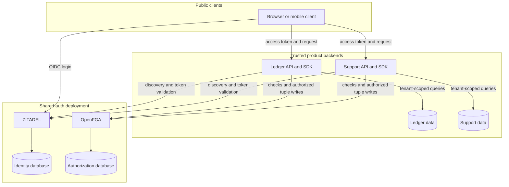
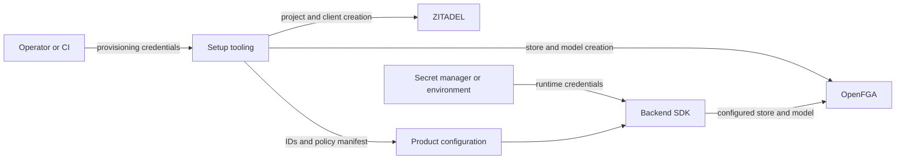

The agreed deployment consists of ZITADEL and OpenFGA, supported by their databases. Heimdall ships language packages and setup tooling. A product installs the runtime package inside its backend and supplies configuration and service credentials.

## Ownership

| Component | Owns | Product integration |
| --- | --- | --- |
| ZITADEL | Identities, authentication, identity federation, sessions | OIDC client and access-token validation |
| OpenFGA | Authorization models and relationship tuples | SDK checks, role reads, and membership writes |
| Heimdall SDK | Conventions, validation, policy mapping, error handling | In-process library with framework adapters |
| Product | Tenant lifecycle, invitations, business data, audit storage | Calls SDK and scopes database operations |
| Setup tooling | Provisioning workflow and generated configuration | Operator command or CI job |

## Credential boundary

Clients receive public OIDC configuration and their own session or token. Product backends receive OpenFGA credentials. Setup tooling receives credentials capable of creating ZITADEL projects and OpenFGA stores.

The initial proposal trusts the product backends operated on this deployment. A store ID partitions authorization data, while service access control determines what a credential can read or write. Verify the selected OpenFGA version and its access-control configuration before promising credential isolation between products. Standard shared-key authentication alone is insufficient evidence of per-store isolation. [OpenFGA configuration](https://openfga.dev/docs/getting-started/setup-openfga/configure-openfga)

A compromised backend can exercise the privileges of its service credential. This is an explicit deployment trust assumption. See [[decisions]] for the isolation question and [[operations]] for concurrency limits.
