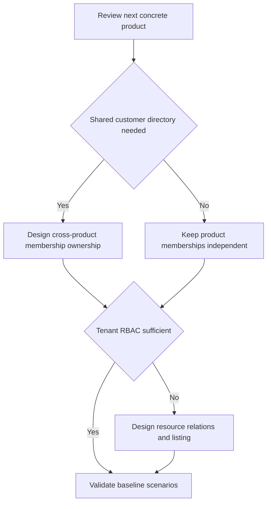

The distinction between agreed constraints and proposed defaults keeps this design reviewable.

| Status | Decision | Rationale |
| --- | --- | --- |
| Agreed | Deploy ZITADEL and OpenFGA with SDKs in product processes | Lean integration and direct service use |
| Agreed | Use Rolldown, Oxlint, Oxfmt and Vitest for TypeScript | Requested tooling for fast agent feedback |
| Agreed | Ship TypeScript and Go SDKs in the initial release | Both are required for initial product integrations |
| Agreed | Publish installable packages per language | Product developers integrate through familiar tooling |
| Agreed | Support multiple products and tenants per deployment | Reuse the auth deployment across products |
| Agreed | Design and dry-run before implementation | Validate the model and failure behavior together |
| Proposed | One ZITADEL project and OpenFGA store per product and environment | Independent policy and configuration |
| Proposed | Start with tenant-scoped RBAC | Short integration path for common role checks |
| Proposed | Product database owns tenants and invitations | Product already owns workspace lifecycle and data |
| Proposed | Shared sign-in with independent product memberships | Explicit access boundaries between products |
| Proposed | Trusted product backends under one operator | Fits direct SDK access to shared services |
| Proposed | Versioned model and permission manifest | Predictable behavior across SDK languages and rollout |

## Questions for the next design session

1. Should a company manage one directory across products, or invite members independently in each product?
2. Which TypeScript framework and Go HTTP adapter should define the initial integration experiences?
3. Are all product backends trusted under the same operator? What per-store service credential restrictions are required?
4. Do tenants need custom roles at runtime, or are product-defined roles sufficient initially?
5. Is document or resource sharing required for the first product?
6. What revocation window is acceptable for identities, memberships, and already-running operations?
7. Should service accounts act as themselves, on behalf of users, or both?
8. Where should setup tooling store provisioning progress and lock concurrent runs?
9. What audit events require durable storage before an operation is acknowledged?

## Gaps from the two-product walkthrough

The [[two-product-walkthrough]] proposes explicit contracts for sessions, paginated workspace discovery, retryable onboarding, and tenant-specific SAML or OIDC setup. Each remains open pending framework selection and executable service verification. Shared organization mappings share login policy across products. Strict SSO enforcement must cover existing sessions and tenant switching.

SCIM user lifecycle and SIEM export are covered in the walkthrough. Open questions include the product worker that runs reconciliation, directory-to-workspace enrollment rules, unsupported SCIM group provisioning, audit event coverage, and durable export.

## Verification status

The documentation build and diagram checks are recorded in the project README after validation. Auth services and the SDK are proposed designs. The candidate OpenFGA model, service credential isolation, and concurrent ownership workflows require executable service tests during implementation.

## Primary references

- [ZITADEL projects](https://zitadel.com/docs/guides/manage/console/projects-overview)
- [ZITADEL organizations](https://zitadel.com/docs/guides/manage/console/organizations-overview)
- [ZITADEL OIDC flow](https://zitadel.com/docs/guides/integrate/login/oidc/login-users)
- [OpenFGA concepts](https://openfga.dev/docs/concepts)
- [OpenFGA roles and permissions](https://openfga.dev/docs/modeling/roles-and-permissions)
- [OpenFGA consistency](https://openfga.dev/docs/interacting/consistency)
- [OpenFGA configuration](https://openfga.dev/docs/getting-started/setup-openfga/configure-openfga)
- [Quartz setup](https://quartz.jzhao.xyz/)
