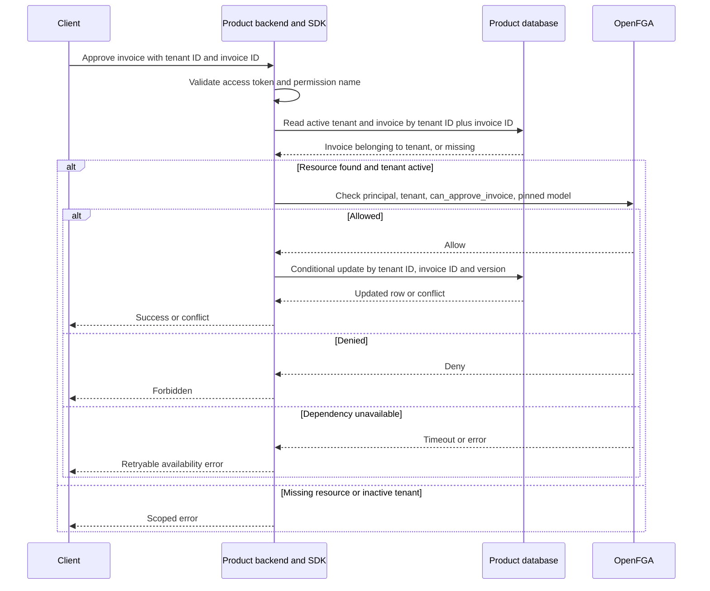
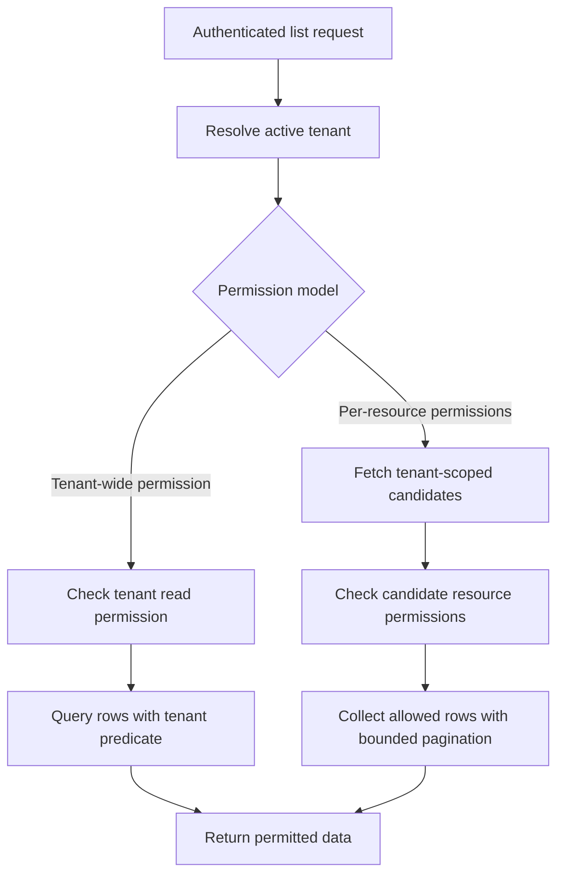

A protected operation combines verified identity, an active tenant, an OpenFGA decision, and a tenant-scoped database operation. Every request derives the product and model from backend configuration.

| Field | Authority | Rule |
| --- | --- | --- |
| Principal | Validated identity | Ignore caller-supplied actor identifiers |
| Tenant ID | Request plus product lookup | Validate format, lifecycle, and membership through permission |
| Resource tenant | Product database | Query and mutate with tenant and resource IDs |
| Permission | Product manifest | Reject unknown values |
| Store and model | Deployment configuration | Pin on every authorization call |
| Decision | OpenFGA | Deny blocks operation, failure produces availability error |

For sensitive writes, request higher-consistency checks and avoid SDK allow caching. OpenFGA's higher-consistency option bypasses its query caches. A successful check and a product database commit remain separate operations, so revocation can race an in-flight write. See [[operations]] for the stated guarantee. [OpenFGA consistency](https://openfga.dev/docs/interacting/consistency)

## List and export flow

Tenant-wide RBAC permits normal database pagination after the tenant permission check. Per-resource access needs an authorization-aware listing contract, including filtering, ordering, total counts, and work limits. Filtering only one database page can produce short pages and incorrect counts. That extension needs its own acceptance tests before release. Exports and background jobs must apply the same scope.
