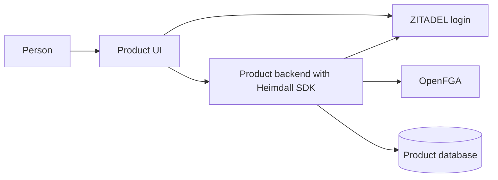

Heimdall makes shared authentication and tenant-scoped authorization available through an SDK installed in each product. Operators deploy ZITADEL and OpenFGA with their databases. Product backends call both services directly through the SDK.

This is a working design dated November 7, 2026. Package names, methods, and provisioning commands are proposals. The scenarios are reasoning exercises awaiting executable verification.

## Read the design

| Page | What we will decide |
| --- | --- |
| [[development-workspace]] | Local setup, agent checks, Git hooks and CI |
| [[task-list]] | Implementation tasks, dependencies, and acceptance gates |
| [[project-structure]] | Repository layout and where each responsibility lives |
| [[two-product-walkthrough]] | Two products end to end, developer wiring, SDK responsibilities, and integration gaps |
| [[architecture]] | Deployment boundary, trust, and component responsibilities |
| [[tenancy]] | Products, workspaces, identities, and ownership of data |
| [[authorization-model]] | Membership, roles, permissions, and optional resource sharing |
| [[shared-sdk-contract]] | TypeScript and Go session, discovery, and onboarding API proposal |
| [[sdk-contract]] | Developer experience and a portable package contract |
| [[flows/provisioning]] | Registering products and creating tenants safely |
| [[flows/authentication]] | Login, token validation, and selecting a tenant |
| [[flows/authorization]] | Permission checks and tenant-scoped data access |
| [[flows/membership]] | Invitations, grants, revocation, and ownership transfer |
| [[operations]] | Model migrations, failures, concurrency, and audit events |
| [[scenarios]] | Expected outcomes for normal and adversarial requests |
| [[decisions]] | Agreed constraints, proposed defaults, and open questions |

## Explorations

The following alternatives are unapproved and tracked separately from the current contract proposal.

- [[explorations/built-in-adapters|SDKs with built-in persistence adapters]] compares simpler sessions, workspace discovery and onboarding with the core SDK approach, including TypeScript and Go examples.

## Reading the diagrams

An arrow names the data or operation that crosses a boundary. An SDK box lives in the product process. Database cylinders denote persistent state. A sequence diagram shows ordering and failure paths. See each flow's data table for validation and persistence details.

Only this site's content directory is an input to publication. Review the decisions page before treating proposed defaults as implementation requirements.
