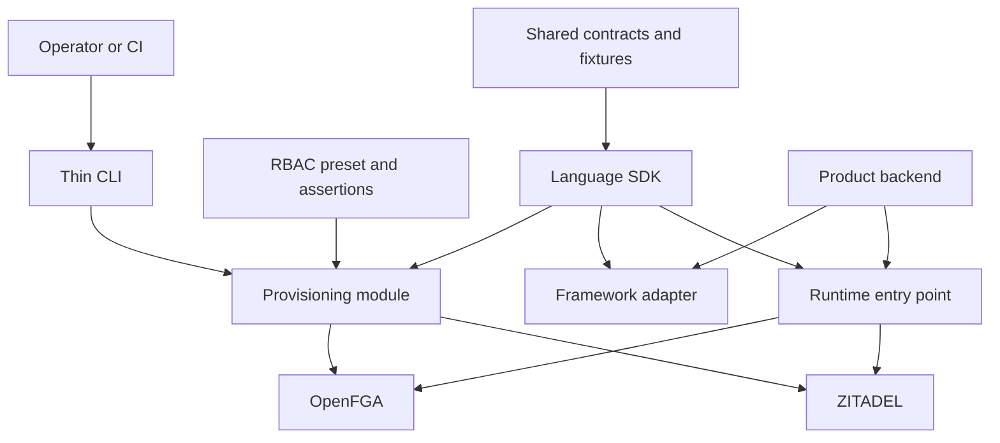

The workspace now contains the Quartz site, TypeScript and Go package scaffolds, shared directory boundaries, and root feedback tooling. Runtime SDK modules, service deployment files, contracts and product examples shown below remain planned. See [[development-workspace]] for the installed tools and commands. TypeScript and Go are both agreed initial-release SDKs. Framework adapters remain open. Both packages implement the same versioned behavioral contract with idiomatic language APIs.

## Repository layout

```text
heimdall/
├── design/                         Existing Quartz project
│   ├── content/                    Architecture, flows, scenarios and roadmap
│   ├── quartz/                     Vendored Quartz engine
│   ├── quartz.config.yaml          Site configuration
│   └── package.json                Documentation commands
├── contracts/                      Portable, versioned SDK behavior
│   ├── manifest.schema.json        Product roles, permissions and client config
│   ├── config.schema.json          Generated runtime configuration
│   ├── audit-event.schema.json     Audit envelope
│   └── fixtures/                   Identity encoding and behavioral cases
├── policies/                       Built-in authorization presets
│   └── tenant-rbac/                 Model template, mappings and assertions
├── sdk/
│   ├── typescript/                 Initial npm package
│   │   ├── src/
│   │   │   ├── index.ts            Runtime exports
│   │   │   ├── config.ts           Configuration validation
│   │   │   ├── identity.ts         Verified principal and token handling
│   │   │   ├── authorization.ts    can, require and effective roles
│   │   │   ├── memberships.ts      Member mutations and workspace discovery
│   │   │   ├── audit.ts            Structured event callback contract
│   │   │   ├── provisioning/      Product setup, tenant bootstrap and SSO setup
│   │   │   ├── adapters/          Selected framework login and session adapter
│   │   │   └── cli.ts              Thin operator command entry point
│   │   ├── test/                   Unit and shared-contract checks
│   │   └── package.json            Runtime, setup and adapter export paths
│   └── go/                         Initial Go module
│       ├── go.mod
│       ├── client.go               Configuration and runtime client
│       ├── identity.go             Verified principal and token handling
│       ├── authorization.go        Permission checks and effective roles
│       ├── memberships.go          Membership mutations and discovery
│       ├── audit.go                Audit event contract
│       ├── provisioning/           Setup, bootstrap and SSO helpers
│       └── adapters/               HTTP login and session integration
├── examples/
│   ├── ledger/                     Product manifest, API, tenant DB and routes
│   └── support/                    Independent product using the same services
├── tests/
│   └── integration/               Cross-service and two-product scenarios
├── deploy/
│   └── local/                     Reproducible ZITADEL and OpenFGA environment
└── .github/workflows/              Build, model tests, integration and releases
```

Create each directory when its first task starts. Build TypeScript and Go against the shared fixtures from the first implementation milestone. TypeScript publishes to npm and Go is distributed as a versioned Go module. Each package consumes the same versioned contracts and fixtures.

## Module boundaries

| Location | Responsibility | Executed by |
| --- | --- | --- |
| `contracts/` | Stable formats and language-independent cases | SDK validation and test runners |
| `policies/tenant-rbac/` | Membership-gated permission model and model assertions | Setup tooling and model tests |
| `sdk/typescript/src/` | Runtime identity, authorization and membership helpers | Product backend |
| `sdk/typescript/src/adapters/` | Framework routes, cookie and session handling | Product backend with supplied session store |
| `sdk/typescript/src/provisioning/` | Privileged service API calls and reconciliation helpers | Operator command or authorized product workflow |
| `sdk/go/` | Idiomatic Go runtime API using context, typed errors and explicit configuration | Go product backend |
| `sdk/go/adapters/` | HTTP and session integration | Go product backend |
| `sdk/go/provisioning/` | Provisioning helpers matching the shared contract | Authorized Go product workflows |
| `sdk/typescript/src/cli.ts` | Argument parsing and calling provisioning functions | Operator or CI |
| `examples/` | Complete business apps showing developer-owned integration | Example product processes |
| `tests/integration/` | Live-service tests, failures and concurrency | Test runner |
| `deploy/local/` | Service configuration and local persistent storage | Developer machine or integration CI |

The proposed package exports separate runtime, provisioning and framework entry points. Credential access is explicitly supplied to the selected entry point. The provisioning implementation can be reused by the CLI and a product's enterprise-settings workflow.



## What stays in the consuming product

| Product-owned integration | Example location | Why it lives there |
| --- | --- | --- |
| Tenant records and lifecycle | Example product database module | Business schema and transactions belong to that product |
| Resource tenant constraints | Invoice or ticket repository | Every business query needs tenant scope |
| Session persistence | Product session store | Product controls storage, availability and expiry policy |
| Invitation delivery | Product notification integration | Product owns recipients, content and communication provider |
| Retry state and execution | Product job or scheduled task | Durable work needs product persistence and a running process |
| Audit delivery | Product logging or outbox pipeline | Product selects durability, retention and SIEM destination |
| Identity organization mapping | Product tenant settings | Customer login scope may span several product tenants |

SCIM reconciliation helpers can be added inside the SDK when that capability is implemented. Their scheduler, checkpoints and enrollment policy belong to the consuming product. SIEM helpers emit events through the product's audit integration. See [[two-product-walkthrough]].

## Existing legacy material

The root still contains old documentation, environment files, keys and other non-code artifacts from the previous implementation. Treat Quartz as the current design reference. Review and deliberately retire or archive legacy material during repository cleanup, keeping secrets outside tracked example configuration. The proposed layout describes the next implementation. See [[task-list]] for sequencing.

## Initial language parity

Both SDKs cover token validation, tenant permission checks, effective roles, membership operations, workspace discovery, audit hooks and the agreed provisioning scope. Framework choices and method names can differ while identity encoding, policy mapping, failures and retry semantics remain consistent.

The proposed single operator CLI lives with TypeScript and emits language-neutral configuration usable by either SDK. Go consumers can supply externally provisioned configuration and use the Go provisioning package directly. A separate Go CLI can be considered if a concrete distribution need emerges.

The proposed example pairing is Ledger in TypeScript and Support in Go. Integration tests must exercise both SDKs against the same fixture cases as well as the cross-product walkthrough. Each SDK accepts the configured product policy so language choice does not constrain product capabilities.
