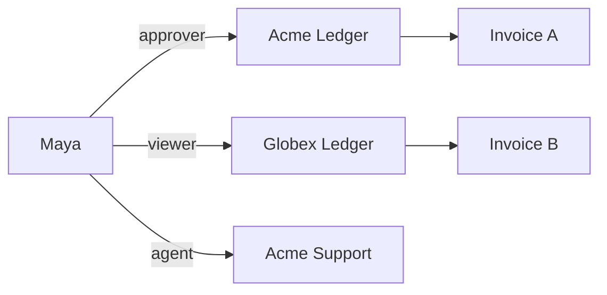
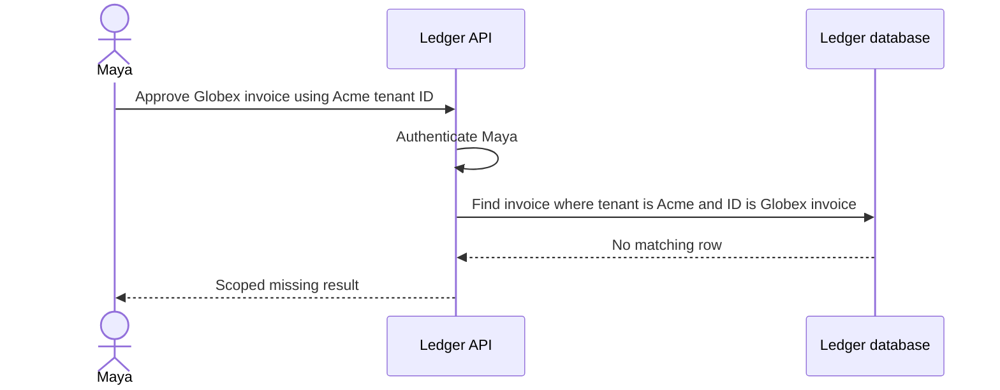

These cases define expected behavior for the proposed model. They are design walkthroughs. An implementation must run them as model and integration assertions before release.

| Case | Setup and request | Expected outcome | Reason |
| --- | --- | --- | --- |
| Read own workspace | Maya reads Invoice A in Acme | Allow | Membership and read role |
| Approve own workspace | Maya approves Invoice A in Acme | Allow | Approver and active membership |
| Viewer attempts approval | Maya approves Invoice B in Globex | Deny | Viewer lacks approval permission |
| Swap invoice ID | Maya requests Invoice B through Acme route | Scoped missing result | Database lookup includes Acme tenant |
| Swap tenant ID | Unaffiliated user requests Acme | Deny | Permission includes membership |
| Cross-product token | Ledger-only audience sent to Support | Authentication rejection | Expected audience validation |
| Same login, new product | Maya logs into Support with appropriate audience | Explicit Support membership required | Product grants are independent |
| SSO without workspace grant | New Acme employee authenticates | Workspace access denied | Identity association does not grant membership |
| Remove membership | Maya retains role tuple after removal | Fresh decision denies | Every permission intersects membership |
| Rejoin workspace | Maya returns after prior removal | Only newly assigned roles apply | Cleanup completed before reactivation |
| OpenFGA unavailable | Approval check times out | Availability error, no mutation | Backend requires a completed allow |
| Partial onboarding | Owner write succeeds, product activation fails | Pending tenant recovered on retry | Durable operation and stable tenant ID |
| Repeated invitation | Same principal retries accepted invite | Same result without duplicate grant | Single-use state and idempotent reconciliation |
| Stolen invitation | Different principal accepts link | Reject | Recipient binding |
| Concurrent owner removal | Two owners remove each other | Preserve an owner through serialized workflow | Product coordination required |
| Revocation during write | Check allows before revoke, commit follows | In-flight operation may finish | Separate transactions |
| Model mismatch | Unknown permission or manifest version | Startup or validation error | Explicit model contract |
| Tenant suspended | Valid token and old tuples still exist | Product gate denies | Lifecycle checked before operation |

## Walkthrough of a failed isolation attempt

## Checks to add when implementing

Run model assertions for every role and membership intersection, then integration cases for token audiences, resource scoping, retry after lost write responses, concurrency, and model rollout. Resource sharing, service accounts, and company-wide directories require additional cases once their contracts are chosen. See [[decisions]].
