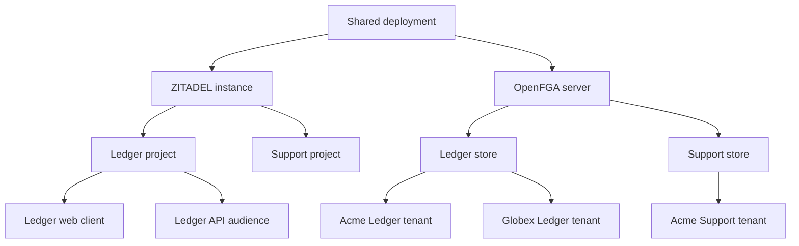
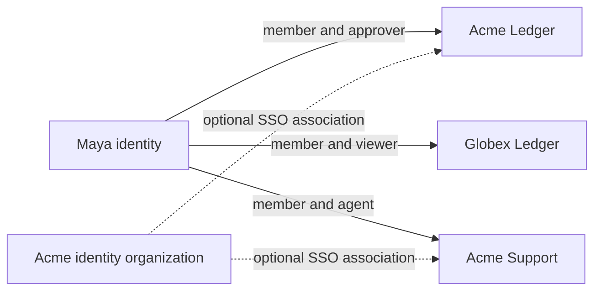
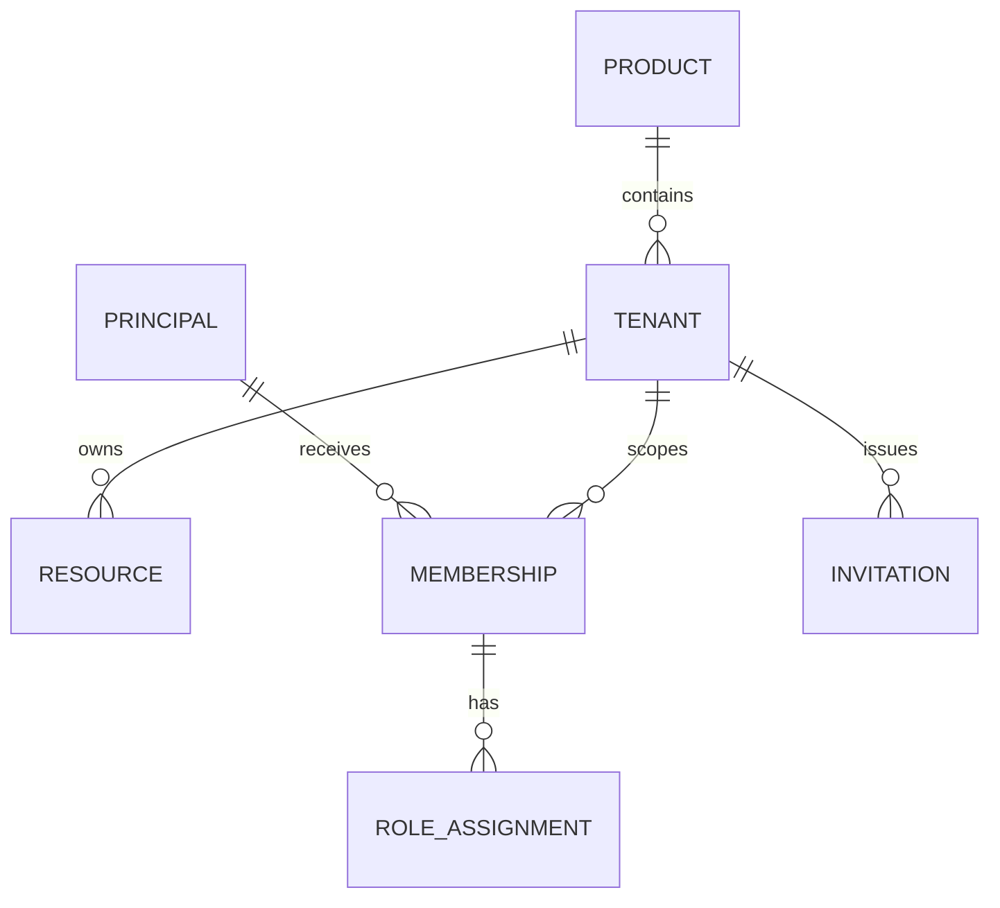

A product is an independently configured application such as Ledger or Support. A tenant is a workspace within that product. A person can belong to several workspaces with different roles.

The proposed mapping uses one ZITADEL project and one OpenFGA store for each product in each environment. Related web, mobile, and API clients belong to that product's ZITADEL project. ZITADEL groups application clients within projects. [ZITADEL projects](https://zitadel.com/docs/guides/manage/console/projects-overview)

## Identity organization and workspace

A ZITADEL organization manages identities and identity configuration. A Heimdall tenant scopes product membership and resources. Their optional association is product metadata. An enterprise can link its organization to multiple product workspaces. A self-serve workspace can contain people from several identity organizations. Enterprise login policy must explicitly decide which identities and authentication methods it accepts. [ZITADEL organizations](https://zitadel.com/docs/guides/manage/console/organizations-overview)

## Data contract

| Record | Authority | Required identifiers and rules |
| --- | --- | --- |
| Identity | ZITADEL | Verified issuer plus subject. Email changes must preserve identity |
| Product configuration | Deployment config | Product and environment, issuer, audience, store ID, model ID, manifest version |
| Tenant | Product database | Immutable tenant ID, lifecycle status, optional identity organization reference |
| Membership and role | OpenFGA | Principal, tenant object, relation |
| Resource | Product database | Immutable ID and tenant ID, enforced in every query |
| Invitation | Product database | Tenant, intended recipient, role, expiry, single-use acceptance state |
| Optional resource relation | OpenFGA | Resource object, parent tenant, explicit grants |
| Audit event | Product audit sink | Actor, tenant, operation, target, result, request ID |

The principal encoding must preserve the pair of issuer and subject across every language SDK. The exact encoding is open. Never use a mutable email address as its key. Opaque tenant IDs receive a fixed OpenFGA type prefix. Runtime requests cannot override the configured store, model, or issuer.

This diagram shows logical relationships across authorities. OpenFGA represents memberships and roles as tuples. A company-wide directory shared across products remains a decision in [[decisions]].
