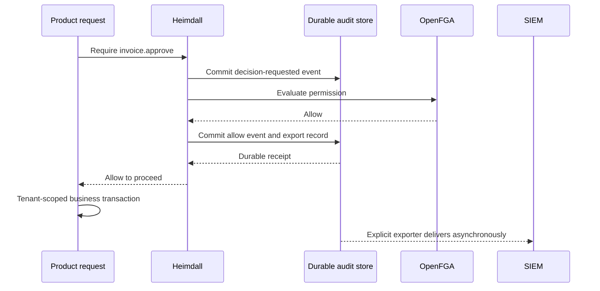

Every role change, ownership transfer and authorization decision is durably audited in the first release. Product/user-configured event definitions extend this mandatory coverage. This means durable local acceptance before the SDK reports a completed decision or mutation, followed by asynchronous delivery to the configured SIEM. It does not require a synchronous remote SIEM acknowledgement on every request.

## Required event coverage

| Operation | Required records |
| --- | --- |
| can/require, lifecycle gate, effective-role checks | Requested decision plus allow, deny, invalid, unavailable or cancelled outcome |
| Discovery and batch checks | Every evaluated authorization decision, correlated to its batch; no sampling |
| Membership/role grant, removal and ownership transfer | Authorized intent before remote dispatch, attempt, confirmed/failed/uncertain outcome |
| Authentication and enterprise policy rejection | Sanitized event with known scope; identity can be absent before verification |
| Recovery, policy configuration and export administration | Initiating operator, target, policy version and outcome |
| Product-defined actions | Validated custom event and product-supplied business outcome |

The logical API decision is always recorded, including a local lifecycle rejection before OpenFGA. Internal relation evaluations that contribute to effective roles/discovery have child decision IDs; opaque server-internal graph traversal is not an observable SDK decision and is not invented. can followed by require constitutes two invocations and two records. Logging an allow does not assert the business operation committed.

## Persistence interface and ordering

Core mode requires a DurableAuditStore supplied by the product; missing mandatory audit configuration fails startup. The PostgreSQL adapter implements it using separate audit/outbox tables, available in session-only and managed compositions. This extends the adapter scope; the operation journal remains separate and is not silently treated as the outbox. Auth operations must await committed audit persistence, not an in-memory queue or callback.

The shared contract requires append(event, options) to return a durable receipt only after commit. Event ID is unique per scope. Repeating the same event ID/payload returns the existing receipt; reusing it with a different payload conflicts. Batch append is atomic or returns explicit per-event receipts; do not acknowledge unpersisted members. TS uses AbortSignal; Go uses context.Context. Physical fsync/replication policy belongs to the supported database durability configuration and its verification.

The executable v1 encoding is specified in contracts/README.md and shared receipt/digest fixtures. Construct an immutable event once before append; retries preserve its event ID, payload and recordedAt. The digest covers every field using a portable typed-value encoding, independent of JSON key order. A returned receipt must match the event's product/environment, ID, timestamp and digest. A mismatch blocks protected work with audit_unavailable. These checks do not substitute for verified database durability.



On crash after evaluation but before terminal persistence, the durable request remains unresolved; recovery appends outcome_unknown. It must not invent an allow/deny result or rerun the check and pretend that is the historical decision. No completed allow was released to product code. Even denying results require persistence; a failed local append returns audit_unavailable rather than a successful can=false result. HTTP mapping is 503 and protected work remains blocked. A separate health signal records audit-store failure without recursively invoking the broken audit path; no claim is made that an unavailable store recorded the error.

Before a mutation, persist immutable authorized intent. After remote success, persist the result before reporting completion. If that persistence fails, return outcome_unknown/pending with the operation ID, never claim rollback. Managed mode preserves its lifecycle quarantine and recovery rules. Durable intent proves an attempt existed; it does not atomically commit a remote tuple write. Business outcomes should be written to an outbox in the same transaction as the business update when that guarantee is required.

## Envelope and extensibility

Required envelope: schema version, event ID, event type/version, occurred/recorded timestamps, product/environment, tenant where applicable, verified actor or explicit unknown actor, target, action/permission, outcome, request/decision/operation IDs, source, SDK version and model/manifest/policy versions where applicable. Store trace correlation without raw tokens, cookies, secrets or unbounded request bodies.

Authentication, authorization, managed operations and export events with new SDK-generated event IDs carry the build version. The current custom-event writer, provider event collector and deterministic audit hold/retirement envelopes retain their original `0.0.0` field value. Those paths can reconstruct the same event ID on a later build, so changing the field in place would change the retained payload digest and reject a valid retry. Existing envelopes and digests remain immutable.

Built-in security types use a reserved heimdall.* namespace. Product events use registered product.* types with versioned attribute schemas. An authorized product/tenant administrator may configure enabled custom definitions through product-owned settings. Their permissions and changes are themselves audited. The backend supplies trusted actor/scope/outcome metadata; a browser cannot spoof them. Extensions cannot rename, suppress, sample, redact away mandatory identifiers or change outcomes of required security events. Unknown types, invalid attributes, sensitive fields and oversized payloads are rejected before persistence.

```ts
const writer = createCustomAuditWriter(pool, {
  productId: "ledger", environment: "production", auditSinks: ["siem"],
  validateCustom: approvedSchemas,
});
await writer.record({
  eventId, eventType: "product.invoice.approved", eventVersion: 1,
  occurredAt, recordedAt, actor, tenantId,
  target: { type: "invoice", id: invoiceId },
  action: "invoice.approve", outcome: "succeeded", requestId,
  attributes: { approvalTier: "standard" },
}, signal);
```

Go exposes `postgres.NewCustomAuditWriter` and `Record(ctx, event)` with the same validation and receipt. The product resolves the actor, tenant and approved schema in trusted backend code. Reuse the same event ID and timestamps when retrying. Use a transactional product outbox if the event must be atomic with a business commit.

## Delivery, retention and failure policy

Export is explicitly scheduled and at least once. Persist per-sink delivery/checkpoints; advance only after acknowledgement of the durable event IDs. Receivers deduplicate by event ID. A timeout after sink acceptance may cause a duplicate; never claim exactly once. Retry transient errors with bounded backoff/jitter; quarantine poison records, alert and preserve them for operator replay. A bad event must not silently disappear or indefinitely block unrelated tenants.

The v1 batch receipt binds sink, product/environment and a nonempty unique subset of submitted event IDs. Partial acknowledgement advances only those IDs; the rest remain pending. Unknown IDs, wrong scope, duplicate IDs or an empty acknowledgement invalidate the response and advance nothing. Receivers deduplicate by product/environment/event ID. A transport timeout preserves the batch for retry even if the receiver may already have committed it.

The first reference transport is authenticated HTTPS JSON batch delivery to an operator-configured SIEM ingestion endpoint/adapter, with an explicit receipt contract. Provider-specific adapters may translate this envelope and acknowledgement. Integration tests require a real compatible ingestion configuration or a clearly identified protocol receiver; a mock alone cannot establish a vendor compatibility claim. Collect ZITADEL events through its supported Events API/export integration with an independent durable checkpoint, then correlate through explicit organization/product mappings. [ZITADEL audit export](https://zitadel.com/docs/guides/integrate/external-audit-log)

No required event is sampled. Default local delivered-event retention is 30 days, configurable by authorized deployment policy; undelivered, unresolved and held records are not purged by that timer. SIEM retention is explicitly configured by the operator. Export failure preserves the backlog. Capacity limits are deployment-configured and validated at startup; reaching a hard persistence limit blocks new protected work, rather than dropping events. Alert on oldest pending age, backlog, poison events, storage usage and failure rate. Bulk export and retention settings need privileged, tenant-scoped authorization. Tenant destinations bind the SDK worker and receipt handler to the authorized tenant. The worker applies the same tenant filter to delivery, backlog counts and requeue. [[evidence/phase-6-audit-delivery#tenant-scoped-delivery-and-replay]]

[[audit-retention]] defines group eligibility, the 30-day age anchor and preservation
of immutable retry identity. Its classifier is implemented; durable retention
storage and deletion remain gated.

The cost of all-decision audit is a durable write before evaluation plus a write before releasing the result, substantial storage and an availability dependency on audit persistence. Batching is permitted only if each invocation waits for its committed receipt. Scope filtering is mandatory even when one organization maps to several products. Minimize personal data and never treat a shared company name as tenant routing authority.

## Acceptance tests

Crash before/after decision evaluation, before/after mutation dispatch and during terminal append; audit-store outage blocks protected work. SIEM outage/restart replays without lost IDs. Duplicate delivery deduplicates. Invalid custom schemas and impersonated built-in types fail. Sparse discovery and roles APIs account for all evaluated checks. Tenant exports do not leak other products. Ownership transfer traces intent through uncertain recovery to final outcome. Both languages run identical schema, receipt and delivery fixtures.
