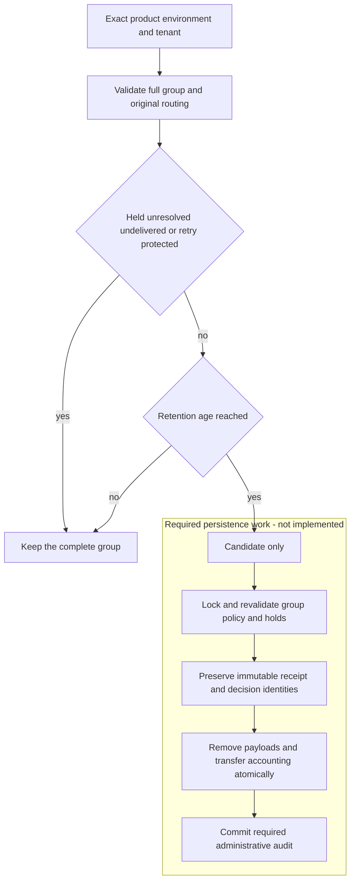

Retention must reclaim delivered payloads without breaking immutable event IDs,
receipts or authorization history. The TS and Go **eligibility classifier is
implemented and fixture-tested**. [[evidence/phase-3-retention-identities]] adds prepared compact storage constraints;
prepared holds, metadata quotas and retirement guards now have live SQL proof. Runtime integration and authorized atomic deletion remain required; no purge is enabled.

## Selection and age

An invocation targets exactly one product, environment and tenant. A null tenant
means product-level records, never every tenant. The caller needs privileged
scope authorization. A decision is one indivisible group: request plus its normal
terminal, or request plus unknown terminal plus recovery administration. Pending
requests cannot be purged. Ordinary events form single-event groups.

The default period is 30 days from the latest recorded or delivered timestamp
across the whole group. Late SIEM acknowledgement therefore starts a fresh local
retention period. Zero configured sinks uses event time. Future timestamps retain
data; clock regression cannot shorten the period. A positive deployment policy
may change the duration only through authorized, audited configuration.

All metadata must validate before returning any retention reason, even when the
group is held. Missing group members, cross-scope members, duplicate event/sink
IDs, unknown states, missing routing metadata or incoherent delivery timestamps
are errors. A quarantined administration delivery protects the entire recovered
decision. Lease expiry is not proof that a hold or retry obligation has cleared.

## Retry identity survives payload retirement

The existing contract returns the original receipt for identical retries and
conflicts on changed payloads under the same scoped ID. Deleting all traces would
silently allow reuse of old event and decision IDs. The retirement transaction
must preserve compact immutable identity: event ID, scope, recorded time, digest,
original routing and decision links. Exact retries still validate their supplied
full events against that identity; they cannot create new deliveries or repeat
an old business operation.

A compact receipt is not an exportable payload or a fresh authorization result.
Historical payload reads must explicitly report local unavailability after
retirement. New holds cannot recreate already-retired content. Compact identities
still consume storage and need explicit count/byte budgets and reservations.
Retirement moves accounting; it does not refund bytes that still exist. Metadata
capacity exhaustion blocks new work instead of silently forgetting IDs. Any
future removal of retry identity requires a separately reviewed retry contract.

This trades some persistent metadata for unchanged retry semantics while removing
full personal payloads after their obligations expire. It avoids an unbounded,
unmetered deduplication cache. SIEM retention remains independently configured.

## Evidence and remaining work

The shared `audit-retention.json` fixture covers 34 cases in both SDKs: age
boundaries, delayed/future/regressed timestamps, absent sink routing, holds,
unresolved/retry-protected groups, poisoned delivery, scope isolation, corruption,
group completeness and safe-integer limits. TypeScript additionally checks the
default and noninteger inputs. Classification is pure and leaves input unchanged.

A candidate grants no deletion authority. Prepared persistence now includes compact
identities, holds, metadata quotas and marker-aware inspection. Explicit retry
obligations use immutable `retry`-purpose holds in that same ledger; see
[[evidence/phase-3-retry-holds]]. A retry hold protects its whole decision and has
no lease or time-based expiry. Its explicit audited release must commit before
retirement; releasing one obligation leaves other obligations active.

Public bearer storage now requires activated v4 and retained audit writes; see
[[evidence/phase-3-public-retention]]. Explicit preparation, bounded backfill and
activation are implemented. Authorized atomic retirement/audit, managed/recovery
runtime integration, bounded scheduling and complete lifecycle fault tests remain
required. Schema readiness alone is not sufficient to enable purge.
The detailed implementation protocol is `contracts/audit-retention.md` in the
repository. [[audit-contract]] remains the product audit contract, and
[[evidence/phase-3-readiness-audit]] tracks the incomplete Phase 3 gate.
