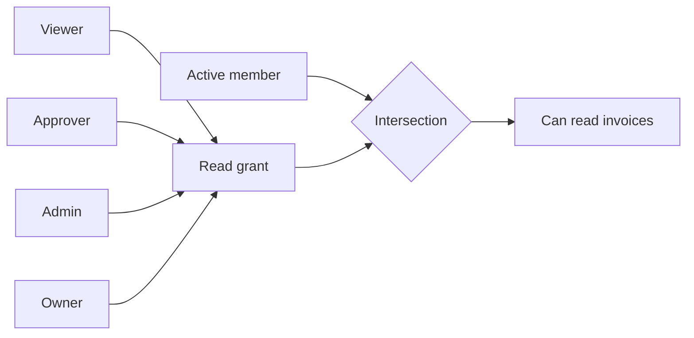
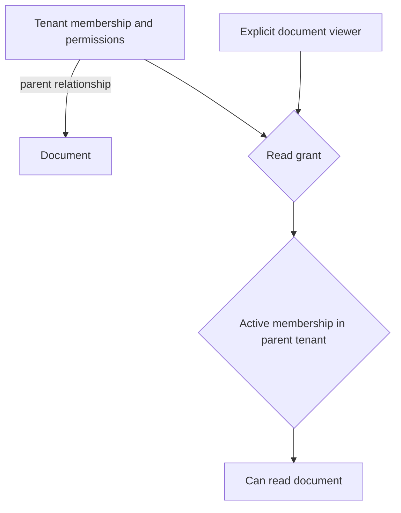

The selected first release uses product-defined tenant-scoped RBAC for human users. Each action maps to a permission relation in the pinned OpenFGA model. An explicit active membership gates every permission, so removing membership disables all roles for that tenant.



## Candidate model

This readable model remains an explanatory sketch. The initial executable TS/Go compiler and its generated relation mapping are documented in [[evidence/phase-3-tenant-model]]; product manifests determine the actual grants. OpenFGA supports composing permissions from role relations. [OpenFGA roles and permissions](https://openfga.dev/docs/modeling/roles-and-permissions)

```fga
model
  schema 1.1

type user

type tenant
  relations
    define member: [user]
    define viewer: [user]
    define approver: [user]
    define admin: [user]
    define owner: [user]
    define can_read_invoice: (viewer or approver or admin or owner) and member
    define can_approve_invoice: (approver or admin or owner) and member
    define can_manage_members: (admin or owner) and member
    define can_manage_admins: owner and member
```

For Maya in Acme, write `user:maya member tenant:acme` and `user:maya approver tenant:acme`. A check for `can_approve_invoice` succeeds. The same check against `tenant:globex` requires Globex relationships. IDs shown here are illustrative.

| Role | Invoice read | Invoice approve | Manage viewers and approvers | Manage admins |
| --- | --- | --- | --- | --- |
| Viewer | Yes | No | No | No |
| Approver | Yes | Yes | No | No |
| Admin | Yes | Yes | Yes | No |
| Owner | Yes | Yes | Yes | Yes |

All rows require active membership. Owner transfer is a dedicated product workflow with serialization. The SDK rejects owner grants through ordinary role assignment. Whether tenant administrators should approve invoices is a product policy choice.

## Effective role resolution

`roles(actor, tenant)` first checks membership and then checks the declared role relations using the pinned model. It returns effective roles only within that tenant. Raw tuple reads alone would miss inherited roles if groups are added later. Membership removal also triggers cleanup of old role tuples before any future reactivation, preventing stale privileges from returning.

## Optional resource access



Resource-level access is an extension. Resource creation must establish its tenant relationship before it becomes visible. The product supplies the authoritative parent from stored data. Cross-tenant sharing needs an explicit policy and scenario set before support. See [[flows/authorization]] and [[scenarios]].
