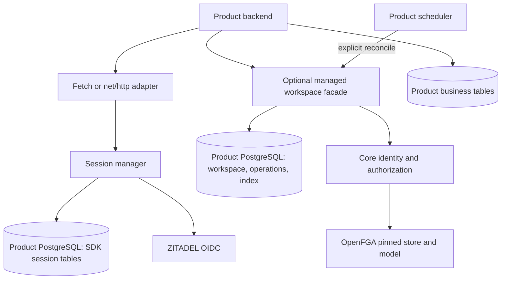
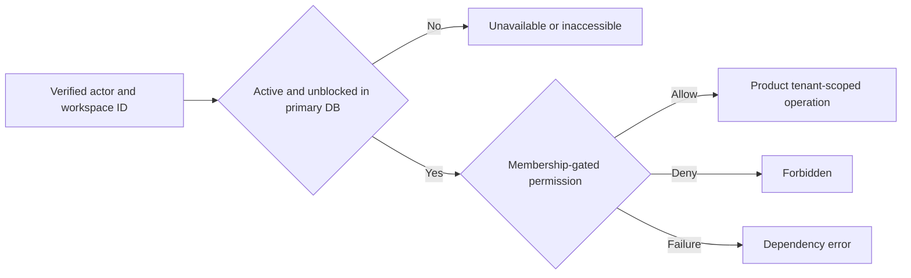
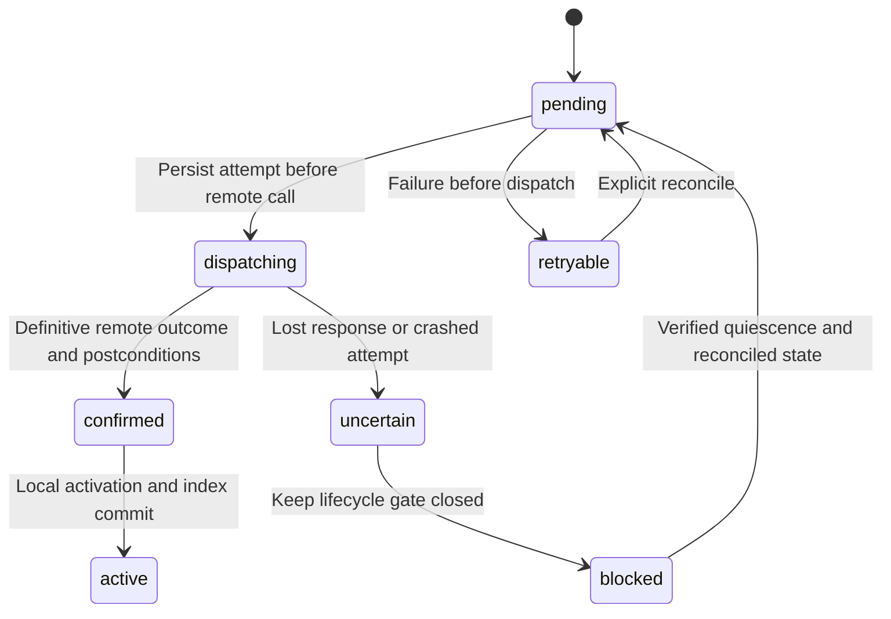

The November 10 [[release-contract]] requires enterprise features and [[audit-contract|durable audit for all authorization decisions, role changes and ownership transfers]]. PostgreSQL adapters now include separate audit/outbox tables in both compositions. [[enterprise-contract]] adds the identity lifecycle gate. These requirements supersede earlier optional-audit wording below.


The adapter direction is selected following the design discussion. This page closes the design scope for implementation; it does not claim implemented or verified runtime behavior. It supersedes [[explorations/built-in-adapters]] for supported scope. The core interfaces in [[shared-sdk-contract]] remain available. API spellings below are contract sketches, to be locked with the executable schemas before publication.

## Decision and release boundary

Provide optional PostgreSQL persistence in both TypeScript and Go. Offer two compositions: sessions with product-owned workspaces, and sessions plus SDK-managed workspaces. Both run inside the consuming product. There is no Heimdall service or required additional database server; the consumer supplies a PostgreSQL connection and operates that database. Products without PostgreSQL can use the core interfaces.

Select portable Fetch Request/Response handlers for TypeScript and net/http handlers for Go as the initial HTTP boundaries. Framework-specific wrappers such as Express can follow; earlier Express snippets were illustrative. Mounted auth routes handle login, callback and CSRF-protected logout. Business routes remain product code.

| In the first adapter scope | Deferred |
| --- | --- |
| PostgreSQL session store, encrypted records, CAS and expiry | Redis, SQLite, ORM-specific adapters |
| Minimal managed workspace directory and durable operation records | SDK ownership of billing, subscriptions or business tables |
| Managed membership candidate index and current OpenFGA checks | Arbitrary custom roles, groups and resource-sharing indexes |
| Create/status, membership mutation integration and bounded reconcile | Implicit timers, goroutines, hosted workers or startup migrations |
| Explicit migration command, compatibility checks, export and recovery runbooks | Automatic adoption of existing tenants or in-place ownership-mode switching |
| TS/Go storage interoperability and failure tests | Universal plugin interface or a second Go operator CLI |

Session-only consumers do not install workspace tables. Managed workspace state, operation records and candidate-index updates must use the same PostgreSQL transaction boundary. Splitting these across adapters/databases is unsupported in v1. Session storage may use another connection, but cannot participate in the managed-workspace transaction.

## Ownership and authority

| Data or decision | Core/product-owned mode | Managed mode |
| --- | --- | --- |
| Identity and provider policy | ZITADEL, configured by authorized workflows | Same |
| Relationship checks | OpenFGA using pinned model | Same, plus mandatory local lifecycle gate |
| Session records | Product implements SessionStore or installs adapter | PostgreSQL session adapter |
| Workspace ID, display name and auth lifecycle | Product database | SDK tables in product database |
| Membership change intent | Product durable workflow | SDK operation journal |
| Membership discovery | Product candidate source | SDK candidate index; never authority to allow |
| Invitations and recipient verification | Product | Product, calling managed membership APIs |
| Creation, billing and customer eligibility policy | Product | Product policy callback on creation |
| Recovery algorithm | Product workflow plus SDK ensure helpers | SDK reconcile, invoked explicitly by product |
| Business data and tenant predicates | Product | Product |
| Durable audit and SIEM delivery | Required product DurableAuditStore/outbox | PostgreSQL audit/outbox adapter; journal remains separate; product schedules delivery |

OpenFGA is the authority for evaluated relationships. The operation journal records requested transitions, not an unconditional desired-state mirror. After an operation completes, reconciliation must not regrant old relationships merely because they appear in historical intent. Out-of-band service changes are drift to inspect; they are not automatically overwritten.

No adapter may write into ZITADEL/OpenFGA internal databases. SDK writes must use public service APIs. No normal runtime credential needs schema-changing database privileges or ZITADEL project-creation privileges.



## Composition and API shape

### Sessions with existing product workspaces

The core WorkspaceSource and SessionStore contracts remain unchanged. PostgreSQL implements SessionStore; existing products supply their stable, active-workspace scan. This mode does not take ownership of tenant lifecycle or cancellation.

```ts
const core = createHeimdall({ config })
const sessions = core.createSessions({
  store: postgres.sessions(pool),
  encryptionKeys: sessionKeys,
  publicUrl: "https://ledger.example.com",
  allowedReturnTo: ["/workspaces"],
})
const discovery = core.createWorkspaceDiscovery({
  source: productWorkspaceSource,
  cursorKeys,
})
// Mount sessions.handle(Request, { signal }) at the configured auth prefix.
```

```go
core, err := heimdall.New(heimdall.Options{Config: config})
if err != nil { return err }
sessions, err := core.NewSessions(heimdall.SessionOptions{
    Store: postgres.NewSessionStore(db),
    EncryptionKeys: sessionKeys,
    PublicURL: "https://support.example.com",
    AllowedReturnTo: []string{"/workspaces"},
})
if err != nil { return err }
mux.Handle("/auth/", sessions.Handler())
```

### Managed composition

Use a distinct constructor/export so ownership is explicit. It combines sessions, workspace persistence, lifecycle-gated authorization and membership mutation scheduling. It does not expose a raw core authorization client as an escape hatch. Applications selecting managed mode must use its facade for all protected operations and membership writes.

```ts
const h = createManagedHeimdall({
  config,
  persistence: postgres.managed(pool),
  sessions: { publicUrl, encryptionKeys: sessionKeys },
  cursorKeys,
  policies: { authorizeWorkspaceCreation },
})
await h.ready({ signal }) // Read-only compatibility check; no migration.
// Mount h.auth.handle on /auth; bridge Fetch requests in the chosen server.

const actor = await h.authenticate(request, { signal })
const result = await h.workspaces.create({
  actor, name: "Acme", idempotencyKey,
}, { signal })
// Return 201 for active, 202 for pending with an authorized operation-status URL.
```

```go
h, err := heimdall.NewManaged(heimdall.ManagedOptions{
    Config: config,
    Persistence: postgres.NewManaged(db),
    Sessions: heimdall.SessionOptions{
        PublicURL: publicURL, EncryptionKeys: sessionKeys,
    },
    CursorKeys: cursorKeys,
    Policies: heimdall.Policies{AuthorizeWorkspaceCreation: creationPolicy},
})
if err != nil { return err }
if err := h.Ready(ctx); err != nil { return err }
mux.Handle("/auth/", h.AuthHandler())
result, err := h.Workspaces().Create(ctx, actor, heimdall.CreateOptions{
    Name: "Acme", IdempotencyKey: requestID,
})
if err != nil { return err }
// Translate active/pending result to the product's HTTP response.
```

`authorizeWorkspaceCreation` is required, executes before a new intent is recorded and defaults to no permission when missing. The SDK supplies verified actor and validated input; the product decides commercial eligibility. An existing operation can be inspected only by its initiating principal or an explicitly authorized operator. Changing policy does not silently rewrite a recorded operation; suspension is a separate explicit action.

| Operation | TS / Go shape | Completion semantics |
| --- | --- | --- |
| Create workspace | workspaces.create / Workspaces().Create | Active or pending with stable operation ID |
| Observe operation | operations.get / Operations().Get | Authorized caller sees status and sanitized reason |
| Discover | workspaces.list / Workspaces().List | Bounded authorized page and continuation |
| Enforce | tenant(id).require / Tenant(id).Require | Local lifecycle gate, then fresh permission check |
| Effective roles | tenant(id).roles / Tenant(id).Roles | Same gate plus membership-gated roles |
| Mutate membership | memberships.add/remove/assignRole / Memberships equivalents | Confirmed or pending; delegation checked before intent |
| Recover | reconcile / Reconcile | Bounded summary of completed, retryable and blocked operations |

All request operations accept AbortSignal/context. No browser-submitted actor, organization, store, model, namespace or policy object is trusted. Return destinations are configured at startup. CSRF protection is required on every cookie-authenticated product mutation.

## Tables, isolation and migration

The conceptual storage families below are a contract to encode in migrations, not final SQL DDL.

| Family | Required fields/invariant |
| --- | --- |
| Schema metadata | Schema version, migration checksum, compatible reader/writer range |
| Login states and sessions | Product/environment, opaque key hash, encrypted payload/key ID, expiry, non-repeating CAS version |
| Workspaces | Product/environment, immutable random ID, validated display name, lifecycle, mutation-block flag, revision |
| Operations | Scope, operation ID, actor, idempotency-key digest, canonical request fingerprint, immutable intent, state, model/manifest, attempts |
| Membership candidates | Scope, principal encoding, workspace ID, stable position, reconciliation metadata; unique per principal/workspace |

Use a fixed SDK schema or deployment-validated identifier. SQL values are parameterized; schema identifiers never come from requests. All keys, unique constraints and foreign keys include product/environment. Product separation in code is not security isolation against a compromised process with shared database credentials; use separate database roles/databases where that boundary is required.

No cascading foreign keys from business tables into SDK tables are supported initially. Products store the immutable workspace ID and perform scoped queries. IDs are never reused. Namespace reuse after reinstall is prohibited unless it restores the original deployment state deliberately.

Migrations run with a deployment credential and exclusive migration coordination, never on client construction. Runtime startup checks the supported schema range and fails closed on incompatibility. Apply additive migrations first, deploy compatible readers/writers, drain old versions, then separately schedule destructive cleanup. Do not promise rollback after destructive migration. SQL and serialization fixtures are shared across languages; no TS/Go-specific duplicate migration histories.

## Session behavior and defaults

Use eight-hour absolute and thirty-minute idle lifetimes as configurable defaults, with idle bounded by absolute expiry. Access-token expiry is enforced independently. Defaults are usability choices, not enterprise compliance guarantees. Cookie names include product/environment; use Secure, HttpOnly, SameSite=Lax, Path=/ and no Domain for __Host cookies. Local HTTP development requires an explicit loopback-only mode and a non-__Host cookie name. Never silently weaken production cookies.

The version-1 envelope uses standard-library AES-256-GCM for records and HMAC-SHA256 with separate keys for cursors; see [[evidence/phase-1-crypto]] and contracts/README.md for formats and interoperability proof. Production composition must enforce deployment-wide key usage limits and rotation before release. Associated data binds scope and record type. Login state is browser-bound and single-use. Refresh uses the SessionStore CAS contract, with a bounded attempt lifetime; an uncertain refresh requires reauthentication. Logout deletes the session so refresh persistence cannot resurrect it. Server-side idle expiry remains authoritative even if a browser retains the cookie.

Keys are explicit, durable and shared by replicas serving the same product. Writers use the active key ID; readers accept a configured rotation set. Retain previous session keys until affected records are rotated/expired. Cursor signing keys have a separate purpose and lifetime. No generated-on-boot keys. Missing/unknown keys fail authentication; logs omit ciphertext and secrets. Exact crypto envelope and interop vectors are release gates.

## Managed authorization and discovery

A managed check first reads the authoritative workspace lifecycle from the primary database. Pending, suspended, tombstoned or mutation-blocked workspaces cannot yield an allow. Database unavailability returns unavailable, never a cached allow. Active/unblocked workspaces then use OpenFGA and the pinned model. For v1 managed enforcement and reconciliation, use HIGHER_CONSISTENCY and no SDK allow cache. OpenFGA documents that this mode bypasses query caches; it does not create a transaction with the product database. [OpenFGA consistency](https://openfga.dev/docs/interacting/consistency)

The extra database read is a deliberate cost. An operation already authorized may finish after suspension or revocation; stronger in-flight cancellation requires product transaction coordination. Managed mode cannot protect applications that bypass the facade or omit tenant predicates from business queries.



Discovery scans the local candidate index joined to active/unblocked workspaces, then checks current membership. Keep core defaults of page size 20, max 100 and scan budget 500; bound check concurrency and preserve the last consumed candidate. Cursor signing binds principal, product/environment, model, format and expiry. Default cursor lifetime is 15 minutes, configurable; expiry restarts traversal. Dependency errors fail the page. Empty pages with continuation are valid. Do not return totals or promise snapshot pagination.

SDK-mediated confirmed membership writes update the candidate index locally. Stale candidates cannot authorize access. Missing candidates may hide access until repaired. Direct service changes are an operator exception: a scoped rescan of known managed workspace membership relations can rebuild candidates, with bounded progress and checkpoints. It must not reconstruct grants from historical intent or automatically adopt unknown remote tenants. Group/inherited membership candidate rebuild is outside the initial direct-user model. Any tuple-change optimization requires separate verification; the correctness path is a scoped rebuild. Rebuilds reconcile concurrent SDK writes before publishing results, and do not infer revocation from an incomplete scan.

## Onboarding, operations and uncertain writes

Idempotency scope is product/environment, operation kind and initiating principal. Bind a caller-supplied key to canonical validated input, including initial owner. Reuse with changed input conflicts. Two different callers cannot retrieve one another's operations. An empty key is invalid. The canonicalization and digest format are shared fixtures. Preserve terminal operation/key tombstones for the workspace lifetime; key expiry/reuse and hard deletion are excluded from v1. Duplicate requests return the same result without executing new writes.

A new workspace and its create operation commit in one local transaction. Pending workspaces are inaccessible. Before each remote mutation, commit a dispatch marker and block the workspace locally. The journal's operation generation and conditional updates prevent an old worker from activating or completing a superseded operation. Ordinary workers use short database transactions to claim work; no database transaction is held across a network call.



The diagram describes workspace creation. For membership changes, the workspace remains logically active but its mutation-block flag denies protected work while mutation is pending or uncertain. Initially serialize one mutation per workspace; this coarse gate can briefly interrupt all members during administration. That availability cost is explicit. Optimizing it to per-principal gates requires a later correctness design.

A confirmed remote response followed by a failed local commit is recoverable from durable confirmation if that record survived. If no durable confirmation exists, treat it as uncertain. A crash after marking dispatch but before actually sending can also be uncertain; avoid pretending the client can always tell the difference.

**An OpenFGA reread is not evidence that a previous write can no longer arrive.** PostgreSQL locks coordinate cooperating database clients; they do not fence external requests. [PostgreSQL locking](https://www.postgresql.org/docs/current/explicit-locking.html) Therefore v1 does not clear an uncertain operation merely because a lease elapsed, a timeout fired or the desired tuples were observed. No conflicting successor mutation, automatic cancellation, ownership transfer, regrant or final cleanup can proceed through that scope while an attempt may still execute.

Safe automatic retries are limited to known pre-dispatch failures and operations whose earlier attempts have definitive outcomes. Uncertain operations remain pending with reason `recovery_required`. The operator recovery runbook must establish quiescence of all possible writers and outstanding service requests using verified deployment controls, inspect current relationships, then reconcile the recorded intent and conditionally unblock. If quiescence cannot be demonstrated, the workspace stays blocked. Stopping a worker, a DB lease timeout or one successful read alone is insufficient. Do not provide a generic unsafe force-unblock flag.

This narrows the earlier promise that every lost response automatically converges. The design chooses denied access and operator intervention over stale grants. A stronger bounded recovery protocol may replace this only after live-service evidence and an explicit contract update. Fault tests and a demonstrable recovery procedure are release blockers for managed lifecycle mutations.

### Dry runs

| Scenario | Observable result | Recovery/limit |
| --- | --- | --- |
| Two identical create requests | One durable workspace/operation | Unique key and payload binding |
| Same key, changed owner/name | Conflict; no new write | Caller submits a deliberate new request |
| Database unavailable before intent | Unavailable; no remote write | Safe request retry |
| Service failure known before dispatch | Pending/retryable | Bounded reconcile retries |
| Owner grant committed, response lost | Pending/recovery_required; inaccessible workspace | Verified quiescence, inspect and reconcile |
| Confirmation persisted, activation commit fails | Pending until local retry | No new grant needed |
| Revoke outcome uncertain | Entire workspace blocked for new managed checks | No regrant/transfer until resolved |
| Stale worker after lease loss | Cannot change current local generation | Possible remote write remains quarantined |
| User abandons pending setup | Operation persists | Explicit reconcile handles safe work; operator handles uncertain work |
| Billing setup fails after auth activation | Auth workspace may be active, business product not ready | Product readiness gate/suspension and its own workflow |

Workspace suspension is a local deny gate and can be applied while remote recovery is blocked; it does not assert tuple cleanup. Resuming requires authorized policy and resolved operations. Automated cancellation and physical deletion of workspaces with dispatched attempts are excluded initially. Tombstones preserve identity and cleanup obligations. Invitation delivery/acceptance and last-owner policy remain product workflows; managed mode requires those workflows to use the facade, durable operation ordering and the same uncertainty gate.

## Recovery execution and operations

`reconcile({ maxOperations: 100, signal })` / `Reconcile(ctx, options)` returns attempted/completed/retryable/blocked counts and continuation. The default batch is 100 with concurrency 1; cap caller input at 1000 and require a deadline. Record per-operation diagnostics; do not fail a whole batch for one known blocked operation. Cancellation stops new work and classifies any dispatched attempt correctly. Backoff for known retryable errors starts at one second, uses jitter and caps at one minute; rate-limit hints override it. Persist next-attempt timestamps. Do not spin retry blocked/uncertain work.

The product schedules calls. No implicit timers, goroutines or startup work. Session cleanup has its own bounded maintenance invocation so session-only users do not need managed operations. Expired sessions are inaccessible even if physical cleanup is delayed. Provide queue age, blocked count, attempt count, cleanup lag and last-success metrics without tokens or sensitive payloads. Request status is caller-authorized; operator diagnostics are separately privileged.

Recovery is at-least-once execution with idempotent local transitions, not exactly-once remote delivery. A callback is not durable evidence. Required records use [[audit-contract]] and the adapter audit/outbox tables or a conforming product store before completion is reported. SIEM delivery follows asynchronously. Do not delete operation records as routine cleanup until their idempotency and uncertain-attempt obligations are discharged.

## Migration, adoption and exit

New products may choose managed mode. Existing products keep their IDs and the core WorkspaceSource path, with built-in sessions if useful. There is no runtime mode switch. A future import must validate namespace collisions, relationships and ownership, freeze writers, and reconcile before cutover; do not silently copy tables or regenerate tenant IDs.

Provide a documented export of workspace IDs/lifecycle and sanitized operation metadata, plus a mapping of the model/relations needed for exit. Session secrets are not included in ordinary export; replacing session storage may require users to log in again. Exiting managed mode requires a maintenance window, resolved dispatched operations, preserved IDs and an explicit transfer of lifecycle/recovery responsibility. It is not a package uninstall operation.

Back up adapter state and encryption keys. Restoring PostgreSQL independently of OpenFGA can lose revocation intents or replay old grants. After a restore, keep managed authorization disabled until an operator reconciles the two systems and session/operation replay policy. Do not automatically run a restored backlog against live tuples.

## Tradeoffs and footguns

| Footgun | Required guardrail | Cost or remaining limitation |
| --- | --- | --- |
| Calling raw can after selecting managed mode | Managed facade always applies lifecycle gate | Extra primary-DB read; bypass remains a product bug |
| Checking a role then querying another tenant's invoice | Tenant predicate in every business query | SDK cannot infer product schema |
| Missing creation policy | Configuration error/default deny | One business-policy callback remains |
| Fresh keys on every boot | Explicit stable key set and key IDs | Consumer operates secret rotation |
| Reusing session/cursor across products | Scope-bound records/cookies/signatures | Separate configuration per product |
| Assuming a lease fences OpenFGA | Block uncertain scopes and prove quiescence | Rare failures may require operator intervention |
| Assuming membership removal is instantaneous everywhere | No allow cache; document in-flight checks | Earlier authorized work may still commit |
| Index treated as permission authority | Fresh membership check and error propagation | Additional service calls; missing candidates can hide access |
| Rebuilding grants from old operation history | Journal is historical; explicit drift reconciliation | Operator review for external changes |
| Running migrations in every replica | Explicit locked deploy step and version check | One deployment step; rollback compatibility work |
| Restoring DB without remote-state reconciliation | Disable managed access/replay until reconciled | Recovery maintenance window |
| Assuming callbacks guarantee audit delivery | Durable product intent/outbox | Product still runs delivery pipeline |
| Assuming auth workspace means paid/ready product | Product readiness gate | Business onboarding remains separate |
| Assuming shared database namespaces isolate hostile backends | Least-privilege roles/separate databases | Same-operator trust still matters |
| Deleting old operation rows to save space | Retain key/tombstone and uncertain-attempt obligations | Storage growth; future retention design |

## Acceptance gates and design closure

Design direction and v1 boundaries are selected. Exact package/API spellings, driver and crypto library choices are implementation details reviewed in the schema/contract work. Service capabilities, recovery proof and performance are evidence gates, not settled claims.

1. Both languages pass SessionStore atomicity, expiry, callback replay, refresh loss and logout-race fixtures.
2. One language writes session/operation/cursor fixtures the other reads, including key rotation and Unicode identities.
3. Two replicas cannot create duplicate workspaces or bypass mutation ordering. Wrong caller/key/payload and wrong-scope records fail.
4. Inject failure before dispatch, after dispatch, after service commit and before/after durable confirmation. Uncertain writes block access and conflicting transitions.
5. Demonstrate an operator recovery procedure against pinned services. If quiescence cannot be established, managed mutation release stays blocked; session-only adapters can ship only under an explicitly revised release scope.
6. Discovery handles sparse pages, mid-batch continuation, dependency failures, drift and index rebuild without treating incomplete scans as revocations.
7. Ledger TS and Support Go run on one auth stack with four tenants and independent adapter state. Also demonstrate an existing-workspace consumer using only session persistence.
8. Migrate with old/new TS/Go readers, refuse incompatible schema, and test backup restoration with writes disabled until reconciliation.
9. Measure added DB reads, mutation-block duration, candidate scan cost and recovery lag. Publish observed limits rather than inventing throughput claims.
10. Run both quickstarts from clean installs. Product wiring is credentials/config, database/keys, explicit migrations, auth route mount, creation policy, tenant-scoped business operations and recovery scheduling.

See [[implementation-roadmap]] for implementation tickets. The earlier exploration remains a historical alternatives record; it is not a second supported API.
