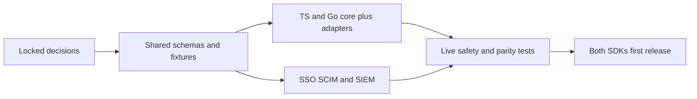

The user locked the product decisions on November 10, 2026. These decisions supersede earlier proposal wording. [[release-contract]] defines the first-release acceptance boundary, [[audit-contract]] defines mandatory durable audit, and [[enterprise-contract]] defines SSO, SCIM and SIEM. SDK behavior is still unimplemented; publishing this design does not certify runtime guarantees.

## Locked decisions

| Decision | Selected behavior | Consequence |
| --- | --- | --- |
| Deployment | ZITADEL and OpenFGA; SDKs in product processes | No Heimdall wrapper service |
| Languages | TypeScript and Go together | Shared behavioral fixtures and release parity |
| Trust | Product backends are operated by one trusted operator | No promise of isolation from hostile backend owners; end-user tenant isolation remains mandatory |
| Products and environments | One ZITADEL project and OpenFGA store per product/environment | Separate audiences/configuration/model rollout; service credentials still need least privilege |
| Cross-directory accounts | Separate tenant-owned accounts for independently administered directories | Approved by the user after Phase 2 evidence; no stable-subject linking or email-based merge in v1 |
| Product membership | Shared sign-in, independently granted memberships | Joining Acme Ledger does not enroll a person in Acme Support |
| Roles | Product-defined, versioned tenant roles for human users | Tenants assign allowed roles; runtime tenant-defined roles, service principals and resource sharing are deferred |
| Adapters | PostgreSQL sessions and optional managed workspaces | Core interfaces remain supported; see [[design/built-in-adapters]] |
| HTTP | TypeScript Fetch and Go net/http | Framework-specific wrappers are optional later additions |
| Recovery | Explicit reconcile, quarantine uncertain dispatched writes | No lease-as-fencing assumption; safe recovery evidence blocks managed release |
| Revocation | Fresh membership decisions; earlier authorized work may finish | Identity/session freshness is bounded separately in [[release-contract]] |
| Audit | Durable records for every authorization decision, role change and ownership transfer | Required local audit failure blocks protected work; export can recover asynchronously |
| Extensible audit | Validated product/user-configured event definitions | Extensions cannot disable or impersonate mandatory security events |
| First release | Core, adapters, tenant SAML/OIDC, SCIM user lifecycle and SIEM | Enterprise work is a hard release dependency in both SDKs |
| Tooling | Rolldown, Oxlint, Oxfmt, Vitest; pnpm 30-day minimum release age | Existing workspace gates remain required |

## What remains to prove, not re-decide

- Pin supported service releases and verify audiences, claims, SCIM lifecycle and credential boundaries.
- Verify strict SSO evidence for new login, existing sessions and tenant switching. Refuse unsupported strict configurations rather than silently allowing fallback.
- Demonstrate uncertain-write quiescence/recovery, atomic storage, mixed-language formats and model migrations.
- Verify provider identity-state freshness, deprovisioning latency, audit crash recovery, sink replay and storage backpressure.
- Finalize concrete schema/crypto/driver/API encodings through implementation review and shared fixtures. These choices must preserve the selected contract.

The default values in [[release-contract]] are design defaults selected to make implementation concrete, not performance measurements or universal compliance guarantees. Runtime evidence can require a documented contract change, but cannot silently weaken first-release scope.

## Deferred scope

Mutually untrusted product operators, tenant-authored runtime roles, resource sharing, public service-account APIs, SCIM group-to-role synchronization, additional database adapters and additional SDK languages require separate designs. Infrastructure service credentials for setup/SCIM/export are still necessary and distinct from public service-principal authorization APIs.

The earlier discussion and [[explorations/built-in-adapters]] remain historical context. [[implementation-roadmap]] is the execution index.

## Cross-directory decision accepted

The user accepted separate tenant-owned accounts after reviewing the pinned provider boundary. Shared organizations may still use one issuer/subject across products with independently granted memberships. Independent directories use their own accounts; an account switch replaces identity-bound session context and evaluates only the new principal’s memberships. This resolves the Phase 2 account-model gate without changing canonical identity encoding or adding an alias table. See [[enterprise-contract]].
