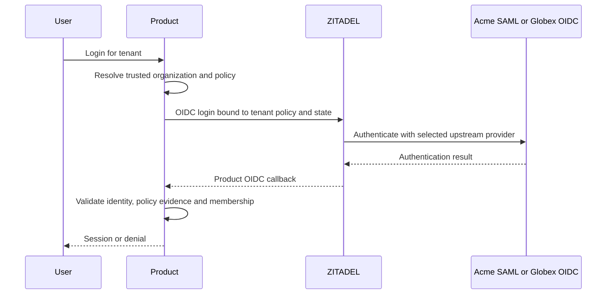
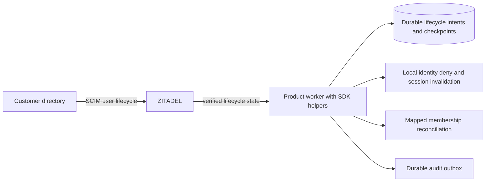

Enterprise capabilities are mandatory in the first release of both SDKs. This page fixes ownership, default policy, failure behavior and acceptance cases. Upstream capabilities must be verified against pinned versions before a feature is described as implemented.

## Tenant SAML and OIDC

A product-owned mapping associates a workspace with a verified ZITADEL organization and a versioned login policy. Acme Ledger and Acme Support can share one organization when they deliberately share provider policy; separate organization contexts are needed for independently administered provider configuration. Membership remains independent.

Authorized enterprise settings workflows configure an organization-scoped SAML or OIDC provider through privileged SDK helpers. The product validates administrator authority and organization ownership. The customer's identity administrator supplies registration/metadata and configures its provider. Setup returns callback/service-provider details, then requires a test login before activation. Secrets use operator/product secret storage and never appear in generated public configuration or audit attributes.

Strict enterprise mode is SSO-only: no password fallback, email-based automatic account linking or implicit guest bypass. Existing sessions and every tenant switch must satisfy the target tenant's policy version and provider/organization authentication evidence; otherwise start compliant reauthentication or deny. Evidence must come from verified provider claims/APIs, not a browser organization hint. If the pinned ZITADEL release cannot prove required evidence, strict mode cannot ship by guessing. Break-glass operator access is an explicit audited deployment procedure, not a hidden local-login route. Guest/fallback policies may be explicitly configured and tested, but never inferred from membership.

[[evidence/phase-2-provider-organization]] records a pinned-service constraint: the user-link APIs reject an organization-scoped provider outside the user's home organization, even with the bootstrap administrator. A workspace membership does not bypass that boundary. The cross-tenant account topology must be verified before claiming stable-subject switching between independently owned providers. A callback with a different issuer/subject must use that principal's own memberships and must not carry over prior identity authority. Instance-level provider alternatives remain unapproved.

Account linking requires verified identity ownership and authorized provider configuration; matching email alone cannot merge principals. Bind identities by issuer/subject. Provider-policy changes invalidate applicable policy evidence so existing sessions are re-evaluated. Users switching between Acme SAML and Globex OIDC cannot reuse noncompliant evidence just because they belong to both.

Pinned-service progress: [[evidence/phase-2-federation-binding]] verifies an intent-to-session-to-token evidence chain for both SAML and OIDC. The implementation still needs strict target-policy and browser-transaction checks, and atomic persistence. [[evidence/phase-2-enterprise-contract]] records the structured evidence schema and shared TS/Go policy-gate amendment; those internal validators do not verify provider provenance. This is evidence of capability, not completed SDK enforcement.

[[evidence/phase-2-self-service-evidence]] verifies session reads with an API-audience user token, avoiding a Login PAT for that read. The returned intent factor contains only a timestamp; it cannot replace verified provider ID/upstream subject provenance. Ordinary hosted-login callback integration remains unproven for the full strict-evidence chain.

## SCIM users and lifecycle

SCIM requests go directly to ZITADEL's organization-scoped service. The customer directory configures endpoint and least-privilege credentials. The SDK does not introduce a SCIM server. Current upstream documentation describes user lifecycle support and excludes SCIM Group provisioning; group-to-role synchronization is not a first-release capability claim. [ZITADEL SCIM guide](https://zitadel.com/docs/guides/manage/user/scim2)

Each product supplies explicit organization-to-workspace enrollment rules. Default is no automatic membership on directory creation. An authorized configuration can opt into specified workspaces and product-defined starting roles, but never implicit owner privileges. Preserve grant provenance so disabling one enrollment rule removes its grants without deleting unrelated independently administered grants. Identity deactivation blocks that identity across affected product sessions; product role cleanup respects the configured mapping.

Workers use verified events or bounded polling according to available service APIs, with full reconciliation for gaps. Re-read authoritative lifecycle state before applying a replayed change; out-of-order activation must not undo a later deactivation. Persist a durable per-subject operation before advancing ingestion checkpoints; checkpointing ingestion does not assert remote application completed. Per-product failures remain pending independently. Export lag and lifecycle lag are observable. Run workers explicitly through the product scheduler.

Once deactivation is observed, first persist a local identity deny/session invalidation in managed mode, then reconcile mapped memberships through the uncertainty-safe mutation path. Core consumers implement the equivalent identity gate interface. This prevents a delayed remote tuple removal from permitting new access in that product. The identity freshness contract in [[release-contract]] additionally covers requests before event ingestion catches up. Worker target under healthy dependencies is observation and deny propagation within 60 seconds; measure it in integration tests and expose lag. Outages do not have an invented bounded completion promise: stale authoritative identity status fails closed after its configured freshness, and pending remote changes retain their recovery gate.

Reactivation does not resurrect all historical role tuples. Confirm cleanup and current approved enrollment rules, then grant only the selected roles under a new audited operation. Inactive/deleted principals cannot accept invitations. Directory deletion preserves required operation/audit tombstones under the configured privacy/retention policy; external IDs never replace issuer/subject as principal identity.

## SIEM and custom events

[[audit-contract]] is mandatory for all decisions, role changes and transfers. Product/user-configured event types are supported extensions, not an exemption to this coverage. The product operates durable storage and a scheduled exporter; the SDK supplies adapters and bounded delivery/reconciliation APIs. Existing customer SIEM/collector infrastructure receives events. No companion Heimdall service is introduced.

Correlate ZITADEL identity/configuration events with product audit using verified organization mappings, issuer/subject and trace identifiers where available. Do not invent a common request ID for unrelated upstream events. Identity collector and product exporter have separate checkpoints. Shared organizations may require authorized fan-out to several products, with explicit filtering of unrelated tenant data.

## Required dry runs

| Scenario | Expected result |
| --- | --- |
| Acme SAML and Globex OIDC on one deployment | Correct tenant provider, independent memberships and product audiences |
| Existing password session enters strict Acme | Compliant reauthentication or deny |
| Tenant administrator submits another organization's ID | Reject before provider changes |
| Same email from unrelated IdP | No automatic principal merge |
| SCIM creates employee | Identity exists; access only from explicit enrollment rules |
| SCIM deactivates member of two products; one worker fails | Identity gate/freshness prevents stale access; each product tracks pending reconciliation |
| Old activation event replayed after disable | Authoritative inactive state wins |
| Reactivation after stale role tuples | Cleanup and current grants only; no revived privileges |
| SIEM rejects one custom event | Preserve/quarantine and alert; other valid scopes can progress |
| SIEM unavailable | Durable backlog; local capacity policy blocks rather than drops when exhausted |

## Implementation and release

#44 owns provider setup and strict SSO; #45 verifies SCIM capability; #47 implements lifecycle reconciliation; #46 implements durable audit; #48 implements SIEM delivery. #50 depends on all of them plus adapter safety and compatibility. Live-service assertions, TS/Go parity and a documented operator setup are required. The docs may be published now, but no deployed auth functionality is implied.

[[evidence/phase-2-federation-credentials]] verifies a narrower instance-scoped session role for SDK-controlled intent/session/OIDC flows. The broad Login client role is unnecessary for that measured chain, but browser binding and strict integration remain open. A server-side SDK credential is still required; this does not introduce a companion service or tenant-isolated infrastructure authority.

Provider intent expiry must not substitute for the local browser-transaction deadline. The pinned ZITADEL implementation uses explicit upstream expiry ahead of its fallback lifetime; see [[evidence/phase-2-federation-binding]]. Require successful, unexpired session creation and signed binding before persisting evidence, while independently enforcing local transaction expiry and target policy age.
