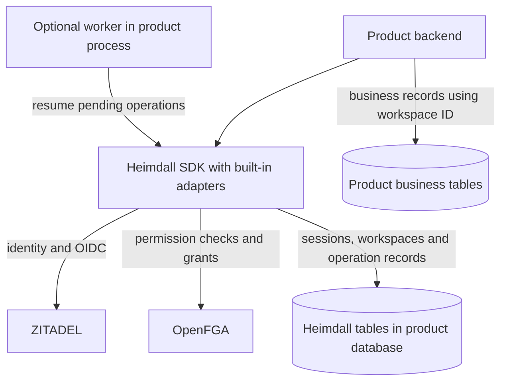
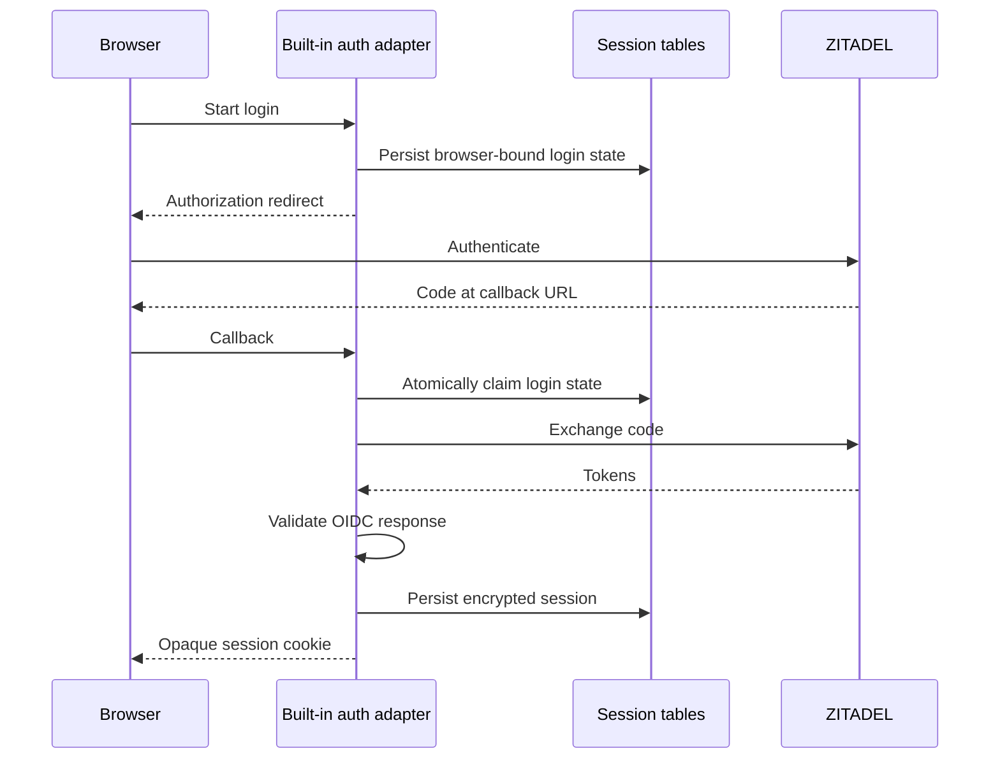
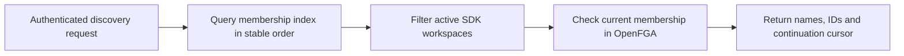
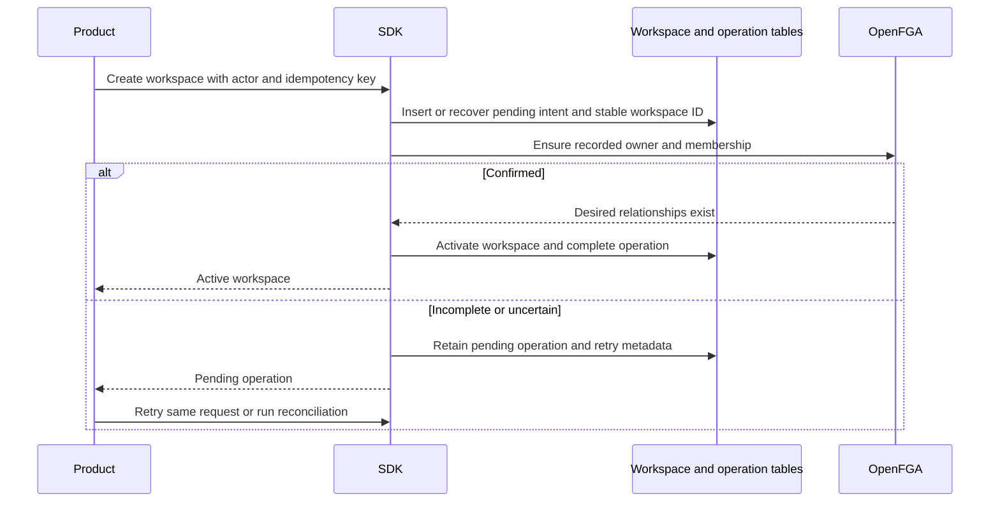

> [!info] Historical exploration — superseded
> The adapter direction is now selected. [[design/built-in-adapters|The adapter scope and safety contract]] defines the supported design, ownership modes and conservative handling of uncertain writes. The examples below record earlier alternatives and are not the current API or recovery guarantee. No prototype results or runtime guarantees are implied.

## What we are exploring

Reduce common integration work by bundling session persistence, a workspace directory and recoverable onboarding into both SDKs. The developer supplies a database connection, runs explicit migrations, mounts authentication routes and protects business operations. PostgreSQL is the proposed first persistence adapter for this experiment.

Heimdall still runs within product processes and talks directly to ZITADEL and OpenFGA. Each product supplies its existing database and, when automatic recovery is desired, an execution mechanism for pending work.

## Comparison with the core SDK approach

| Concern | Core SDK contract proposal | Built-in adapter exploration | Tradeoff |
| --- | --- | --- | --- |
| Sessions | Product implements atomic storage interface | PostgreSQL adapter manages session records | Less wiring, SDK schema and key-management obligations |
| Workspace directory | Product scans its active tenant records | SDK owns minimal workspace records | Simple discovery, overlap with existing tenant models |
| Membership discovery | SDK checks product-supplied candidates | SDK queries its membership index and validates access | Efficient candidates, synchronization and reconciliation |
| Onboarding | Product stores intents and activates tenants | SDK records intent, grants ownership and activates | One public call, SDK owns durable lifecycle behavior |
| Recovery | Product retries recorded work | Optional worker or explicit reconcile call | Easier integration, background execution remains necessary |
| Database changes | Product controls custom persistence schema | Versioned SDK migrations installed explicitly | Repeatable setup, upgrade and rollback compatibility work |
| Business transactions | Product integrates auth operations into its workflow | Product links its records to an SDK workspace ID | External side effects still need product orchestration |
| Portability | Storage interface can target multiple databases | Initial adapter targets PostgreSQL | Smaller integration for supported stacks, narrower initial support |

Three integration levels are worth comparing. The core SDK offers maximum persistence control. The adapter approach offers opinionated persistence with explicit installation. An automatic-startup approach could also provision and migrate, but would introduce privileged startup credentials and competing replica migrations. This exploration favors explicit migrations and setup.



## Developer experience in TypeScript

The following APIs are illustrative. `pool`, `config` and key material come from product deployment configuration. Connection setup and framework bootstrapping are omitted for clarity.

```ts
const h = createHeimdall({
  config,
  persistence: postgres(pool),
  publicUrl: 'https://ledger.example.com',
  sessionKeys,
  cursorKeys,
})

// Proposed Express adapter supplies login, callback and logout routes.
app.use('/auth', expressAuth(h))

const actor = await h.authenticate(request, { signal })
const page = await h.workspaces.list(actor, { cursor, limit: 20, signal })

// Product checks its own policy for who may create a workspace.
await creationPolicy.require(actor)
const result = await h.workspaces.create({
  actor,
  name: 'Acme',
  idempotencyKey: requestId,
}, { signal })

if (result.status === 'pending') {
  return onboardingPending(result.operationId)
}

await h.tenant(result.workspace.id).require(actor, 'invoice.read', { signal })
```

A create operation can return active or pending. The example exposes that distinction so dependency outages cannot masquerade as completed onboarding. Identity errors, invalid arguments and idempotency conflicts remain typed failures. A lost response is reconciled using the same idempotency key.

## Developer experience in Go

```go
h, err := heimdall.New(heimdall.Options{
    Config: config,
    Persistence: postgres.New(db),
    PublicURL: "https://support.example.com",
    SessionKeys: sessionKeys,
    CursorKeys: cursorKeys,
})
if err != nil {
    return err
}

mux.Handle("/auth/", h.AuthHandler())

actor, err := h.Authenticate(ctx, r)
if err != nil {
    return err
}
page, err := h.Workspaces().List(ctx, actor, heimdall.ListOptions{
    Cursor: cursor,
    Limit: 20,
})
if err != nil {
    return err
}

if err := creationPolicy.Require(ctx, actor); err != nil {
    return err
}
result, err := h.Workspaces().Create(ctx, actor, heimdall.CreateOptions{
    Name: "Acme",
    IdempotencyKey: requestID,
})
if err != nil {
    return err
}
if result.Status == heimdall.Pending {
    return onboardingPending(result.OperationID)
}
return h.Tenant(result.Workspace.ID).Require(ctx, actor, "ticket.read")
```

These snippets represent several endpoint bodies. Production handlers consume `page`, translate errors and render responses. Both SDKs must expose the same active/pending semantics, cancellation behavior and retry contract. Go uses contexts, while TypeScript carries an abort signal.

## Sessions with sensible defaults

The adapter can supply session and login-state tables, atomic compare-and-swap behavior, callback claiming, encrypted payload persistence and refresh coordination. Cookie defaults can include Secure, HttpOnly, Path=/ and a product-specific name. A proposed default lifetime is eight hours absolute and thirty minutes idle, subject to the product's policy and provider token lifetime.

The product supplies stable encryption keys through its secrets configuration, the public URL, session policy overrides and route mounting. Return destinations must be validated against a same-origin or explicit-path policy. Logout remains CSRF protected, and the product protects its other cookie-authenticated mutations.



The adapter reduces consumer code, while Heimdall assumes responsibility for migrations, expiry, encryption-key rotation, multi-replica races and provider refresh failures. A first implementation should preserve the conservative refresh recovery rules in [[shared-sdk-contract]]. Tenant-specific SSO enforcement and existing-session reuse still need explicit policy validation.

## Workspace directory and membership index

| SDK-owned table family | Minimum responsibility |
| --- | --- |
| Sessions and login states | Expiry, encrypted payload and concurrency version |
| Workspaces | Immutable ID, name, lifecycle state and product scope |
| Membership index | Candidate workspace IDs for a principal, synchronization state |
| Operations | Idempotency binding, desired mutation, status and retry metadata |

Product tables reference the workspace ID and retain billing, subscriptions, invoices, tickets and other business data. Whether physical foreign keys should be supported is an adoption decision because they couple application migrations to the SDK schema.



The membership index is a discovery projection. OpenFGA evaluates authorization. SDK mutations persist an operation before changing relationships and reconcile the index afterward. Partial failure can temporarily hide a newly granted workspace or leave an outdated candidate. Fresh membership checks remove revoked candidates from responses, and protected business requests perform their own checks.

Direct OpenFGA changes can make the index stale. Adoption should specify SDK-mediated membership writes as the normal path and provide reconciliation for external edits. Index corruption or loss needs a rebuild procedure with defined source-of-truth rules. Sparse or filtered results still require bounded work and continuation semantics.

## One-call onboarding and recovery



The SDK can hide the durable operation mechanics behind `create`. The same idempotency key with a changed actor or payload must conflict. An operation-status endpoint must authorize the caller before returning progress. Pending workspaces remain inaccessible to business operations.

A PostgreSQL transaction cannot atomically commit an OpenFGA mutation. Recovery therefore remains part of the implementation even with one public method. Cancellation, deletion and retries must be serialized so a stale worker cannot recreate grants after cleanup. Lease expiry alone does not fence an in-flight external write.

| Recovery option | Developer wiring | Tradeoff |
| --- | --- | --- |
| Request-driven retry | Repeat create with the original key | Pending operations may remain abandoned |
| Built-in worker | Start and stop worker with product process | Coordination, resource limits and graceful shutdown |
| Scheduled reconciliation | Invoke SDK reconciliation from existing scheduler | One explicit scheduled task, suitable for ephemeral processes |

Illustrative worker entry points could be `await h.reconcile({ signal, maxOperations: 100 })` in TypeScript and `h.Reconcile(ctx, options)` in Go. A long-running worker could call the same mechanism. Starting the SDK client should not silently start background goroutines, timers or migrations. The product explicitly chooses recovery execution.

## What the developer still integrates

- Service endpoints, runtime credentials, database connection and encryption keys.
- Explicit migrations before application rollout.
- Auth route mounting and permission checks at business operations.
- Tenant predicates on every business query and mutation.
- Product policy for workspace creation, invitations and delegated administration.
- Recovery execution when automatic completion is required.
- Product-specific onboarding such as billing accounts or default projects.

A billing subscription and an auth workspace require coordination across their respective systems. The SDK can expose a stable workspace ID and operation outcome to support that workflow. An outbox or durable event delivery interface would need its own contract before promising reliable onboarding events.

## Migration and adoption costs

Existing products may already have workspace IDs and membership tables. An adapter mode needs an explicit import or mapping strategy, duplicate-ID rules and a rollback plan. Fresh products get the simplest path by using SDK workspace IDs from the start.

Both language adapters need identical schema semantics and version compatibility. Mixed TS and Go deployments must handle supported rolling upgrades, migrations under a deployment lock, and backward-compatible reads. The SDK should fail startup with an actionable error when the schema is incompatible. Tests must cover one language writing a record that the other reads.

## Questions before adoption

1. Are consuming products comfortable giving Heimdall ownership of minimal workspace records?
2. Is PostgreSQL an acceptable first adapter for both languages?
3. Should pending onboarding be exposed by default, or should create wait up to a configurable deadline?
4. Which worker or scheduler pattern is acceptable to the first two products?
5. How will existing workspace IDs and out-of-band membership changes be imported or reconciled?
6. Which session defaults are suitable for both ordinary and enterprise SSO tenants?

## Evidence needed to compare approaches

Implement a disposable example only after selecting that experiment. Measure integration code, configuration steps and operational obligations for the same Ledger and Support scenarios using each approach. Test callback replay, concurrent refresh, worker crashes, lost OpenFGA responses, membership-index drift, schema upgrades across TS and Go, and cancellation during cleanup.

A decision to adopt this exploration should explicitly update [[decisions]], [[shared-sdk-contract]], [[project-structure]] and [[task-list]] with the selected scope and migration obligations.
