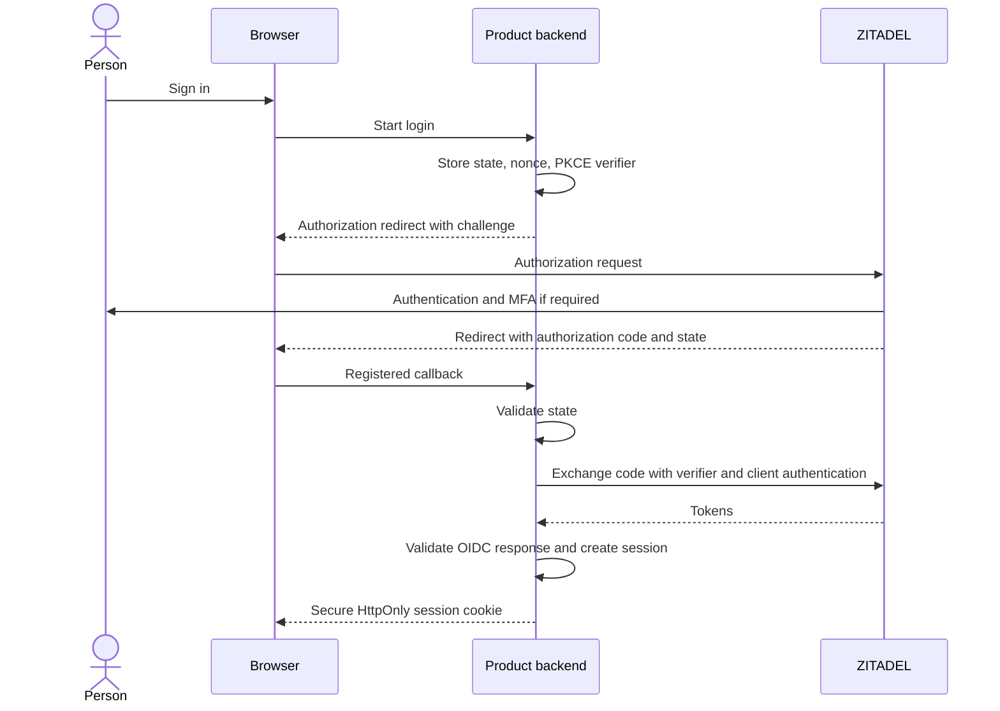
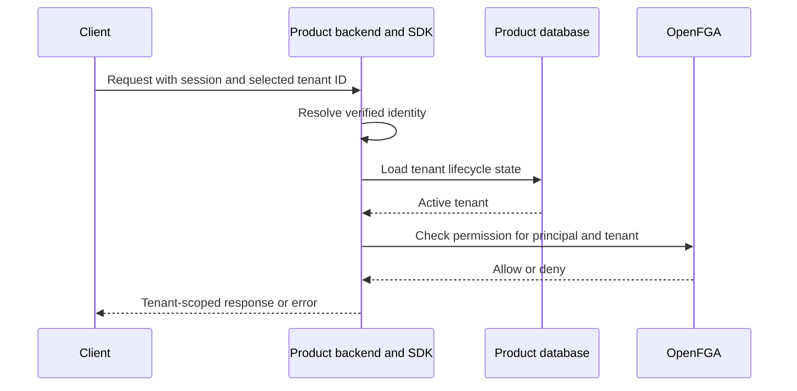

The selected browser flow uses Authorization Code with PKCE and a product backend session. The backend owns the callback and session cookies. Native and SPA clients can use their corresponding OIDC client profiles. [ZITADEL OIDC guide](https://zitadel.com/docs/guides/integrate/login/oidc/login-users)

| Data | Travels between | Required handling |
| --- | --- | --- |
| State, nonce, verifier | Backend login state and callback | Bind to initiating session, expire, consume once |
| Authorization code | ZITADEL through browser to backend | Exchange only at configured issuer endpoint |
| Access token | Client or backend to product API | Validate issuer, audience, expiry and signature or introspection |
| Identity | Validated token to SDK | Canonical issuer and subject pair |
| Session cookie | Backend and browser | Secure, HttpOnly, appropriate SameSite and CSRF protection |
| Refresh token | ZITADEL and session owner | Secure storage and lifecycle handling |

The baseline assumes JWT access tokens configured for local verification. Opaque-token deployments need explicit introspection support and credentials. Discovery and signing keys are cached, with bounded refresh on unknown keys. ID tokens describe the login session. API authorization validates an access token intended for that API. [ZITADEL token introspection](https://zitadel.com/docs/guides/integrate/token-introspection)

## Tenant selection

A selected tenant ID is a request input. Membership and permission checks establish access. A shared identity can select Acme or Globex and receive different permissions. A product token must satisfy the receiving API's audience requirements, even when both products share an issuer. [ZITADEL audience validation](https://zitadel.com/docs/support/troubleshooting)

Disabling an identity and revoking product membership have different propagation paths. Local JWT validation alone does not satisfy the selected contract. [[release-contract]] requires bounded authoritative identity/status freshness (60 seconds by default, capped by token expiry), no stale-positive fallback, and fresh membership-sensitive checks. Tenant selection also verifies the target SSO policy under [[enterprise-contract]].
