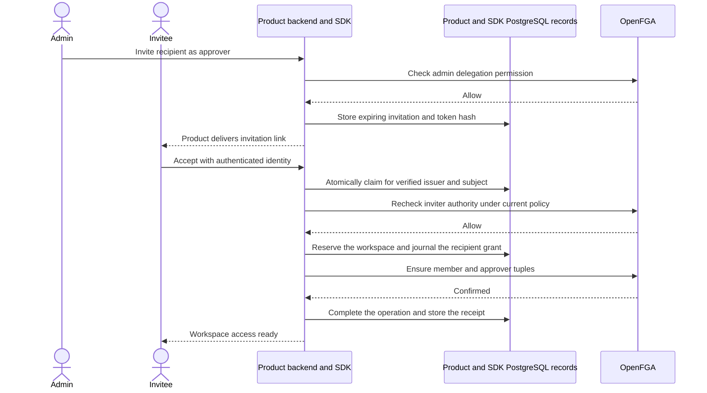
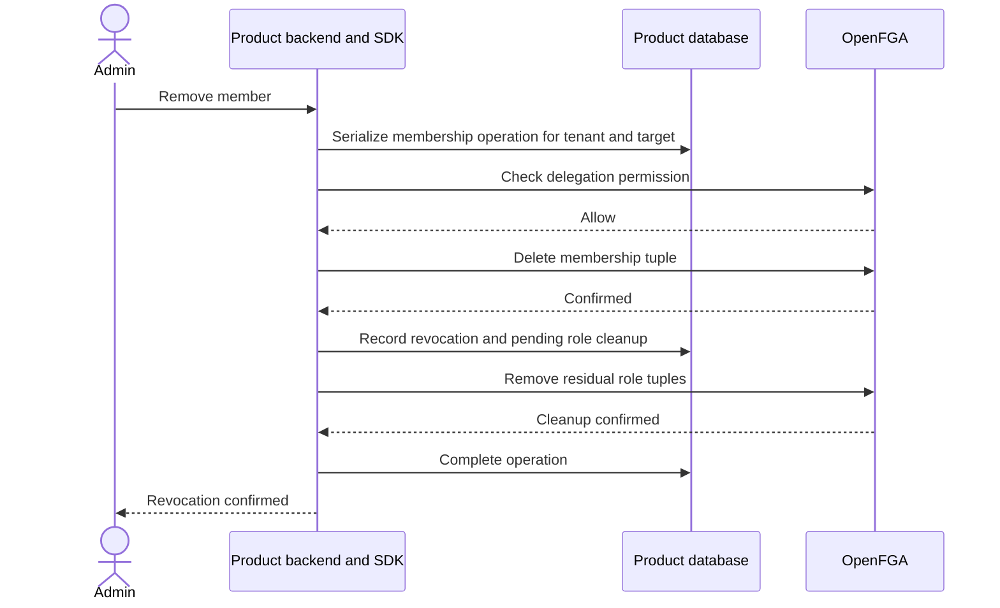

The product stores invitation state and delivers invitations through its existing communication mechanism. The SDK authorizes grant and revoke operations. Invitations bind a tenant, permitted role, intended recipient, expiry, and a single-use token.

The reference products bind the invitation to the recipient's ZITADEL issuer and subject. The product persists the token hash, expiry, workspace, inviter, recipient and approved roles. Its first claim must precede expiry. The same recipient can resume that claim with the same idempotency key and receive the original receipt after completion. Each product owns recipient lookup and delivery.

The managed SDK checks the inviter's current delegation at issue and again before authorizing a new acceptance dispatch. It checks the durable identity deny gate for the inviter at acceptance and verifies the recipient's current principal. The workspace revision fences competing managed membership changes between planning and reservation. If the provider write has already become uncertain, the recorded recipient grant follows [[operations]] recovery. The acceptance journal identifies the recipient as initiator, and the product invitation record links the inviter.

## Delegation rules

| Operation | Proposed authority |
| --- | --- |
| Grant or revoke viewer and approver | Active admin or owner |
| Grant or revoke admin | Active owner |
| Transfer ownership | Dedicated owner workflow with product transaction and lock |
| Remove membership | Active delegated administrator, subject to last-owner protection |
| Bootstrap first owner | Trusted tenant creation workflow |

Every permission in the baseline intersects with membership. Once its deletion is visible to a fresh check, residual roles cannot authorize. Cleanup must finish before reactivation to avoid restoring historical roles. Concurrent grants and removals use the product's serialized mutation workflow. A timeout is an uncertain outcome that needs reconciliation.

Ownership transfer must preserve at least one owner under concurrency. OpenFGA checks and writes alone do not establish that product-wide transaction. The product serializes transfers and last-owner removals, with a durable operation record to recover from partial completion.
