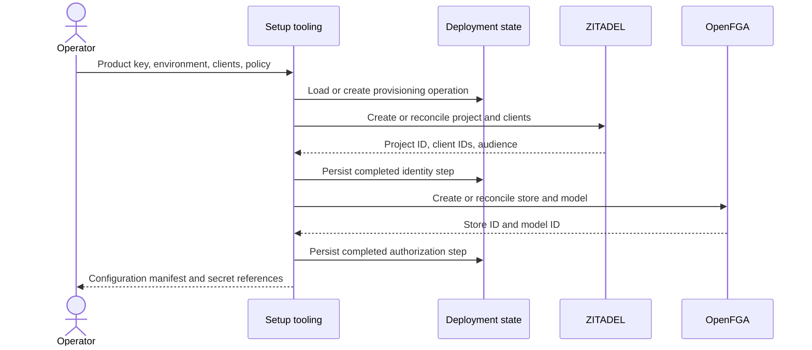
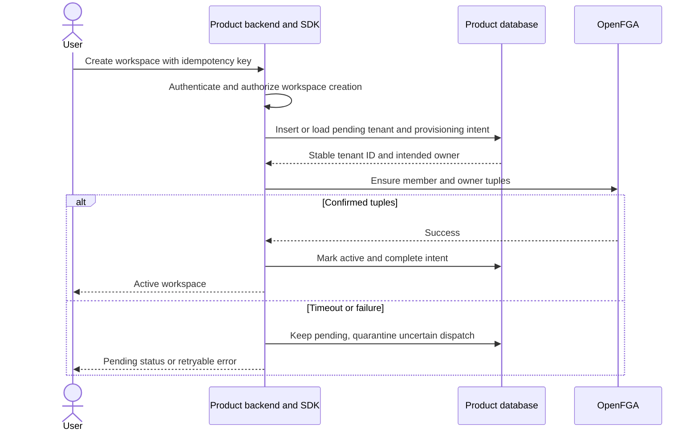
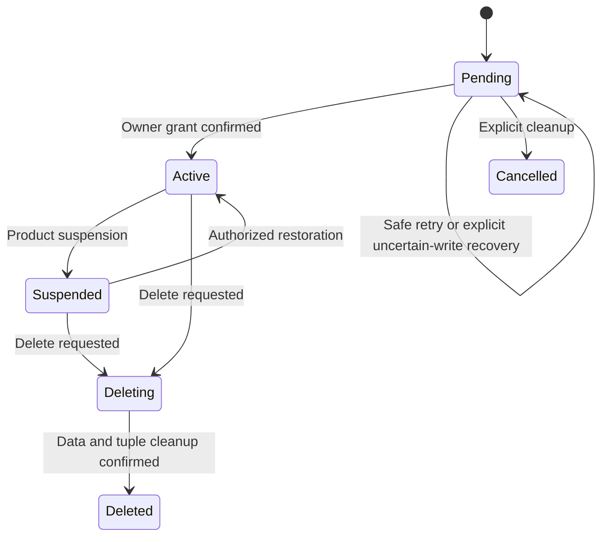

Product registration runs in an operator command or deployment job. The resulting configuration binds a backend to one product and environment.

| Data | Source and destination | Validation and persistence |
| --- | --- | --- |
| Product key and environment | Operator to setup | Stable operation key, exclusive provisioning lock |
| Redirect URIs | Product manifest to ZITADEL | Explicit allowed URLs per client |
| Policy | Versioned manifest to OpenFGA | Model validation and scenario assertions before activation |
| Resource IDs | Services to deployment state | Save returned IDs after each completed step |
| Credentials | Secret store to setup or backend | Separate setup and runtime access |

Retries reconcile known IDs. A timeout after create requires discovery or operator reconciliation before another create. Names alone may be ambiguous. The operator uses a durable PostgreSQL setup journal, separate from managed-workspace tables; concrete encoding is defined during contract implementation. Existing externally provisioned IDs should also be accepted.

## Workspace creation

The product database coordinates tenant creation and its initial owner. A unique idempotency key ensures retries refer to the same tenant.

The product schedules bounded recovery through its existing job mechanism. Known pre-dispatch failures can retry; uncertain dispatched writes require verified quiescence before reconciliation, not a blind request replay. In managed mode the workspace stays blocked under [[design/built-in-adapters]]. API operations reject inactive tenants before authorization. Suspension is an application gate that every entry point must honor. Deletion prevents new operations first, then removes data and relationships with retryable cleanup. Tenant IDs are never reused. See [[operations]].

[[evidence/phase-5-managed-onboarding]] shows the current managed PostgreSQL API in both SDKs and records the provider and database fault tests.
