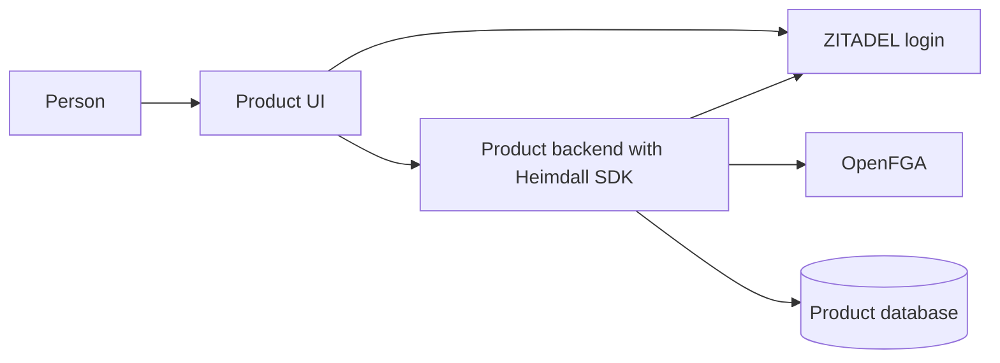

Heimdall makes shared authentication and tenant-scoped authorization available through an SDK installed in each product. Operators deploy ZITADEL and OpenFGA with their databases. Product backends call both services directly through the SDK.

Product decisions are locked as of November 10, 2026. [[release-contract]], [[audit-contract]] and [[enterprise-contract]] define required delivery. API spellings and schemas are finalized during implementation; the scenarios still require executable verification.

## Read the design

Start with [[system-design|the complete system-design specification]] for the functionality, component boundaries, developer wiring and end-to-end data flows. The documents below define the detailed contracts.

| Page | What it specifies |
| --- | --- |
| [[development-workspace]] | Local setup, agent checks, Git hooks and CI |
| [[release-contract]] | Locked first-release scope and revocation defaults |
| [[audit-contract]] | All-decision durable audit, custom events and export failure behavior |
| [[enterprise-contract]] | Mandatory SSO, SCIM user lifecycle and SIEM |
| [[task-list]] | Implementation tasks, dependencies, and acceptance gates |
| [[design/built-in-adapters]] | Selected adapter scope, ownership modes, recovery limits and footguns |
| [[project-structure]] | Repository layout and where each responsibility lives |
| [[two-product-walkthrough]] | Two products end to end, developer wiring, SDK responsibilities, and integration gaps |
| [[architecture]] | Deployment boundary, trust, and component responsibilities |
| [[tenancy]] | Products, workspaces, identities, and ownership of data |
| [[authorization-model]] | Selected membership/role model; resource sharing is deferred |
| [[shared-sdk-contract]] | TypeScript and Go session, discovery, and onboarding API proposal |
| [[sdk-contract]] | Developer experience and a portable package contract |
| [[flows/provisioning]] | Registering products and creating tenants safely |
| [[flows/authentication]] | Login, token validation, and selecting a tenant |
| [[flows/authorization]] | Permission checks and tenant-scoped data access |
| [[flows/membership]] | Invitations, grants, revocation, and ownership transfer |
| [[operations]] | Model migrations, failures, concurrency, and audit events |
| [[scenarios]] | Expected outcomes for normal and adversarial requests |
| [[decisions]] | Locked decisions, deferred scope and implementation evidence gates |

## Explorations

The following page preserves earlier alternatives. The selected scope now lives in [[design/built-in-adapters]].

- [[explorations/built-in-adapters|SDKs with built-in persistence adapters]] compares simpler sessions, workspace discovery and onboarding with the core SDK approach, including TypeScript and Go examples.

## Reading the diagrams

An arrow names the data or operation that crosses a boundary. An SDK box lives in the product process. Database cylinders denote persistent state. A sequence diagram shows ordering and failure paths. See each flow's data table for validation and persistence details.

Only this site's content directory is an input to publication. Review the decisions page before treating proposed defaults as implementation requirements.
