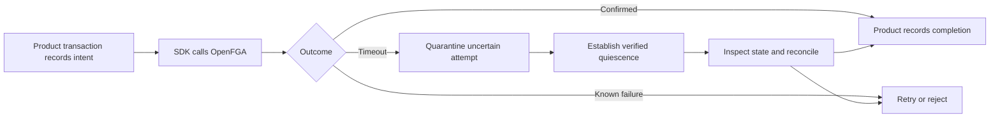
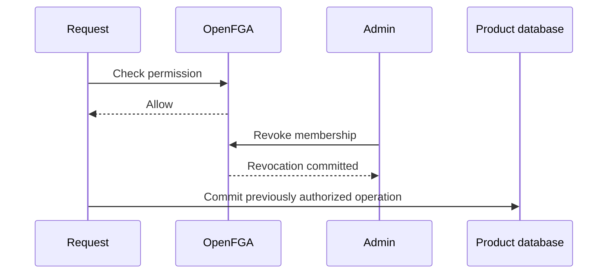
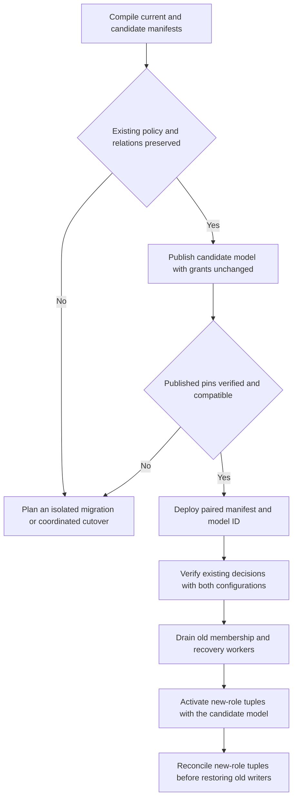

SDKs execute within product processes. Core workflows use product-owned persistence; selected adapters can supply operation and audit storage. [[audit-contract]] requires durable recording of all decisions, role changes and ownership transfers. [[release-contract]] fixes revocation/freshness behavior. Authentication services and the business database have independent transactions.



## Managed adapter safety boundary

[[design/built-in-adapters]] selects optional SDK-owned operation records and lifecycle state in the product database. Core mode retains product workflows. Managed checks include the local active/unblocked gate before OpenFGA. A dispatched write with uncertain outcome blocks access and conflicting transitions until verified quiescence and reconciliation. A reread, expired lease or stopped worker alone is insufficient. This is a deliberate availability tradeoff; automatic recovery of every lost response is not claimed.

## Decision consistency

Higher-consistency queries bypass OpenFGA query caches. The SDK must also avoid stale allow caching where revocation latency matters. Backend validation of an unexpired JWT has a separate identity-revocation window. [OpenFGA consistency](https://openfga.dev/docs/interacting/consistency)



This race is possible in the baseline. The agreed guarantee covers new decisions after a confirmed revocation, subject to the selected datastore and consistency behavior. A requirement to cancel all already-authorized in-flight operations needs product-level coordination and a stronger protocol. Model that requirement before claiming immediate revocation.

## Model rollout

Each SDK deployment pins the store ID, authorization model ID and manifest version. OpenFGA models are immutable and callers using different models can read the same tuples. Heimdall's compiler assigns relation names in sorted role and permission order. A new name that sorts before an existing name can reuse an existing relation and give an old tuple a different meaning. [OpenFGA immutable models](https://openfga.dev/docs/getting-started/immutable-models)

For an additive rollout on the same store, compare the compiled role and permission mappings and the policy for existing permissions before publishing. Keep every existing relation bound to the same business meaning throughout the overlap and add new roles and permissions at the end of their respective sort orders. A change that reuses a relation needs a separate migration plan with an isolated store or a coordinated cutover. The append-only procedure below covers the tested case where new roles grant new permissions and existing policy is preserved.



After publishing the candidate but before activating any new grants, run the read-only provisioning check. It requires the current and candidate runtime config JSON and exact manifest JSON. Both configs must refer to the same product, environment, issuer, audience, ZITADEL project, and OpenFGA store. The candidate must have a higher manifest version and a different model ID. OpenFGA credentials are supplied separately.

```ts
import { inspectModelRollout } from "@heimdall/sdk/provisioning";

const report = await inspectModelRollout(
  { configJSON: currentConfig, manifestJSON: currentManifest },
  { configJSON: candidateConfig, manifestJSON: candidateManifest },
  openfgaToken,
  signal,
);
```

```go
report, err := provisioning.InspectModelRollout(ctx,
    provisioning.ModelRolloutDeployment{ConfigJSON: currentConfig, ManifestJSON: currentManifest},
    provisioning.ModelRolloutDeployment{ConfigJSON: candidateConfig, ManifestJSON: candidateManifest},
    openfgaToken,
)
```

Require a successful verification and a compatible report before starting the overlap. The report identifies changed existing role and permission mappings, changed existing permission grants or delegation, and a changed owner role. Mismatched pins return an availability error. The inspection reads model definitions and leaves runtime configuration and tuples in place. Its report covers manifest-defined authorization semantics. Operator checks still cover deployed workers, current tuples and pending operations.

Include administration, SCIM and recovery workers in the drain. Resolve pending writes under their original binding, preserving any quarantine until verified quiescence and reconciliation. After activation an old SDK membership read can return `unavailable` on the new role relation even while its checks for old permissions continue to work. To roll back, pause writers, reconcile pending work, remove candidate-only tuples with the candidate model, and verify old membership reads and permission decisions before restoring the old configuration. If the older view cannot be restored safely, keep the affected workflow blocked and recover forward.

Record store IDs, model IDs and manifest versions from diagnostics and verify each product and environment independently. See [[phase-7-model-rollout]] for the live rehearsal and its scope.

## Failure contract

| Failure | Behavior |
| --- | --- |
| OpenFGA timeout during check | Availability error, block protected operation |
| ZITADEL unavailable | Existing verified identity status usable only within configured freshness/token expiry; stale status returns unavailable |
| Unknown signing key while discovery is unavailable | Authentication cannot complete |
| Timeout during tuple write | Reconcile desired state before reporting success |
| Product database commit fails after owner grant | Tenant stays pending until recovered |
| Concurrent role grants and revocations | Product serializes mutations for affected scope |
| SIEM sink fails | Retain durable outbox and retry; never silently drop required events |
| Local audit persistence fails | Block protected work and return audit_unavailable; never report a completed allow |

The required envelope, custom event registration, durable receipt, unresolved-attempt handling, retention and delivery are specified in [[audit-contract]]. Callbacks are optional notifications after persistence, never the durability boundary.

Service identities and delegated background jobs need a separate principal policy. The first model covers human users. See [[decisions]] for pending service-account semantics.
