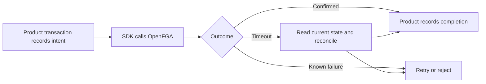
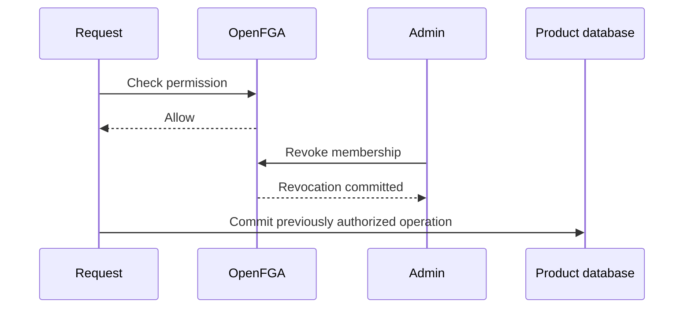
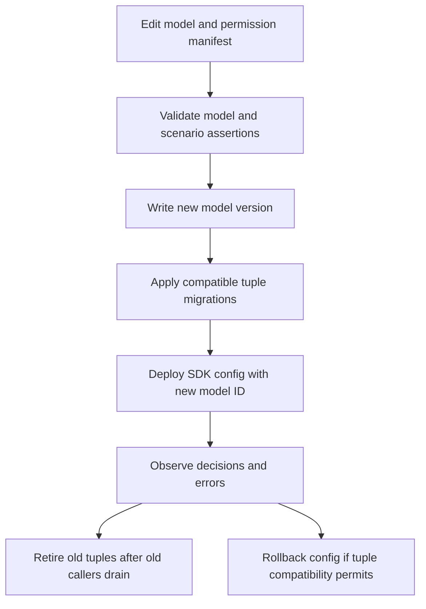

SDKs execute within product processes. Product workflows own durable retries, lifecycle transactions, and audit persistence. Authentication services and the business database have independent transactions.

## Managed adapter safety boundary

[[design/built-in-adapters]] selects optional SDK-owned operation records and lifecycle state in the product database. Core mode retains product workflows. Managed checks include the local active/unblocked gate before OpenFGA. A dispatched write with uncertain outcome blocks access and conflicting transitions until verified quiescence and reconciliation. A reread, expired lease or stopped worker alone is insufficient. This is a deliberate availability tradeoff; automatic recovery of every lost response is not claimed.

## Decision consistency

Higher-consistency queries bypass OpenFGA query caches. The SDK must also avoid stale allow caching where revocation latency matters. Backend validation of an unexpired JWT has a separate identity-revocation window. [OpenFGA consistency](https://openfga.dev/docs/interacting/consistency)

This race is possible in the baseline. The proposed guarantee covers new decisions after a confirmed revocation, subject to the selected datastore and consistency behavior. A requirement to cancel all already-authorized in-flight operations needs product-level coordination and a stronger protocol. Model that requirement before claiming immediate revocation.

## Model rollout

Models are versioned and calls should specify the intended model ID. A migration deploys compatible tuples and configuration before retiring old relationships. [OpenFGA immutable models](https://openfga.dev/docs/getting-started/immutable-models)

During rolling deployment, callers may use different models over the same tuples. Plan compatibility in both directions. Store IDs, model IDs, and manifest versions appear in diagnostic events. Development and production have separate product configuration and stores.

## Failure contract

| Failure | Behavior |
| --- | --- |
| OpenFGA timeout during check | Availability error, block protected operation |
| ZITADEL unavailable with valid cached JWT verification material | Existing JWT requests can verify until token expiry and key-cache limits |
| Unknown signing key while discovery is unavailable | Authentication cannot complete |
| Timeout during tuple write | Reconcile desired state before reporting success |
| Product database commit fails after owner grant | Tenant stays pending until recovered |
| Concurrent role grants and revocations | Product serializes mutations for affected scope |
| Audit sink fails | Apply product's explicit audit durability policy |

Audit events include actor, tenant, permission or mutation, target, outcome, correlation ID, and model ID. Exclude raw tokens, credentials, and unnecessary identity data. Guaranteed mutation audit requires a durable product intent or outbox because an SDK callback can fail after a remote write succeeds.

Service identities and delegated background jobs need a separate principal policy. The first model covers human users. See [[decisions]] for pending service-account semantics.
