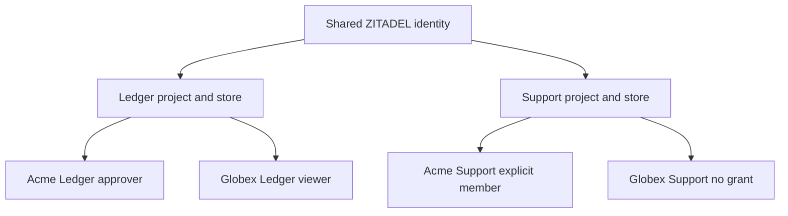

The first release includes both SDKs, the selected PostgreSQL adapters, tenant SAML/OIDC setup and enforcement, SCIM user lifecycle reconciliation, and durable SIEM integration. None of those may be silently postponed to label a partial SDK the agreed first release. Internal development milestones can deliver them incrementally.

## Product and tenant boundaries

A workspace is a tenant within a product. Ledger production and Support production each receive a ZITADEL project, intended audiences, an OpenFGA store/model and an adapter namespace. Acme and Globex are separate workspaces within each product. Staging has separate configuration. Sharing an identity or company name creates no cross-product grant. Organization mappings configure enterprise login, not automatic access.

The operator owns all product backends. The SDK protects end-user requests and mistakes through verified principals, fixed configuration and scoped APIs. A compromised backend can exercise its service/database credential privileges; namespace strings and SDK validation do not isolate hostile server owners. Test least privilege, and document any deployment-wide service credentials.

## Role and administration contract

Roles and permission mappings are declared in the product manifest and deployed with a model/manifest version. The default example has viewer, approver, admin and owner, but each product chooses its own names and business permissions. Admin can delegate only the explicit non-owner role set allowed by the manifest; owner assignment is reserved for bootstrap/transfer. Reject unknown role/permission names and tenant-provided model changes.

First owner is the verified principal recorded immutably in the authorized create intent. Invitations are product-owned, recipient-bound, expiring and single-use. Acceptance calls the same audited membership APIs. Ownership transfer requires an existing owner, an eligible active member as target and serialized operation state. Confirm target membership/ownership before removing the source owner's grant; a crash may temporarily leave two owners, never intentionally zero. The uncertainty gate blocks conflicting work. Resume only from confirmed or safely recovered state. Removing the last owner through ordinary membership APIs is rejected.

## Identity and revocation defaults

- Every protected request authenticates a verified principal. A valid session cookie alone cannot bypass access-token validation or current identity-status policy.
- Membership-sensitive checks use higher consistency with no SDK allow cache. Managed mode additionally reads the active/unblocked workspace gate from the primary database.
- Identity/session revalidation has a default maximum positive freshness of 60 seconds, capped by token expiry. At expiry of that freshness, obtain authoritative identity/token status through the verified ZITADEL integration or fail unavailable. Negative/inactive results deny and invalidate local sessions. Products may reduce freshness to zero for online checks on every request.
- Introspection alone is not assumed to expose every account-deactivation event. Pinned-service tests must prove the selected token and user-status checks detect disable/delete; include a user-status check where needed. Cache keys bind issuer, subject, token/session and policy version. No stale-positive fallback after the freshness deadline.
- A confirmed identity-state transition visible to those provider APIs must cause new protected requests to deny within the configured freshness plus the bounded request deadline. This does not promise instant detection before the provider exposes the change. Already-authenticated in-flight work may finish.
- Session defaults remain eight hours absolute, thirty minutes idle. These are independent from access-token expiry and the 60-second identity freshness limit. Refresh cannot extend the original absolute session deadline.
- Default service-call deadline is five seconds, bounded by the caller's earlier deadline; refresh coordination waits within that bound. Cancellation after a dispatched mutation can produce an uncertain result and must preserve the recovery journal.

ZITADEL supports online token introspection; the SDK must verify the exact disabled-user/token semantics in its supported release. [ZITADEL introspection](https://zitadel.com/docs/guides/integrate/token-introspection)

The 60-second freshness and five-second call deadline are initial configurable design defaults, not measured SLA claims. The selected contract permits an already-authorized invoice transaction to commit after revocation. Products needing stronger in-flight fencing must add business transaction coordination.

## Setup and execution ownership

A single operator CLI in TypeScript emits language-neutral runtime configuration. Operator provisioning uses a durable PostgreSQL setup journal in an operator-selected database, with per-product/environment operation serialization; it must not depend on a product's managed-workspace tables already existing. Privileged credentials are injected separately. A local-only setup shortcut cannot be advertised as multi-operator safe. Uncertain remote resource creation is reconciled conservatively, not blindly retried.

The product mounts HTTP routes, supplies database connections/keys, runs explicit migrations and schedules bounded reconciliation/export. No SDK constructor starts a worker or migration. Creation eligibility, business readiness and tenant predicates remain product code. Default role changes and transfer workflow decisions are auditable according to [[audit-contract]].

## First-release dry runs

| Scenario | Required outcome |
| --- | --- |
| Maya signs into Support after Ledger | Correct Support token; no access until Support membership is explicitly granted |
| Maya substitutes Globex invoice ID on Acme route | Tenant-scoped lookup/update returns missing, without leaking the resource |
| Maya's membership is confirmed removed | Fresh checks deny even if old role tuples remain |
| Maya's identity is disabled | New requests deny within the verified identity freshness contract; expired freshness plus provider outage blocks access |
| Request allowed just before revocation | May finish; audit distinguishes allow from final business outcome |
| Unknown role supplied by tenant admin | Validation error, no role/model creation |
| Ownership transfer loses a remote response | Workspace blocked; no conflicting transfer; durable audit records intent and uncertainty |
| Acme requires SAML and Maya has a password session | Reauthenticate with policy-compliant evidence or deny, never accept membership as SSO proof |
| Directory disables Maya | Explicit lifecycle policy revokes affected memberships in each enrolled product; no unrelated tenant changes |
| SIEM is offline | Durable local events queue; no loss or silently dropped required decisions |
| Local audit store is unavailable | No authorization allow/result is released as successful; protected operation does not begin |

## Completion gates

All of #44–#48 (SSO, SCIM verification/reconciliation, audit and SIEM), #49 (compatibility) and #55 (adapter safety) are required before #50 releases. #30 closes the product design decisions; executable schemas, service verification and implementation issues remain open. A failing service capability is a release blocker or requires an explicit design change, never a reason to silently omit enterprise scope.
