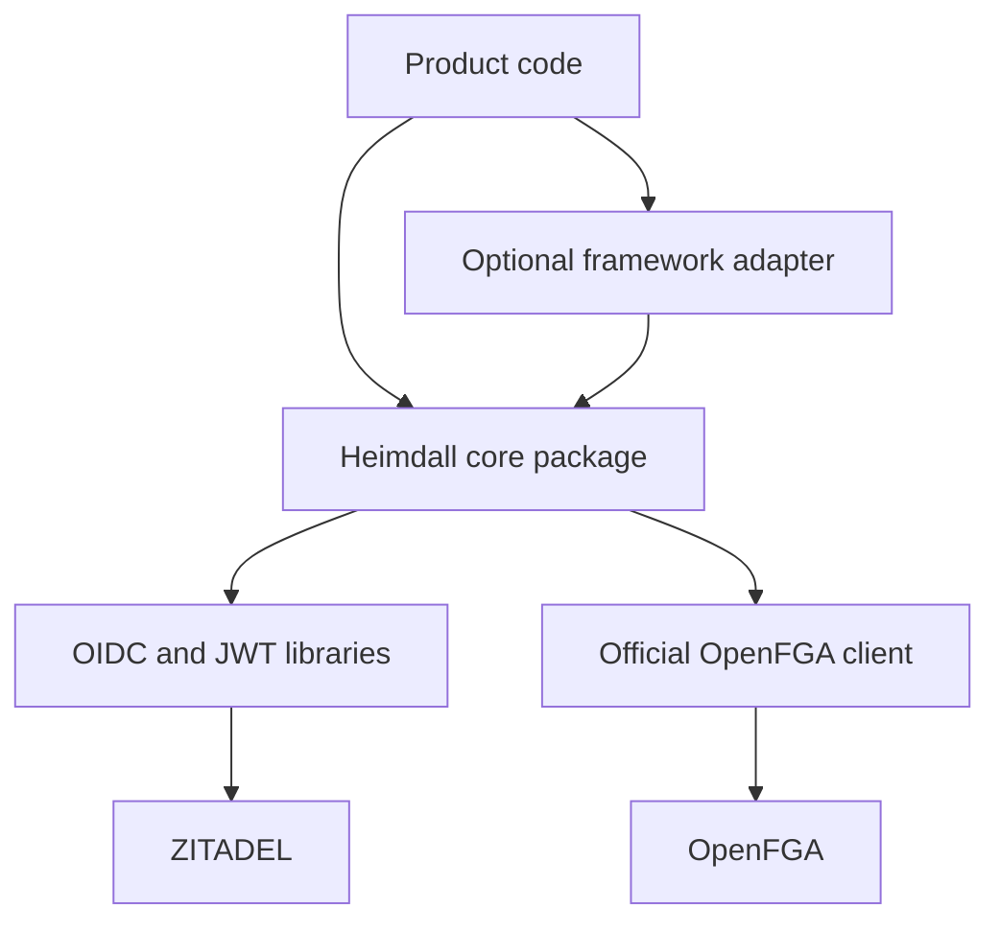
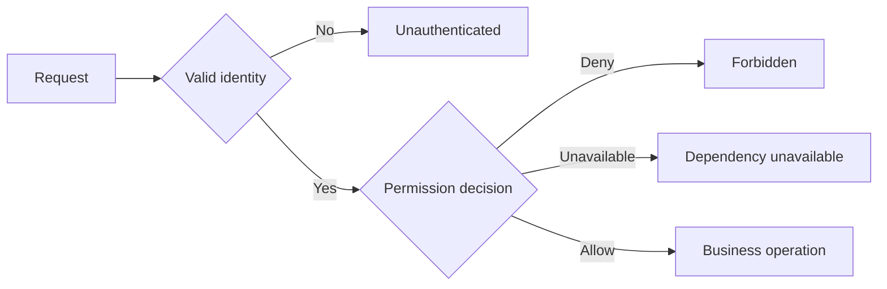

The first-release contract is now selected: [[release-contract]], [[audit-contract]] and [[enterprise-contract]]. Durable audit is required for every authorization decision and mutation; online identity freshness applies in both core and managed modes. The snippets below illustrate API shape, not a bypass of those requirements.


Each language package shares the same identity encoding, permission manifest, error semantics, and behavioral fixtures. Framework adapters translate HTTP requests into the core contract. Method names below illustrate the proposed TypeScript ergonomics.



See [[shared-sdk-contract]] for the v0.1 proposal with TypeScript and Go signatures, session storage semantics, bounded workspace discovery, and durable onboarding retries. Its API names refine the earlier sketches below.

## Configuration

```ts
const auth = createHeimdallFromEnv()
const actor = await auth.authenticate(request)
const tenant = auth.tenant(route.tenantId)
await tenant.require(actor, "invoice.approve")
await invoices.approve({ tenantId: tenant.id, invoiceId: route.invoiceId })
```

Startup validates issuer, expected audience, OpenFGA endpoint, store ID, model ID, and manifest version. Authentication uses a maintained OIDC or JWT library. Credential loaders support environment injection. Endpoint and store selection come from trusted deployment configuration.

| Operation | Contract |
| --- | --- |
| `authenticate(request)` | Produce a verified principal or an authentication error |
| `tenant(id)` | Bind a validated tenant identifier to an authorization context |
| `require(actor, permission)` | Fresh permission decision, throwing on deny or dependency failure |
| `can(actor, permission)` | Boolean for completed decisions, typed error on unavailable service |
| `roles(actor)` | Effective tenant roles, gated by membership |
| `assignRole(actor, target, role)` | Validate allowed role and delegation permission before tuple write |
| `removeRole(actor, target, role)` | Authorize removal and handle retry safely |
| `bootstrapOwner(tenant, principal, operation)` | Restricted provisioning entry point used by product lifecycle workflow |

The product checks tenant lifecycle state and scopes business queries. It owns the transaction used to update business records. An optional adapter may wrap these steps, but the core package must expose them explicitly.



HTTP adapters typically map these errors to 401, 403, and 503. A tenant-scoped lookup may return 404 to avoid exposing resource existence. Unknown permission names fail validation. Browser helpers can drive UI visibility through product endpoints. Privileged OpenFGA credentials stay in backend processes.

Setup tooling and runtime use separate entry points. TypeScript and Go are the initial SDK languages. The selected HTTP boundaries are TypeScript Fetch and Go net/http; [[design/built-in-adapters]] defines the supported configuration and persistence compositions.

## Walkthrough refinements

The [[two-product-walkthrough]] adds proposed `auth.routes`, `addMember`, `listMemberships`, and `provisioning.ensureOwner` helpers. It defines the developer-owned persistence and route wiring for each, and illustrates session, discovery, retry, and enterprise SSO integration; the selected behavior is governed by [[shared-sdk-contract]], [[design/built-in-adapters]] and [[enterprise-contract]]. These names remain illustrative.

Both initial packages run the same behavioral fixtures. Go APIs should accept request contexts for cancellation and deadlines and expose idiomatic typed errors. TypeScript APIs should expose corresponding cancellation and error behavior. See [[project-structure]] for package locations and [[task-list]] for the parity release gate.
