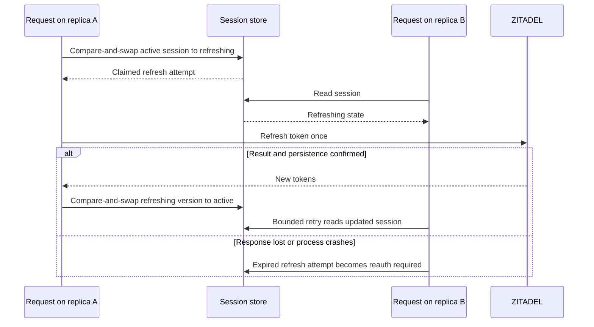
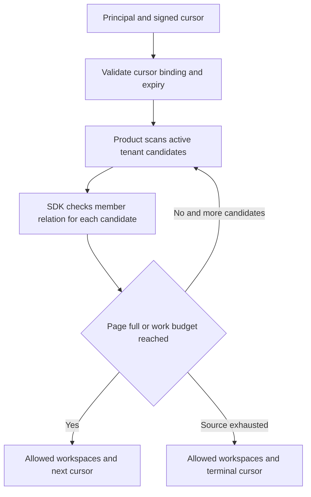
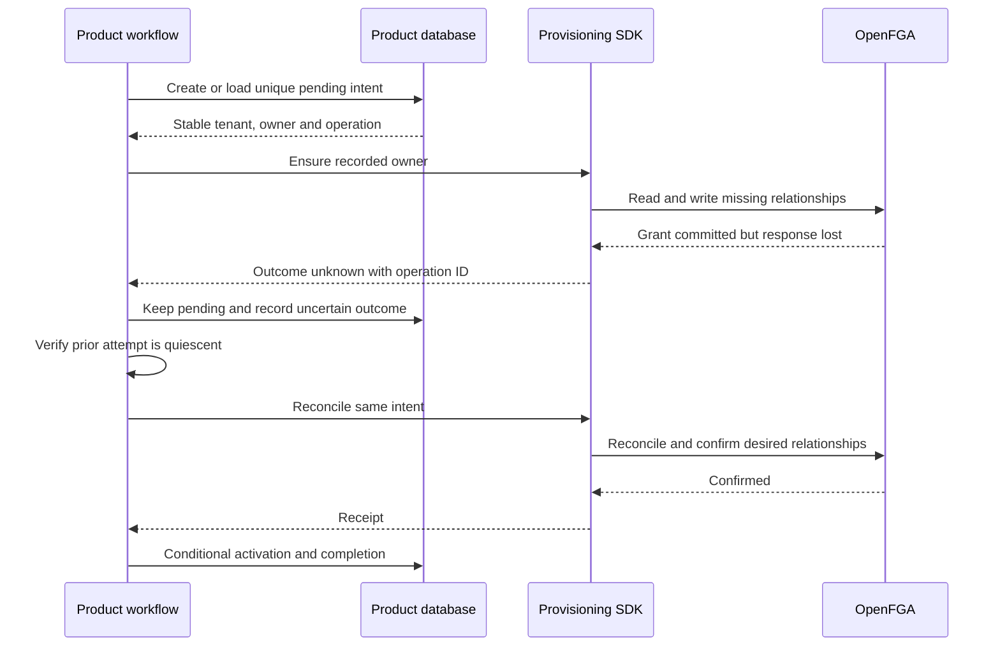

The November 10 decisions are locked in [[release-contract]], [[audit-contract]] and [[enterprise-contract]]. These extend the core interfaces below with mandatory durable audit and bounded identity revalidation. Earlier API sketches remain illustrative until encoded as schemas; enterprise delivery is mandatory in both SDKs.


The behavioral contract is selected; exact API spellings and concrete encodings remain implementation deliverables. TypeScript and Go implement the same behavior with idiomatic APIs. Examples below describe interfaces to build. Live-service tests must validate the implementation before release. This page refines the illustrative APIs in [[two-product-walkthrough]] and [[sdk-contract]].

## Adapter extension and precedence

[[design/built-in-adapters]] adds selected PostgreSQL sessions and optional managed workspaces. The interfaces below remain the core/product-owned path. Managed mode owns its operation journal and workspace/index transactions, requires a lifecycle gate on every permission/role check, and supplies Fetch/net/http handlers. Explicit migrations and bounded reconcile are separate operations.

The earlier onboarding example below illustrates desired-state reconciliation; it does not prove an uncertain attempt has stopped. In managed mode, an uncertain dispatched write remains pending/recovery_required and blocks conflicting changes and new access until verified quiescence. A reread or lease expiry alone cannot permit activation, inverse mutation or cleanup. This narrower safety rule supersedes any suggestion that every lost response automatically completes on retry.

## Common rules

The client is bound to product, environment, trusted issuer, audience, OpenFGA store, model and manifest version. Callers cannot override these per request. A verified principal contains issuer and subject, principal kind, and available authentication evidence. Session helpers return this verified principal. Trusted internal workflows can resolve another principal through a separate privileged identity API.

The version-1 human-user object encoding is `user:` followed by unpadded base64url of UTF-8 compact JSON `[issuer,subject]`. Preserve the configured issuer exactly after discovery validation. Both languages produce identical bytes using canonical ASCII JSON escaping as specified in contracts/README.md: lowercase Unicode escapes, including surrogate pairs, with no normalization. Encoding alone does not authenticate a principal. Golden fixtures cover Unicode, punctuation and issuer differences. Keep tenant IDs immutable and validate length and permitted characters. Service principals require their own future contract.

| Behavior | TypeScript | Go |
| --- | --- | --- |
| Cancellation and deadline | Required request options carrying `AbortSignal` | `context.Context` as first parameter |
| Successful result | Resolved promise | Value and nil error |
| Failure | `HeimdallError` with stable `code` | Typed error supporting `errors.Is` against sentinel errors |
| Denied permission | `can` returns false, `require` throws forbidden | `Can` returns false with nil error, `Require` returns forbidden |
| Dependency failure | Throw unavailable or deadline error | Return corresponding error |
| Mutation after uncertain response | Return outcome-unknown error and operation ID where available | Same error category and operation ID |

Shared error codes include `unauthenticated`, `forbidden`, `invalid_argument`, `not_found`, `conflict`, `unavailable`, `deadline_exceeded`, `cancelled`, `audit_unavailable`, and `outcome_unknown`. Cancellation after a remote write may leave its outcome unknown. Do not automatically retry non-idempotent mutations. Credentials and token material must never appear in errors.

```ts
const actor = await auth.sessions.authenticate(request, { signal })
await auth.tenant(tenant.id).require(actor, 'invoice.approve', { signal })
```

```go
actor, err := auth.Sessions().Authenticate(ctx, r)
if err != nil { return err }
if err := auth.Tenant(tenant.ID).Require(ctx, actor, "invoice.approve"); err != nil {
    return err
}
```

The product still loads an active tenant and scopes the business query by tenant ID. Token-only APIs use `tokens.verify(accessToken, options)` or `Tokens().Verify(ctx, accessToken)` and enforce the same audience and identity rules.

## Sessions

A session manager runs inside the product backend. The browser receives an opaque random cookie. The product supplies durable storage, a stable encryption-key set, cookie policy and an allowlist of return destinations. The SDK owns OIDC state, nonce, PKCE, token validation, session rotation, and encrypted session payloads.

### Public API

```ts
const sessions = await auth.createSessions({
  callbackUrl: "https://ledger.example.com/auth/callback",
  returnTo: "/workspaces",
  zitadelAPIAudience,
}, { signal })

// Mount these methods with the product's Fetch adapter.
const loginResponse = await sessions.start(request)
const callbackResponse = await sessions.callback(request)
const actor = await sessions.authenticate(request)
const logoutResponse = await sessions.logout(request)
```

```go
sessions, err := auth.NewSessions(ctx, heimdall.SessionOptions{
    CallbackURL: "https://ledger.example.com/auth/callback",
    ReturnTo: "/workspaces", ZitadelAPIAudience: zitadelAPIAudience,
})
if err != nil { return err }

// Mount these methods with the product's net/http adapter.
err = sessions.Start(w, r)
err = sessions.Callback(w, r)
actor, err := sessions.Authenticate(r)
err = sessions.Logout(w, r)
```

TypeScript returns responses containing redirects and cookie changes. Go writes those responses and returns errors for the product to handle. HTTPS cookies use Secure, HttpOnly, SameSite=Lax, Path=/ and the `__Host-` prefix. Session defaults are eight hours absolute and thirty minutes idle. Each mounted adapter uses one configured relative return path and a manifest-registered callback URL. Logout accepts a same-origin POST. The product applies CSRF protection to its other cookie-authenticated state-changing routes.

For tenant-specific login in Phase 6, an optional `tenantId` is resolved through a product-supplied tenant-login resolver. The resolver returns a trusted organization mapping and allowed login policy. The SDK binds that policy to login state and validates the resulting authentication evidence. A browser-supplied organization ID cannot directly select privileged configuration. Strict SSO policy validation remains a live-service acceptance requirement.

### Minimal storage interface

```ts
type StoredSessionRecord = {
  value: Uint8Array
  revision: string
  expiresAt: number
}

interface SessionStore {
  create(key: string, value: Uint8Array, expiresAt: number,
    signal: AbortSignal): Promise<string | null>
  read(key: string, signal: AbortSignal): Promise<StoredSessionRecord | null>
  compareAndSwap(key: string, revision: string, value: Uint8Array, expiresAt: number,
    signal: AbortSignal): Promise<string | null>
  delete(key: string, signal: AbortSignal): Promise<void>
}
```

```go
type StoredSessionRecord struct {
    Value []byte
    Revision string
    ExpiresAt int64
}
type SessionStore interface {
    Create(context.Context, string, []byte, int64) (string, error)
    Read(context.Context, string) (*StoredSessionRecord, error)
    CompareAndSwap(context.Context, string, string, []byte, int64) (string, error)
    Delete(context.Context, string) error
}
```

Expiration is in Unix milliseconds. A successful write returns the committed revision as a canonical positive signed 64-bit decimal string. A definitive failed predicate returns null in TypeScript or an empty revision in Go. The write returns its revision directly so a concurrent writer cannot change which revision the caller observes. Store revisions never repeat for a key, including after deletion and expiry. An unknown write outcome returns `outcome_unknown`.

Create succeeds only for an absent or expired key. Read returns absent for an expired record. Compare-and-swap succeeds only against the current unexpired revision and cannot recreate deleted records. Delete is idempotent. All operations are atomic across product replicas. The store owns TTL enforcement and eventual physical cleanup. Use a shared key ring and a deployment-wide key-usage reservation port that commits one reservation before each encryption. Use the runtime's durable identity gate for account-wide denials. Token inactivity conditionally tombstones the observed revision in the custom store and lets that record expire. The SDK scopes keys by product, environment and record type, authenticates the expiry in the encrypted payload, and gives the store opaque envelope bytes.

Supply the TypeScript `sessionStorage` or Go `SessionStorage` option at runtime construction. Omit this option when using the bundled PostgreSQL session adapter. See [[evidence/phase-4-custom-session-store]] for wiring and verification.

Login callback atomically claims its login record before exchanging the code. A second callback is rejected. The login record is also bound to a browser cookie so stolen state alone cannot complete another browser's login.

### Refresh and logout races



Only one refresh attempt may own a session version. Other requests wait within their deadline or receive an unavailable response. If refresh outcome is uncertain, require reauthentication rather than replay a potentially consumed refresh token. This intentionally trades a new login after rare failures for deterministic behavior. A crashed attempt has a bounded lifetime, after which the session becomes unusable.

Pinned-service evidence: [[evidence/phase-2-oidc]] found that deleting a ZITADEL provider session did not revoke its refresh capability. The optional upstream-revocation policy must use explicit token revocation and report uncertain/outage results; provider-session deletion alone cannot be called complete token revocation. This does not change the local logout default.

Local logout atomically deletes the stored session and clears the cookie. Refresh persistence uses compare-and-swap, so it cannot resurrect a deleted session. Upstream token revocation or provider-wide logout is an explicit additional policy. Already-authenticated in-flight product operations follow the revocation limits in [[operations]].

## Workspace discovery

The application needs workspace IDs, names and lifecycle status. The proposed baseline uses product-owned keyset pagination over active tenant candidates, with SDK membership checks for each batch. This avoids binding the public pagination contract to unverified OpenFGA list behavior. It can be expensive when a user belongs to very few tenants in a large product. Optimize the candidate source with a product membership index when measured scale requires it, while retaining fresh authorization checks.

### Public API and product driver

```ts
const workspaces = auth.createWorkspaceDiscovery({ source: workspaceSource })
const page = await workspaces.list(actor, {
  cursor: requestCursor,
  limit: 20,
  signal,
})
// { items: Workspace[], nextCursor: string | null }

interface WorkspaceSource {
  scan(input: {
    after: string | null
    limit: number
  }, options: RequestOptions): Promise<{
    items: Array<{ workspace: Workspace; position: string }>
    exhausted: boolean
  }>
}
type Workspace = { id: string; name: string }
```

```go
discovery := auth.NewWorkspaceDiscovery(workspaceSource)
page, err := discovery.List(ctx, actor, heimdall.WorkspaceListOptions{
    Cursor: requestCursor,
    Limit: 20,
})
// page.Items and page.NextCursor

type WorkspaceSource interface {
    Scan(context.Context, ScanOptions) (CandidatePage, error)
}
type ScanOptions struct {
    After string
    Limit int
}
type Candidate struct {
    Workspace Workspace
    Position string
}
type CandidatePage struct {
    Items []Candidate
    Exhausted bool
}
```

The source queries the product's active tenants in a stable, unique order, such as creation ID plus tenant ID. Positions resume strictly after the corresponding candidate. It returns at most the requested limit and must advance or report exhaustion. Names and tenant identifiers are validated before returning a public result.



### Pagination semantics

- Default page size 20, maximum 100. Proposed default scan budget is 500 candidates per request, configurable by the backend.
- Preserve candidate order. Return only active candidates with a completed allow decision for membership.
- Return a short or empty page with a continuation cursor when the scan budget is reached. The UI continues while a cursor exists. Totals are omitted.
- The next cursor records the last consumed candidate. If a batch contains more allowed results than fit, resume after the last consumed item so later items remain eligible.
- SDK cursors are authenticated and bind product, environment, principal, source position, model ID, format version and expiry. All replicas share configured cursor keys. Cursors are opaque to clients.
- Dependency failure fails the page request. It must not silently filter failed checks as denials or advance a returned cursor past them.
- This is a live traversal. Changes behind the cursor can appear on a fresh traversal. No snapshot guarantee is made. Every subsequent protected operation checks current access again.

[[evidence/phase-2-openfga-limits]] confirms that the pinned ListObjects response truncates at 1,000 direct memberships without continuation. It cannot replace the candidate-source pagination contract or establish complete membership absence.

An optimized OpenFGA-based or indexed candidate source must preserve these semantics before becoming a supported alternative. Both SDKs run the same fixture with sparse membership, deleted tenants, identical display names and concurrent changes.

## Tenant onboarding and retries

The product owns authorization to create workspaces, idempotency records, tenant transactions and retry scheduling. The SDK exposes an idempotent initial-owner operation. A successful operation means the expected relationships were confirmed. Activation is a separate product database commit.

### Public API

```ts
const intent = await tenantRepo.beginOnboarding({
  productId: config.productId,
  operationId: idempotencyKey,
  owner: actor.identity,
  name: 'Acme',
})

// Runs under the product's durable per-tenant mutation serialization.
if (intent.status !== 'active') {
  const receipt = await ensureTenantOwner(
    configJSON, manifestJSON, mutationToken,
    { operationId: intent.operationId, tenantId: intent.tenantId, owner: intent.owner },
    (signal) => tenantRepo.commitAuditedDispatch(intent, signal),
    signal,
  )
  await tenantRepo.activateIfPending(intent, receipt)
}
```

```go
intent, err := tenantRepo.BeginOnboarding(ctx, BeginOnboardingInput{
    ProductID: config.ProductID,
    OperationID: idempotencyKey,
    Owner: actor.Identity(),
    Name: "Acme",
})
if err != nil { return err }

// Product serializes all lifecycle mutations for this tenant.
if intent.Status != Active {
    receipt, err := provisioning.EnsureTenantOwner(
        ctx, configJSON, manifestJSON, mutationToken,
        provisioning.TenantOwnerInput{
            OperationID: intent.OperationID, TenantID: intent.TenantID,
            Issuer: intent.Owner.Issuer, Subject: intent.Owner.Subject,
        },
        func(ctx context.Context) error { return tenantRepo.CommitAuditedDispatch(ctx, intent) },
    )
    if err != nil { return err }
    if err := tenantRepo.ActivateIfPending(ctx, intent, receipt); err != nil {
        return err
    }
}
```

These are product workflow bodies, not standalone endpoints. `tenantRepo` is application code. Both examples assume authenticated creation authorization, payload validation, and a serialized workflow around bootstrap, cancellation and activation. The dispatch callback must commit the audit and dispatch marker before OpenFGA writes. The workflow must record confirmed, failed or uncertain outcomes before activation or releasing the operation. The SDK's operation ID is for correlation. Durable idempotency is provided by the product's stored intent.

### Required product operation record

| Field | Contract |
| --- | --- |
| Product, environment and operation ID | Unique idempotency scope |
| Initiating principal and payload fingerprint | Bind retries to the same caller and request |
| Tenant ID | Allocated once and never reused |
| Initial owner issuer and subject | Immutable after operation creation |
| State | Pending, active, cancelled or cleanup required |
| Attempt and outcome | Diagnostic correlation and retry status |

Same key and same payload returns the existing operation. Same key with another owner, name or payload returns conflict. Unrelated callers cannot recover another caller's operation through its idempotency key. Setup retries for product resources use a separate operator provisioning record.

### SDK ensure behavior

1. Validate the pending intent input and principal encoding within a privileged workflow.
2. Read the required member and owner relationships using the strongest supported consistency for reconciliation.
3. If an unexpected existing owner is observed, return conflict. The product's serialization prevents competing bootstrap operations. The SDK read cannot provide an atomic global uniqueness guarantee.
4. Write missing relationships. Handle concurrent duplicate writes by rereading and verifying desired state.
5. Confirm membership and ownership and return a receipt containing operation ID, tenant ID, principal and model ID.
6. On uncertain write outcome, return `outcome_unknown`. The caller keeps the tenant blocked and establishes quiescence before reconciling the same recorded intent. Successful grants are preserved for reconciliation.



Cancellation and grant writes must use the same product serialization mechanism. A stale worker must not recreate grants after cleanup. Lease expiry alone is insufficient fencing for an external service write. Use a serialized workflow with recovery that reconciles any in-flight attempt before final cleanup. Keep that boundary explicit in the integration recipe.

## Shared conformance cases

| Area | Required fixture or integration test |
| --- | --- |
| Identity | Both languages encode identical issuer and subject pairs |
| Sessions | Callback replay rejected across replicas |
| Sessions | Concurrent refresh uses one owner, lost refresh result requires login |
| Sessions | Logout during refresh cannot resurrect session |
| Discovery | Sparse memberships return continuation even for empty pages |
| Discovery | Page-full mid-batch resumes without skipping allowed candidates |
| Discovery | Wrong-principal cursor rejected, dependency errors fail the request |
| Onboarding | Same key and payload produces one tenant and owner |
| Onboarding | Changed owner or payload conflicts |
| Onboarding | Lost response quarantines uncertain dispatch; confirmed grant plus failed activation permits safe local recovery |
| Onboarding | Cancelled operation cannot be revived by a stale worker |

The principal encoding, storage versions, cursor format and error codes belong in `contracts/` with fixtures. The implementations belong in both SDKs. The product persistence recipes belong in Ledger and Support examples. See [[project-structure]] and [[task-list]].
