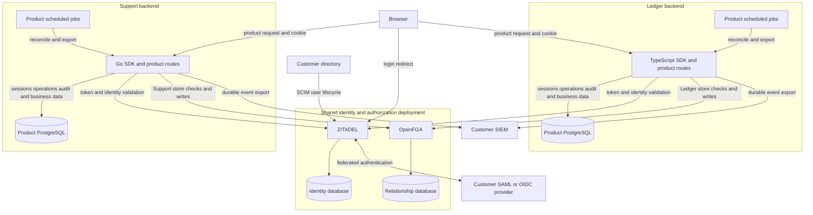
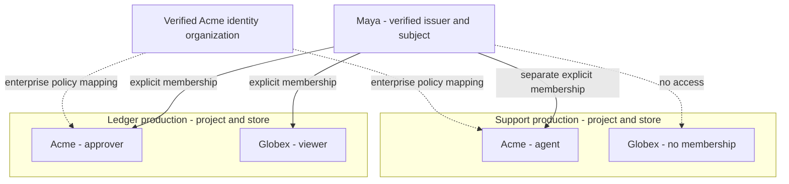
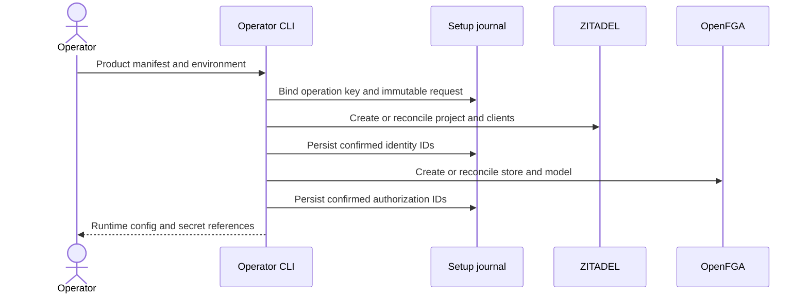
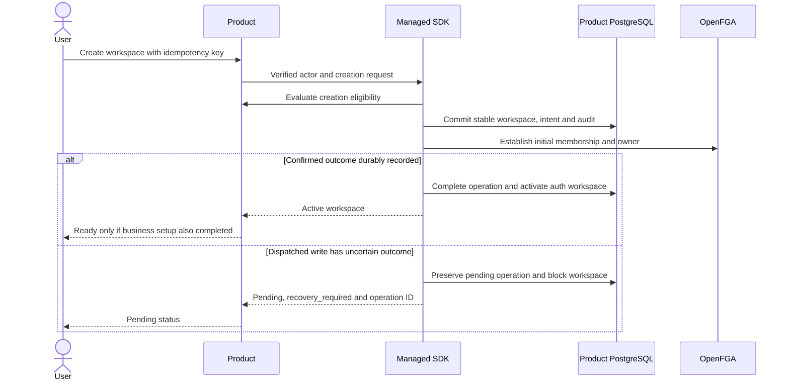
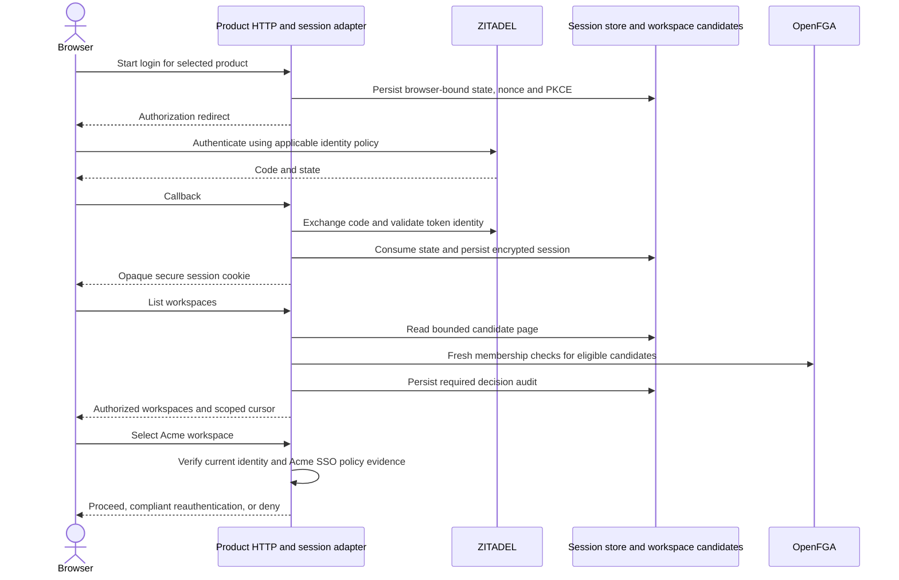
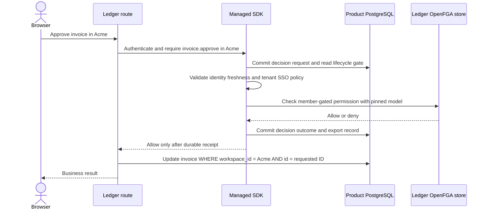
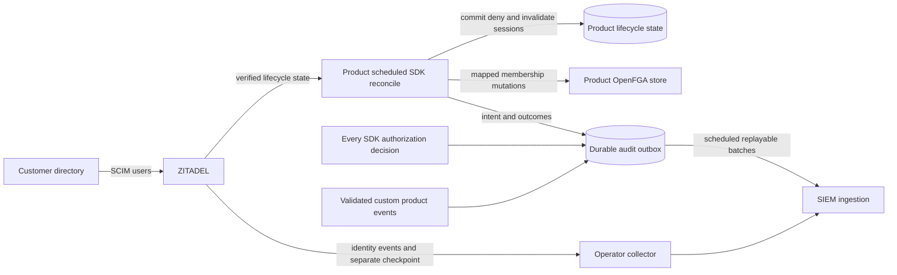

This is the entry point to the agreed Heimdall design. It defines what we are building, how the pieces work together, who owns each responsibility and which scenarios must pass. The linked contracts are part of this specification. Implementation tickets organize delivery; they do not replace or weaken these requirements.

**Status: design selected; runtime unimplemented.** TypeScript and Go ship together. Exact API spellings, physical schemas and service-version compatibility are implementation deliverables, not reasons to reopen the selected product scope. Historical explorations are not implementation instructions.

## 1. Functionality we are building

Heimdall lets one operator onboard multiple products onto one ZITADEL/OpenFGA deployment. Each product can itself serve multiple tenants, called **workspaces**. Developers install an SDK into their backend. There is no companion Heimdall API service.

| Capability | Required first-release behavior | Detailed specification |
| --- | --- | --- |
| Product setup | Register or bind a product/environment to identity clients, audiences, store and pinned model; emit language-neutral configuration | [[flows/provisioning]], [[release-contract]] |
| Authentication and sessions | Verified identity, browser login/callback/logout, secure server sessions, refresh coordination and bounded identity freshness | [[shared-sdk-contract]], [[design/built-in-adapters]] |
| Workspace discovery | Return only active workspaces whose membership is currently verified; bounded pagination, scope-bound cursors, explicit errors | [[shared-sdk-contract]], [[design/built-in-adapters]] |
| Workspace onboarding | Authorized creation, stable IDs and first owner, durable idempotency, status and conservative recovery | [[design/built-in-adapters]], [[flows/provisioning]] |
| Role resolution and enforcement | Product-defined roles and permissions, active membership gate, tenant-bound checks and delegation rules | [[authorization-model]], [[flows/authorization]] |
| Membership administration | Explicit invitations, grants, revocation and serialized ownership transfer; protect the last owner | [[flows/membership]], [[release-contract]] |
| Tenant enterprise login | Organization-mapped SAML/OIDC setup and strict SSO enforcement, including tenant switching | [[enterprise-contract]] |
| Directory lifecycle | SCIM users into ZITADEL; explicit per-product enrollment and deprovisioning reconciliation | [[enterprise-contract]] |
| Audit and SIEM | Durable records for all decisions, role changes and ownership transfers; validated custom events; replayable export | [[audit-contract]] |
| Built-in adapters | PostgreSQL persistence plus TS Fetch and Go net/http boundaries, explicit migrations and maintenance | [[design/built-in-adapters]] |
| Language parity | Same observable semantics and storage/wire formats in both SDKs | [[shared-sdk-contract]], [[project-structure]] |

Deferred: tenant-authored runtime roles, SCIM group synchronization, resource sharing, public service-account APIs, mutually untrusted backend operators, additional databases and languages. Product-defined custom audit events are included; they do not imply runtime custom roles.

## 2. Deployment and trust boundaries

The product supplies its database, secrets, routes and scheduler. SDK logic executes in the product process; scheduled work invokes the same packages. The databases beneath ZITADEL and OpenFGA are operated with those services and never accessed directly by the SDK.

Backends belong to one trusted operator. Tenant IDs and store IDs prevent accidental scope mixing through the SDK; they do not isolate a hostile backend possessing broad service credentials. Setup credentials are separate from runtime credentials. Browsers never receive OpenFGA, provisioning or database credentials.

## 3. Product, workspace and identity model

A product/environment has its own ZITADEL project/audiences, OpenFGA store and pinned model, and adapter namespace. A workspace is an immutable tenant ID inside that product. A ZITADEL organization is an identity-policy boundary; an explicit mapping connects it to workspaces for enterprise SSO or enrollment.

Shared login does not grant membership. The same company name does not establish a mapping. A Ledger token does not automatically satisfy Support's audience. Workspace selection is untrusted input until the backend verifies lifecycle, identity policy and membership. Business rows always retain their workspace ID.

## 4. What the developer wires up

| Integration concern | Product/operator supplies | SDK handles |
| --- | --- | --- |
| Bootstrap | Product manifest, redirect URLs, service endpoints and privileged secret references | Validated setup workflow, durable progress and resulting IDs/configuration |
| Persistence | PostgreSQL connection, durable keys, explicit migration step and backups | Session, managed workspace and audit/outbox storage implementations |
| HTTP | Mount Fetch or net/http auth handler; protect business routes | Login state, PKCE, callback validation, session cookie and logout mechanics |
| Tenant UI | Workspace picker, onboarding form and pending-operation UI | Authorized discovery pages, create/status and safe retry classification |
| Business policy | Creation eligibility, invitations, readiness/billing, tenant-scoped queries | Role validation, permission enforcement and managed lifecycle gates |
| Enterprise setup | Customer IdP details, authorized organization mapping and directory configuration | Setup helpers, policy checks and lifecycle reconciliation |
| Background work | Schedule bounded maintenance/reconcile/export and monitor failures | Durable checkpoints, retry classification, batch limits and SIEM envelopes |

**Two supported compositions:** an existing product can keep its workspace source and durable workflow while using sessions/core contracts; a new product can choose managed workspaces and SDK operation/index tables. Core consumers provide conforming durable audit and identity/lifecycle behavior too. Choosing core is not an exemption from security requirements. There are no implicit migrations, timers or workers.

Both language API sketches live in [[design/built-in-adapters]] and [[shared-sdk-contract]]. They are interfaces to implement, not packages that currently execute.

## 5. Setup and onboarding data flow

Operator setup first creates or binds Ledger and Support independently. Its PostgreSQL setup journal is independent of product-managed workspace tables. Product onboarding then creates Acme and Globex under each configured product.

Same scoped key and same payload refer to one operation. Changed payload conflicts. A timeout is not proof of failure. A lease expiry or successful relationship read does not prove an old write can no longer arrive. Uncertain dispatched operations remain quarantined until verified quiescence and reconciliation; only known-safe retries are automatic. See [[design/built-in-adapters]] for the recovery procedure and release gate.

## 6. Login, discovery and tenant switching

Candidate indexes are discovery hints, never permission authority. Each result requires current checks. Sparse pages may return continuation with no entries; callers must follow the cursor rather than interpret that as global absence. Dependency failures are errors, not empty successful pages. Discovery does not pre-authorize later requests.

Sessions default to eight hours absolute and thirty minutes idle. Identity/status freshness defaults to at most 60 seconds, capped by token expiry; stale status plus provider outage fails closed. Access-token validation still applies. Refresh cannot extend absolute session lifetime. Full races, cursor rules and cancellation behavior are in [[shared-sdk-contract]] and [[release-contract]].

## 7. Enforcing roles and protecting business data

Product manifests define roles and permission mappings. Active membership intersects every permission. Resolving roles supports UI and administrative views; the backend enforces permissions again for the actual operation.

Inactive or blocked workspaces deny before protected work. Authorization dependency failure remains distinct from deny. Audit-store failure blocks work and returns unavailable. An allow is not evidence that the business transaction committed. Already-authorized in-flight work may finish after revocation; stronger transaction fencing belongs to the product.

Membership changes and ownership transfers use durable intent, delegation checks and the same uncertainty gate. Ordinary role APIs cannot grant owner or remove the last owner. Transfers confirm the target owner before removing the source; a crash can leave two owners temporarily, not intentionally zero.

## 8. Enterprise lifecycle and durable audit

SCIM creation does not automatically enroll a user. Product-defined mapping rules select workspaces and starting roles; disabling identity must block sessions even if remote membership cleanup is pending. Replay reads authoritative state so stale activation events cannot undo later deactivation. Group provisioning and automatic group-to-role mapping are deferred.

Every authorization decision, role change and ownership transfer is durably recorded. Custom events extend reserved security events; they cannot suppress or impersonate them. SIEM delivery is at least once, with event-ID deduplication and durable checkpoints. SIEM outage grows the backlog; local persistence exhaustion blocks work rather than dropping required records.

## 9. Data ownership and persistence

| Data | Authority | Boundary |
| --- | --- | --- |
| Identity, authentication, upstream provider configuration | ZITADEL | Verified issuer/subject and authorized organization mapping |
| Membership and evaluated roles/permissions | OpenFGA | Fixed product/environment store and model |
| Session/login state | Selected SessionStore | Scope-bound encrypted records, expiry and atomic CAS |
| Managed workspace lifecycle and operations | SDK tables in product PostgreSQL | Workspace, operation and candidate-index transaction boundary |
| Discovery candidates | Product source or managed index | Incomplete/stale hints; current authorization required |
| Audit and delivery receipts | DurableAuditStore/outbox | Committed event identity, mandatory scope and replay checkpoints |
| Invoice/ticket/customer readiness/invitations | Product | Tenant predicates and product transactions |
| Setup progress | Operator PostgreSQL setup journal | Serialized product/environment provisioning |

Restore and model migration are coordinated operations across independent systems. Restoring local state cannot blindly replay old grants against live OpenFGA. [[operations]] and [[design/built-in-adapters]] specify compatibility, recovery and exit requirements.

## 10. Implementation acceptance and traceability

| Dry run | Required result | Contract |
| --- | --- | --- |
| Maya joins Acme Ledger, then logs into Support | Login succeeds; no Support membership is implied | [[two-product-walkthrough]], [[tenancy]] |
| Maya substitutes a Globex invoice ID on Acme route | No cross-tenant read or write | [[flows/authorization]], [[scenarios]] |
| Concurrent create retries | One stable workspace and owner intent; changed payload conflicts | [[design/built-in-adapters]] |
| Owner write succeeds but response is lost | Pending/blocked; no blind retry or false activation | [[design/built-in-adapters]] |
| Workspace discovery encounters stale candidates or service outage | Fresh checks filter candidates; outage is explicit | [[shared-sdk-contract]] |
| Session refresh races logout or loses its response | No resurrection; uncertain refresh requires reauthentication | [[shared-sdk-contract]] |
| Password session switches into strict SAML workspace | Compliant reauthentication or deny | [[enterprise-contract]] |
| SCIM disables member of two products | Identity gates block; cleanup tracked independently | [[enterprise-contract]], [[release-contract]] |
| SIEM unavailable, then recovers | Replay durable IDs without loss; duplicates tolerated | [[audit-contract]] |
| Local audit commit fails | Protected work never begins | [[audit-contract]] |
| TS writes state and Go reads it | Same identity, session, cursor and operation semantics | [[shared-sdk-contract]] |

Implementation order is contracts/fixtures, core and persistence, managed workflows and enterprise integrations, then live two-product verification. [[implementation-roadmap]] maps the work to tickets; [[project-structure]] maps it to directories. Every behavioral change updates its owning contract and shared fixture. A service limitation that prevents the selected behavior is a release blocker or an explicit design change.

[[decisions]] records locked decisions. [[release-contract]], [[audit-contract]], [[enterprise-contract]] and [[design/built-in-adapters]] own their detailed requirements. Earlier examples with looser retry or optional-audit wording are superseded by these contracts. Historical [[explorations/built-in-adapters|alternatives]] remain separate. The site describes the build target; passing live-service and cross-language tests is what establishes that it has been built.
