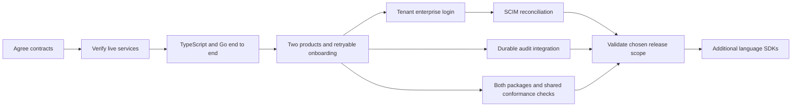

This is a proposed backlog derived from [[two-product-walkthrough]]. Checked items describe completed documentation work. Unchecked items require design decisions or implementation. Directory ownership is described in [[project-structure]].

Execution is tracked in [[implementation-roadmap|the implementation roadmap]] and [GitHub issue #29](https://github.com/techsavvyash/heimdall/issues/29). Its 22 child tickets expand this backlog into PRDs, implementation plans, dependencies and acceptance criteria. Ticket creation does not approve unresolved design proposals.

## Completed design foundation

- [x] Bootstrap the Quartz site and verify Mermaid rendering.
- [x] Scaffold TypeScript and Go packages, workspace directories, formatter, linter, type checks, Knip, Git hooks and CI checks. See [[development-workspace]].
- [x] Document direct SDK integration with ZITADEL and OpenFGA.
- [x] Walk through Ledger and Support with Acme and Globex tenants.
- [x] Describe developer wiring and SDK responsibilities.
- [x] Record sessions, workspace discovery and onboarding retry gaps.
- [x] Document enterprise SSO, SCIM and SIEM integration boundaries.

The [[shared-sdk-contract]] now contains a v0.1 API proposal for review. Its storage and pagination guarantees still need executable validation before the associated tasks are complete.

## 1. Settle the first implementation contract

- [x] Select TypeScript and Go as the initial SDK languages.
- [ ] Select the first TypeScript framework adapter and Go HTTP integration.
- [ ] Confirm independent product membership and backend trust assumptions.
- [ ] Define identity encoding, tenant IDs, error semantics and configuration schemas.
- [ ] Define roles, delegation rules and first-owner bootstrap behavior.
- [ ] Define session-store interface, refresh concurrency, logout and expiry.
- [ ] Verify workspace query limits and choose a discovery pagination contract.
- [ ] Define setup state, locking, idempotency keys and onboarding reconciliation.
- [ ] Choose revocation and audit guarantees, including in-flight operations.

**Where:** Quartz decisions first, then `contracts/` and `policies/`.

**Exit condition:** Every baseline SDK operation has inputs, outputs, errors, persistence ownership and an acceptance scenario. Proposed names in the walkthrough become one consistent contract.

## 2. Validate against running services

- [ ] Pin ZITADEL and OpenFGA releases and create the local deployment.
- [ ] Verify product audiences, identity organization context and runtime credentials.
- [ ] Validate the tenant RBAC model and all membership intersections.
- [ ] Create two projects, two stores and four tenant fixtures.
- [ ] Exercise OpenFGA listing limits and higher-consistency behavior.
- [ ] Verify what the chosen OpenFGA credential can access across stores.

**Where:** `deploy/local/`, `policies/tenant-rbac/`, `tests/integration/`.

**Exit condition:** Live-service evidence supports the baseline assumptions before SDK ergonomics are finalized.

## 3. Build end-to-end paths in both SDKs

- [ ] Implement config validation in TypeScript and Go and verified principal construction.
- [ ] Implement `can`, `require`, and membership-gated effective role resolution.
- [ ] Implement the chosen framework's login, callback and session integration.
- [ ] Build Ledger with TypeScript and Support with Go as the proposed example pairing.
- [ ] Exercise login and a protected tenant-scoped endpoint in each example.
- [ ] Run identical identity, permission, error and audit fixtures through both SDKs.
- [ ] Demonstrate deny, invalid audience and unavailable-service responses.

**Where:** `sdk/typescript/`, `sdk/go/`, `examples/ledger/`, `examples/support/`.

**Exit condition:** A developer installs the package, mounts authentication, selects an active tenant and protects a real operation with a small, documented integration.

## 4. Complete onboarding and multiple products

- [ ] Implement reusable product provisioning and the thin setup CLI.
- [ ] Generate pinned runtime config from the product manifest.
- [ ] Implement retryable initial-owner setup and the pending-to-active recipe.
- [ ] Implement member addition, role changes and removal with delegation checks.
- [ ] Implement workspace discovery joined with product-owned display data.
- [ ] Demonstrate invitation acceptance and serialized ownership transfer.
- [ ] Connect both examples to the shared deployment with separate manifests, audiences, stores and permissions.
- [ ] Run all two-product scenarios and lost-response or partial-failure cases.

**Where:** SDK provisioning and membership modules, both examples, integration tests.

**Exit condition:** Both products work independently on the same stack. Retried onboarding produces one tenant with the intended owner. Cross-tenant resource substitution and cross-product tokens fail.

## 5. Add tenant-specific enterprise login

- [ ] Implement organization mapping and privileged provider-setup helpers.
- [ ] Demonstrate Acme SAML and Globex OIDC configurations.
- [ ] Define shared versus independent login policy across products.
- [ ] Verify account linking, guests, fallback login and tenant-switch behavior.
- [ ] Test strict SSO requirements against existing sessions and identity evidence.

**Where:** SDK provisioning and auth adapter modules, example tenant settings, integration tests.

**Exit condition:** Tenant selection produces the expected authentication policy and membership checks, including existing-session scenarios.

## 6. Add enterprise lifecycle and audit integration

- [ ] Verify SCIM status and user lifecycle behavior in the pinned ZITADEL release.
- [ ] Define explicit directory-to-workspace enrollment and revocation policy.
- [ ] Implement reconciliation helpers and a product-worker example with checkpoints.
- [ ] Test deactivation, reactivation, replay and failures across both products.
- [ ] Finalize audit event schema and SDK event hooks.
- [ ] Demonstrate ZITADEL event collection and product audit delivery to a selected sink.
- [ ] Verify tenant filtering, event correlation, retention and required delivery durability.

**Where:** SDK lifecycle helpers, `contracts/audit-event.schema.json`, product worker and audit examples.

**Exit condition:** Measured deprovisioning latency and audit-delivery behavior match the agreed contract. Directory group synchronization requires a separate supported integration if needed.

## 7. Package and extend

- [ ] Run shared fixtures, model assertions and live-service tests in CI.
- [ ] Verify package exports, clean install and the documented developer quickstart.
- [ ] Test model migrations, mixed SDK versions and rollback compatibility.
- [x] Retire legacy root documentation, environment files, credentials, keys, test payloads and screenshots.
- [ ] Release the TypeScript npm package and versioned Go module when both pass the agreed initial scope.
- [ ] Add further languages only when requested, using the shared conformance fixtures.
- [ ] Design custom roles, service identities and resource sharing when their use cases are selected.

**Where:** Package metadata, CI workflows, Quartz integration docs and future language directories.

**Exit condition:** A fresh product can reproduce the documented integration. The release scope is explicit about any enterprise features scheduled for later delivery.

## Dependency order

Baseline release timing and enterprise feature priority are still open. The recommended next task is to select the TypeScript and Go adapters and settle the session, discovery and retry contracts together, then validate them against the pinned services.

## Initial-release parity gate

Every SDK task above applies to both TypeScript and Go unless explicitly scoped to the single proposed operator CLI or a language-specific adapter. Test both packages against the same permission and identity fixtures, request cancellation, dependency failures, lost write responses and model-version compatibility. Implementation may progress at different speeds, but the initial-release scope must be supported and verified in both.
