[[release-contract]], [[audit-contract]] and [[enterprise-contract]] now lock the first-release scope and supersede older open-policy questions in this walkthrough. Enterprise SSO/SCIM/SIEM are required; all authorization decisions, role changes and transfers require durable audit.


Ledger and Support share a ZITADEL and OpenFGA deployment. Each product has Acme and Globex workspaces. Maya has different roles in each workspace. This walkthrough uses the selected independent product membership policy. APIs, manifests, and commands are illustrative contracts awaiting implementation.

## Adapter update

This walkthrough describes the core/product-owned integration. [[design/built-in-adapters]] now defines optional PostgreSQL sessions and managed workspace ownership, with Fetch/net/http boundaries. Managed mode replaces custom intent/index persistence with SDK tables and explicit reconcile. Its uncertain-write quarantine supersedes the earlier assumption that a lost response always completes automatically on retry. Billing, resource scoping, invitations, SSO mapping and durable audit delivery remain product responsibilities.

## Who wires up what

| Step | Operator or product developer wires up | Heimdall SDK or setup tooling handles |
| --- | --- | --- |
| Deploy | Services, databases, URLs, TLS, backups, credentials | Configuration validation |
| Register product | Versioned manifest and environment | Reconcile projects, clients, store, model and generated IDs |
| Login | Framework routes, application URL, session storage | OIDC flow, callback validation, session adapter |
| Enterprise SSO | Authorized settings endpoint, tenant mapping, customer IdP inputs | ZITADEL provider setup and organization-aware login |
| Create tenant | Tenant row, creation policy, durable operation and retry runner | Idempotent initial membership and owner grant |
| Discover workspaces | Tenant names, status, selector UI and pagination | Resolve accessible tenant IDs |
| Manage members | Admin endpoints, invitation delivery and durable acceptance | Delegation checks and membership or role writes |
| Enforce access | Permission on endpoint and tenant predicate on data operation | Identity validation and OpenFGA decision |

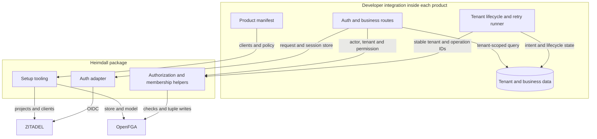

## 1. Deploy the shared services

The operator deploys ZITADEL and OpenFGA with persistent databases. Setup credentials can provision resources. Runtime credentials are injected into trusted product backends. Service credential isolation requires validation against the selected OpenFGA deployment, as described in [[architecture]].

## 2. Register Ledger and Support

The developer writes one manifest for each product. The manifest shown here is a proposed shape. A complete schema must include delegation rules and ownership behavior before use.

```yaml
product: ledger
clients:
  web:
    redirectUris:
      - https://ledger.example.com/auth/callback
permissions:
  - invoice.read
  - invoice.approve
  - members.manage
roles:
  viewer: [invoice.read]
  approver: [invoice.read, invoice.approve]
  admin: [invoice.read, invoice.approve, members.manage]
```

Support declares `ticket.read`, `ticket.reply`, and `members.manage`, with viewer, agent, and admin roles. A proposed command provisions each manifest.

```sh
heimdall setup --manifest ledger/heimdall.yaml --environment production
heimdall setup --manifest support/heimdall.yaml --environment production
```

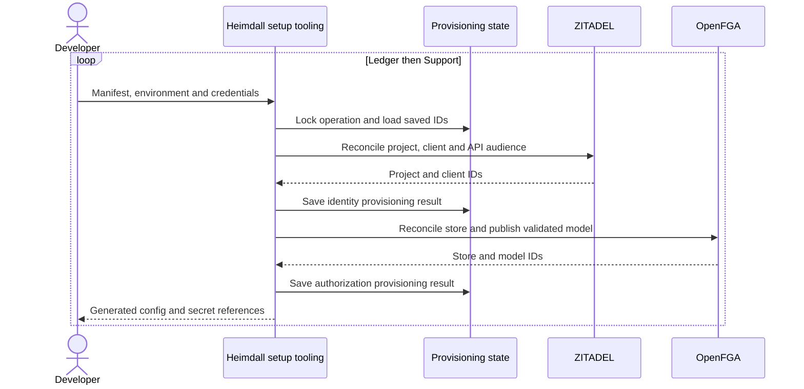

| Generated binding | Ledger production | Support production |
| --- | --- | --- |
| Identity | Ledger project and web client | Support project and web client |
| API | Ledger audience | Support audience |
| Authorization | Ledger store and pinned model | Support store and pinned model |

**Simplification opportunity.** Tooling records generated IDs and resumes partially completed setup. The developer supplies a manifest and secrets. A timeout after resource creation needs reconciliation before another create. See [[flows/provisioning]].

## 3. Install the package and connect login

```ts
const auth = createHeimdall({
  config: generatedConfig,
  secrets: process.env,
})

app.use('/auth', auth.routes({
  sessionStore: existingSessionStore,
}))
```

The developer mounts routes and supplies persistent session storage. The SDK adapter owns login state, PKCE, callback validation and session handling. SPA and mobile integrations need their own client login profile and API token validation.

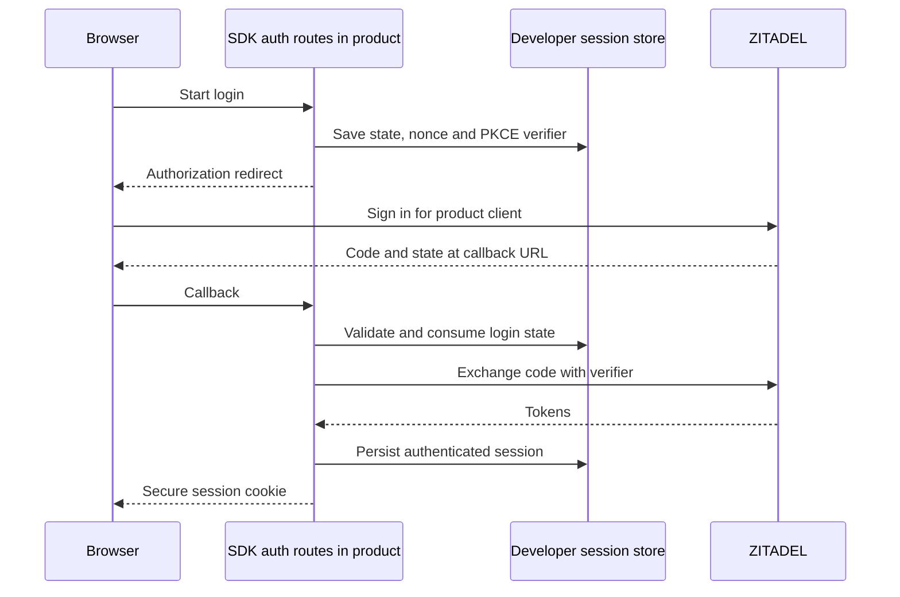

**Session gap.** Choose the first framework and define the session-store interface, expiry, refresh concurrency, logout, CSRF protection, and account-revocation behavior. An existing login session may need reauthentication when entering a tenant with stricter SSO rules. See [[flows/authentication]].

## 4. Create four workspaces

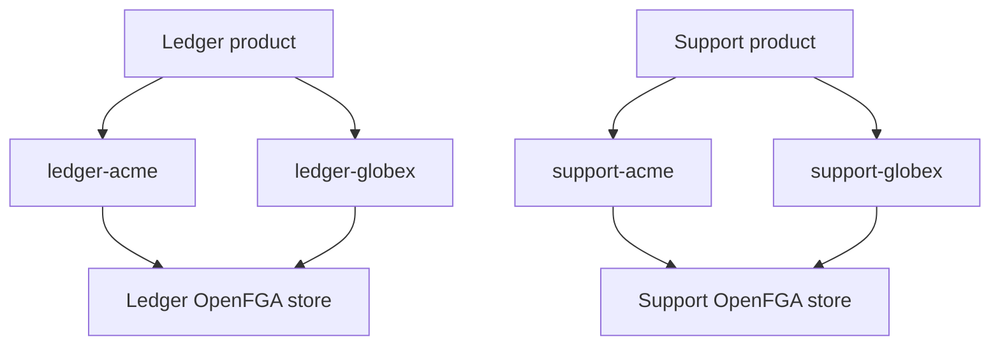

The product authenticates and authorizes workspace creation, then records a pending tenant, the intended owner and a unique operation ID.

```ts
const tenant = await tenants.ensurePending({
  operationId,
  name: 'Acme',
  initialOwner: actor.id,
})

await auth.provisioning.ensureOwner({
  tenantId: tenant.id,
  principal: actor,
})

await tenants.activate(tenant.id)
```

On retries, the product loads the recorded owner and verifies it matches the operation before invoking the SDK. Bootstrap access is restricted to the trusted provisioning workflow.

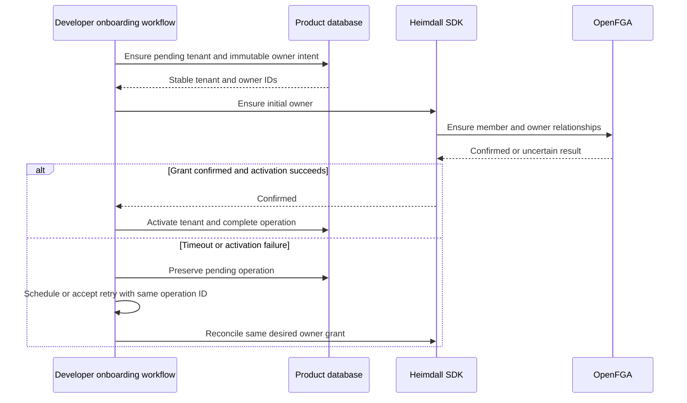

**Retry gap.** The product owns durable progress, locking and the retry runner. The SDK needs a precise `ensureOwner` reconciliation contract for already-existing tuples, partial writes and lost responses. Membership must precede activation. Concurrent cancellation and deletion need serialization. This workflow is a proposal that requires fault-injection tests.

## 5. Assign Maya different roles

| Product | Workspace | Maya's role |
| --- | --- | --- |
| Ledger | Acme | Approver |
| Ledger | Globex | Viewer |
| Support | Acme | Agent |
| Support | Globex | Admin |

```ts
await auth.tenant(tenant.id).addMember({
  actor: administrator,
  target: maya,
  role: 'approver',
})
```

`addMember` is a proposed convenience operation for establishing membership and an initial role. `assignRole` changes an existing member's roles. Both validate the acting administrator's delegation rights. Invitations bind acceptance to an authenticated identity and use the product's durable acceptance workflow. The SDK must prevent reactivation from restoring residual historical roles. See [[flows/membership]].

## 6. Discover and select workspaces

After login, the UI needs accessible workspaces with names and lifecycle status. OpenFGA owns memberships. The product database owns display information.

```ts
const memberships = await auth.listMemberships(actor, { cursor, limit })
const workspaces = await tenants.findActiveByIds(memberships.tenantIds)
```

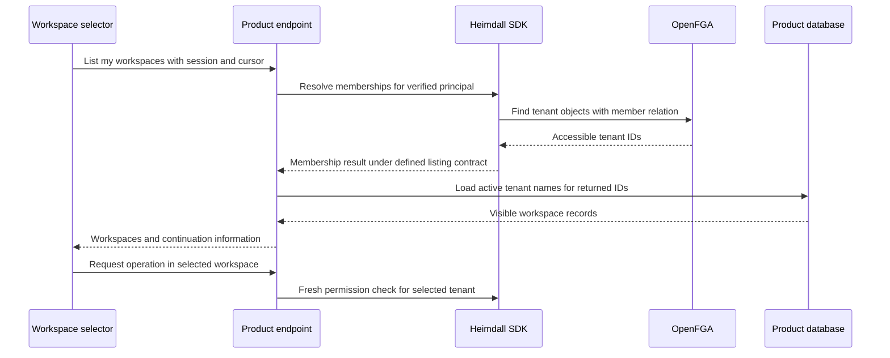

**Discovery gap.** Define pagination, ordering, result limits, and behavior when inactive or deleted tenants remove rows from a page. Native OpenFGA query limits and continuation support must be verified before committing to the cursor API shown above. The product may need to scan additional candidates to fill a page. Discovery is advisory for UI navigation. Protected operations always check current access.

**Simplification opportunity.** Provide one membership-listing SDK contract and a framework recipe that joins it with product tenant records. Tenant names remain owned by the product database.

## 7. Enforce each operation

```ts
const actor = await auth.authenticate(request)
const tenant = await tenants.requireActive(request.params.tenantId)
await auth.tenant(tenant.id).require(actor, 'invoice.approve')
await invoices.approve({
  tenantId: tenant.id,
  invoiceId: request.params.invoiceId,
})
```

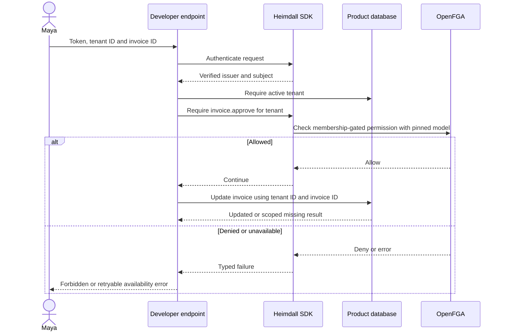

| Request | Expected outcome |
| --- | --- |
| Approve Acme Ledger invoice | Allow |
| Approve Globex Ledger invoice | Deny |
| Acme route with Globex invoice ID | Tenant-scoped operation finds no matching invoice |
| Reply to Acme Support ticket | Allow |
| Ledger-only token sent to Support | Reject audience |
| Valid identity without tenant membership | Deny |

Framework middleware can remove repeated authentication and tenant loading. The developer declares the permission and keeps tenant constraints in database queries. Checks and business commits have a race window described in [[operations]].

## 8. Configure SAML or OIDC for an enterprise tenant

ZITADEL supports identity providers scoped to an organization. Map an enterprise workspace to an organization and configure its upstream SAML or OIDC provider there. The SDK starts login with the organization's context using the reserved organization scope. The product continues to integrate with ZITADEL using OIDC. [ZITADEL identity providers](https://zitadel.com/docs/guides/integrate/identity-providers/introduction) · [Organization context](https://zitadel.com/docs/guides/manage/console/organizations-overview)

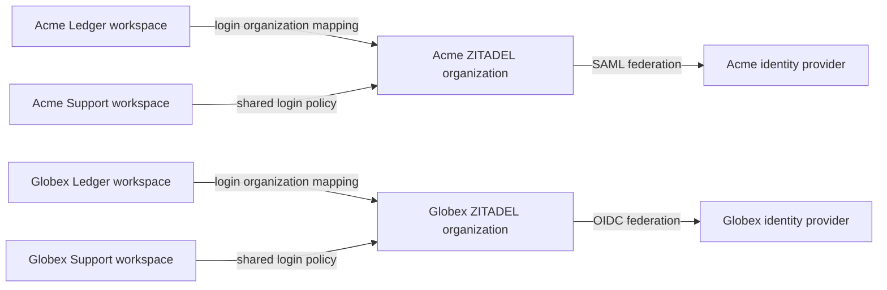

Sharing an organization across a customer's products shares its organization login configuration. Workspaces requiring independently managed login policies need separate organization contexts or another explicitly designed policy arrangement. Product memberships remain independently granted.

| Configuration | Developer or operator supplies | Proposed SDK helper does |
| --- | --- | --- |
| Tenant mapping | Verified tenant ID and selected organization ID | Resolve the mapping through a supplied product callback |
| OIDC provider | Issuer, client registration and secret | Validate inputs and configure organization provider |
| SAML provider | Customer metadata and required settings | Configure organization provider and return service-provider details |
| Activation | Authorized admin request and tested configuration | Activate provider and apply intended login settings |
| Login | Tenant slug or invitation context | Resolve trusted mapping and include organization context |

Setup also requires the customer's identity administrator to register the application and exchange redirect URLs or SAML metadata. Provider activation and external-login policy are part of configuration. [Generic OIDC setup](https://zitadel.com/docs/guides/integrate/identity-providers/generic-oidc) · [SAML setup example](https://zitadel.com/docs/guides/integrate/identity-providers/okta_saml)

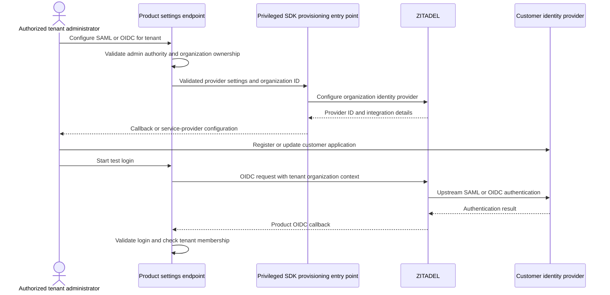

**SSO implementation gate.** [[enterprise-contract]] selects strict SSO defaults, account-linking constraints, explicit guest/fallback policy, tenant switching and session reuse criteria. Verify organization binding and authentication evidence against the chosen ZITADEL version before promising SSO-only access. OpenFGA membership alone cannot establish which upstream provider authenticated a session.

## 9. SCIM provisioning and deprovisioning

ZITADEL exposes SCIM under an organization-scoped endpoint such as `/scim/v2/{orgId}`. Its documented support covers user provisioning and lifecycle operations. The current guide lists the User schema as supported and Groups as unsupported. The API reference labels the interface Preview, so pin and verify the intended release before promising production compatibility. [SCIM guide](https://zitadel.com/docs/guides/manage/user/scim2) · [SCIM API](https://zitadel.com/docs/apis/scim2)

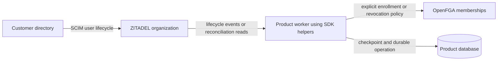

The customer administrator configures the endpoint and credential in their directory. An authorized operator configures the organization and the allowed provisioning scope. Organization creation and SCIM credential setup remain privileged operations.

Creating a directory user does not define which product workspaces or roles they should receive. The product must choose an explicit enrollment policy. Group-to-role synchronization would need another supported directory integration and a mapping contract because SCIM Groups are outside the documented support.

**Lifecycle gap.** SCIM requests go directly to ZITADEL. An SDK library needs execution in a product worker or scheduled job to propagate changes into OpenFGA. The proposed reconciler persists checkpoints, retries idempotently, and maps organization changes only to the affected product tenants. This can use existing product infrastructure. A product that has no worker needs an execution mechanism before automatic synchronization can be promised.

Deactivation must cover identity/session behavior and product membership revocation. Already-issued JWTs can remain locally valid until expiry. Removing membership blocks new membership-gated permission decisions once the deletion is visible. Reconcile grants on reactivation explicitly. Test the interval from SCIM deactivation to effective denial, event replay, and partial failure across Ledger and Support.

## 10. SIEM integration

ZITADEL offers audit data through its Events API and documents external SIEM integration patterns. The operator selects an event collector or existing logging integration and configures credentials, retention and delivery. [ZITADEL audit export](https://zitadel.com/docs/guides/integrate/external-audit-log)

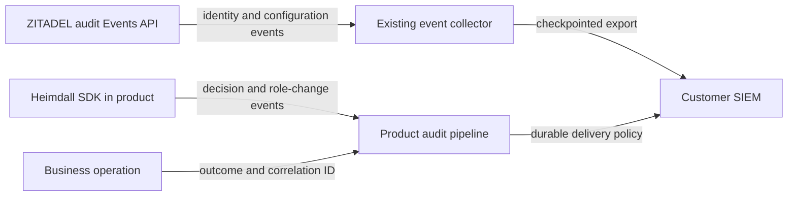

The required SDK audit adapter durably records and exports product, tenant, actor, permission, target, result, model ID and correlation ID. The product adds the actual business-operation outcome. The operator connects these events to their SIEM using existing collectors or sinks. Identity events need explicit organization-to-product mappings for correlation and tenant-scoped export.

**Audit implementation gate.** [[audit-contract]] defines event schemas, retention, filtering, replay and mandatory durable delivery behavior. SDK callbacks alone cannot satisfy this contract. A service API access log alone may lack the actor and business outcome needed for investigation. Verify coverage of direct service changes as well as SDK-mediated writes. Credentials and raw tokens must be excluded from exported events.

## Integration gaps to close next

| Gap | Next design output | Acceptance scenario |
| --- | --- | --- |
| Sessions | First framework adapter and session-store contract | Two backend replicas handle callback, refresh and logout safely |
| Workspace discovery | Query strategy and pagination contract | User has many workspaces, some inactive, with no skipped accessible rows |
| Onboarding retries | Durable operation schema and reconciliation contract | Lost remote response stays pending/blocked until safe recovery; confirmed write with failed local activation recovers without duplicate creation |
| SCIM lifecycle | Product execution mechanism and checkpointed reconciliation | Deactivation revokes intended memberships in both products despite a transient failure |
| SIEM | Correlated event schema and delivery policy | Identity event, access decision and business outcome can be traced without cross-tenant disclosure |
| Enterprise SSO | Organization mapping and enforcement contract | Acme SAML and Globex OIDC work independently, tenant switching respects login policy |

The resulting developer integration consists of a manifest, generated configuration and credentials, auth routes, tenant and membership workflows, and protected operations. Follow [[decisions]] for defaults awaiting agreement and [[scenarios]] for the broader dry-run set.
