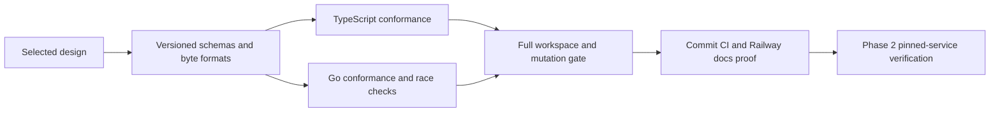

**Phase 1 complete.** This phase covers executable language-neutral contracts. It does not claim deployed authentication, database adapters or enterprise integrations.

## Requirement-by-requirement evidence

| Phase 1 requirement | Authoritative implementation and tests |
| --- | --- |
| Exact identity encoding and malformed Unicode rejection | identity v1 vectors; native TS/Go invalid-Unicode cases; [[phase-1-progress]] |
| Stable errors, deny vs failure, cancellation and uncertain mutation | error schema/code corpus, transport fixtures, AbortSignal/context tests; [[phase-1-errors-schemas]] |
| Product/environment/client/model/manifest configuration | config and manifest schemas, cross-reference and delegation fixtures; [[phase-1-manifests]] |
| Endpoint parsing and explicit local HTTP | endpoints-v1 fixtures in both languages; matched client/runtime transport profiles; secure default and remote HTTP rejection |
| Immutable workspace IDs and lifecycle denial | workspace-record schema and all lifecycle/block combinations; [[phase-1-login-workspaces]] |
| Session expiry, identity freshness and policy binding | session-payload and session-v1 fixtures; [[phase-1-session-cursor]] |
| Browser-bound single-use login contract | login-payload and login-v1 expiry/replay/scope/policy fixtures; [[phase-1-login-workspaces]] |
| Discovery cursor identity/scope/expiry | cursor-payload and cursor-v1 fixtures; signed envelope verification |
| Portable encrypted records, signed cursors and key rotation sets | reference and actual TS/Go writer vectors, tamper tests and envelope limits; [[phase-1-crypto]] |
| Immutable intents, scoped idempotency and conservative retry states | intent/journal schemas, digest vectors and state matrix; [[phase-1-operations]] |
| Mandatory audit envelopes, custom namespaces and receipts | audit schemas, reserved/custom event vectors, fingerprint and receipt binding; [[phase-1-audit]], [[phase-1-audit-receipts]] |
| Migration checksum and reader/writer compatibility | metadata schema, bridge-upgrade matrix, checksum/range failures; [[phase-1-storage]] |
| Both runners detect changed expected results | Temporarily changed the first identity expected ID; targeted Vitest and Go tests both failed; restored original bytes before full checks |
| Workspace feedback and builds | 765 Vitest tests, Go race tests, formatting, Oxlint, TypeScript, Knip, Go vet, Rolldown/declarations and Quartz passed |

The endpoint fixtures include malformed ports/IPs, numeric-host alternatives, IDN configuration, Unicode paths, dot segments, encoded separators, wrong profiles and explicit local callbacks. No dependencies were added in this final checkpoint.

## Phase boundary and compatibility rules

Versioned schemas and contracts/README.md define the byte formats and interpretation. Unknown schema versions fail, optional extensions require a versioned compatibility decision, and deployed migration history cannot be rewritten. Fixture changes must update both runners and documented semantics together; a passing suite is not permission to weaken selected behavior.

The public SDK entry points intentionally remain empty. Internal helpers require the documented schema/decryption/trusted-context preconditions. Phase 3 will compose them with actual SQL and identity validation; Phase 4 will expose working integrations. Shared persistence schemas describe payloads/metadata, while physical DDL, indexes, constraints and transactional conformance are Phase 3 deliverables.

No wrapper service is introduced. Required SSO, SCIM, SIEM, all-decision durable audit, managed uncertainty quarantine and both-language parity remain unchanged. Real service claims, recovery controls, refresh/logout races, durable commits, live migrations and delivery replay are later phase acceptance requirements, not missing evidence concealed by this contract milestone.

## Deployment proof

Source commit b6790c2d9d5e32e0bdd142f4ce13ecdc374b55fd passed GitHub Actions run 42905076577, including frozen dependency installation and the complete workspace gate. Railway docs deployment 8f349e9a-8afd-4da4-8f72-f10e0a5908f7 reached SUCCESS. The public acceptance page returned HTTP 200 with the 765-test result, requirement matrix and Mermaid source. Phase 1 contract acceptance is complete; Phase 2 pinned-service verification is next. This deployment serves documentation, not an authentication runtime.
