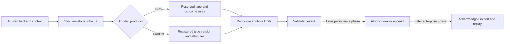

**Partial progress; Phase 1 remains open.** Both SDKs validate shared audit event semantics after structural validation. Receipt schemas describe wire formats; persistence and export are not implemented.

## Verified behavior

Shared fixtures exercise reserved event types/outcomes, required correlation and scope, unknown actors on early failures, and system actors for scheduled work. Product events require registered product.* types/versions and validated attributes; they cannot impersonate reserved security types.

Recursive checks reject known sensitive fields, metadata spoofing, invalid numeric/string bounds, excessive depth, container counts and structural weight. They cannot detect secrets concealed in arbitrary values. Backend construction must supply verified actor and scope metadata.

The full workspace gate passed with 473 Vitest tests, Go conformance tests with the race detector, lint/types/static checks, SDK build/declarations and Quartz.

## Data flow

## Remaining evidence

Receipt digest canonicalization and atomic idempotent append remain pending. A JSON receipt is not proof of a database commit. Durable audit gating, crash recovery, backlog controls and SIEM delivery need live evidence in their implementation phases. Custom schema loading and actor verification are not provided by these validators.

## Deployment proof

Pending verification for this checkpoint.
