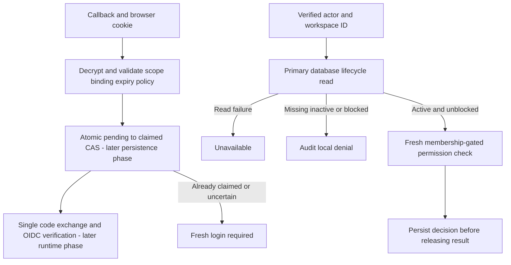

**Partial progress; Phase 1 remains open.** Shared login/workspace schemas and internal TS/Go validators now cover callback preconditions and managed lifecycle decisions.

## Verified behavior

Login fixtures cover every bound scope field, browser-cookie digest mismatch, exact expiry, lifetime bounds, invalid timestamps, claimed replay, and tenant policy changes including addition/removal. The login record binds issuer/client, configured callback/return destination and tenant policy without accepting an organization ID as browser authority.

Workspace fixtures cover all four lifecycle states with both mutation-block values, missing records, corrupt scope and backward timestamps. Only active/unblocked produces check_relationships; no local state produces an allow. Database errors must remain unavailable instead of becoming absent/deny.

The full gate passes with 642 Vitest tests, shared Go race tests, lint/format/type/static checks, SDK build/declarations and Quartz. No dependencies were added.

## Limits and remaining proof

No callback endpoint, durable claim, token exchange or database lifecycle transition is implemented here. Cryptographic envelope tests exist separately; these schema/semantic fixtures do not prove cookie generation, nonce validation, SSO evidence or storage atomicity. Managed checks still require the complete audited authorization path. In-flight authorized work may finish after suspension, as specified in the selected design.

## Deployment proof

Pending verification for this checkpoint.
