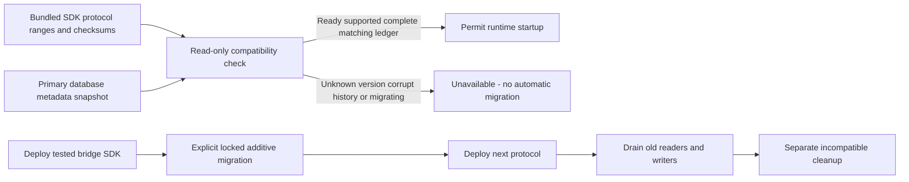

**Partial progress; Phase 1 remains open.** TS and Go now enforce the same metadata, migration history and reader/writer compatibility rules through internal read-only helpers.

## Verified behavior

Shared fixtures cover current schema, bridge SDK before/after an additive migration, new reader/writer protocol before/after migration, unsupported future/old schemas, removed reader or writer compatibility, migrating state, reversed ranges, missing/extra/duplicate/skipped ledger entries, changed checksums and invalid bundled policy.

Both languages consume the same metadata schema and semantic fixtures. The full workspace gate passes with 706 Vitest tests, Go race tests, formatting/lint/type/static checks, SDK build/declarations and Quartz. No dependencies were added.

## Remaining proof

The fixtures contain synthetic checksums and do not constitute SQL migrations. No database lock, DDL, backup restoration or live rolling upgrade has been executed here. Metadata is not an integrity boundary against a database administrator. Startup checks cannot fence processes already running; deployment coordination remains mandatory.

## Deployment proof

Source commit d24a2b11cf75c5656f2e3de51c56b5fc7780a5a0 passed GitHub Actions run 42903933907. Railway docs deployment 97e21687-11c3-4b09-aeb2-06d2926930c6 reached SUCCESS. The public evidence page returned HTTP 200 with the expected 706-test result and Mermaid flow source. This is a documentation deployment, not live migration evidence.
