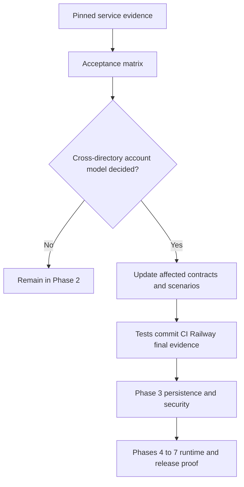

**Phase 2 is not complete.** This audit consolidates the accumulated service evidence and identifies the remaining decision. It does not advance to Phase 3 or claim working SDKs. Historical checkpoint pages retain the limitations that applied when each probe ran; the matrix below links later evidence that supersedes some of those open items.

## Service acceptance matrix

| Requirement | Evidence inspected | Result and boundary |
| --- | --- | --- |
| Supported service pins and datastore settings | deploy/verification/versions.json; [[phase-2-openfga]], [[phase-2-zitadel]] | Exact image digests recorded; PostgreSQL 17.11, OpenFGA 1.22.0, ZITADEL API/Login 4.19.4. Keycloak is a test fixture, not a runtime dependency. Test transport/privileges are not a production hardening claim. |
| Reproducible local or externally supplied environment | deploy/verification/README.md, zitadel.md, enterprise-idp.md, recovery.md; [[phase-2-openfga-limits]] | Fresh local OpenFGA/PostgreSQL reproduction passed. External Railway enterprise setup and protected probe inputs are documented and exercised. A fresh local enterprise stack is not claimed or required by #32's externally supplied environment option. |
| Two products and four workspaces | [[phase-2-openfga]], [[phase-2-oidc]] | Two OpenFGA stores/four workspace objects and two ZITADEL product clients exercised. Cross-product tokens are inactive at the other client. These are service probes, not the later two-product SDK walkthrough. |
| Signing and identity validation | [[phase-2-oidc]], [[phase-2-self-service-evidence]] | Code/PKCE, issuer/subject/audience/nonce, unknown key and wrong-signature rejection, authoritative identity and own-session reads verified. SDK cache/rotation/outage behavior remains Phase 3/4/7 work. |
| Credential boundaries | [[phase-2-openfga]], [[phase-2-scim-credentials]], [[phase-2-federation-credentials]], [[phase-2-lifecycle-events]] | OpenFGA key and event viewer are deployment/instance-wide. SCIM user role is organization-scoped; federation session role is instance-scoped. This matches the trusted backend operator boundary, not hostile product-owner isolation. |
| Listing and consistency | [[phase-2-openfga-limits]] | ListObjects truncates at 1000 without continuation; stable scoped Read retrieved all 1001 tuples; 101-tuple write rejected without partial writes. Higher-consistency membership revocation denies. Candidate indexes and concurrent rebuilds are later SDK work. |
| Uncertain-write recovery controls | [[phase-2-openfga-recovery]], [[phase-2-railway-recovery]] | Lost committed response and blocked database write tested. Stop/remove, database drain, sole credential retirement and reconciliation verified for the single-replica trusted topology. SDK quarantine/journal/generation enforcement remains Phase 3/5/7. |
| SCIM lifecycle and state visibility | [[phase-2-scim]], [[phase-2-scim-credentials]], [[phase-2-oidc]] | Users create/disable/repeated-disable/reactivate/delete, domain behavior and cross-org denial verified. Identity/token observations cover disable/delete. SDK freshness and local-deny propagation still require implementation. Groups remain excluded. |
| SAML/OIDC provenance and browser binding | [[phase-2-federation-binding]], [[phase-2-browser-federation]], [[phase-2-enterprise-contract]] | Real providers, selected intent/user binding, session-to-token sid/auth_time, expiry and replay rejection verified; browser callback binding tested. Shared TS/Go fixtures reject password-only, changed-policy, wrong-tenant and prior-account evidence. Durable runtime strict-policy enforcement is Phase 4/6. |
| Cross-directory account topology | [[phase-2-provider-organization]], [[phase-2-two-tenant-federation]] | **Decision pending.** Organization-scoped providers cannot link to users owned by another organization. Separate tenant-owned accounts work with one product client, but adopting that v1 account model requires the user's decision. Stable identity linking is not implicitly approved. |
| Upstream event collection capability | [[phase-2-lifecycle-events]] | Scoped reads, per-aggregate replay, aggregate-local sequences, time-window discovery, saturated-boundary refusal and actual SQL writer-drain behavior verified. Never use one global sequence. Durable ingestion, retention-gap handling, export receipts and full moving-checkpoint concurrency tests belong to Phase 3/6/7. |
| Assumptions disproved by services | Evidence above and [[design/enterprise-contract]], [[design/release-contract]] | Explicitly recorded: session deletion does not revoke refresh; ListObjects is incomplete; credentials have broader scope; session factors omit provider identity; upstream expiry overrides fallback; event sequences are local; database time precision matters. Cross-directory account choice remains unresolved. |

## What blocks advancement

The account model is the remaining explicit product decision: use separate tenant-owned accounts for independently administered directories, or extend the design with a verified identity-linking model. This choice affects principal identity, sessions, memberships, SSO setup and account switching. Matching email is not authorization to merge accounts. No alias table or silent identity carryover may be implemented as a workaround.

Once the decision is recorded, review its impact on the contracts and acceptance scenarios, run the affected checks, and publish a final Phase 2 completion record with exact commit, CI and Railway evidence. This audit itself is not that completion record.

## Later-phase obligations remain mandatory

A service capability probe cannot certify database CAS, durable audit, SDK HTTP cookies, refresh races, tenant switching, ownership transfer, worker scheduling, or SIEM receipt recovery. Those are explicit deliverables of Phases 3–7, not reasons to keep expanding the service spike into a full SDK implementation. They remain first-release gates and cannot be removed to close this phase.

The most recent service proof is event-visibility run 16aece51-3eda-48e4-a976-ad799e5ea3d8, committed in e38ea793ad2f5e21b4b4b4656907f030387762bb. CI runs 42931790582 and 42931780015 passed; Railway docs deployment 56c2f35a-e9b8-49ae-b3b3-9a2e28006fdd succeeded and the correction was verified publicly. Individual evidence pages and tests/integration/evidence/ retain the earlier source/run/deployment records.
