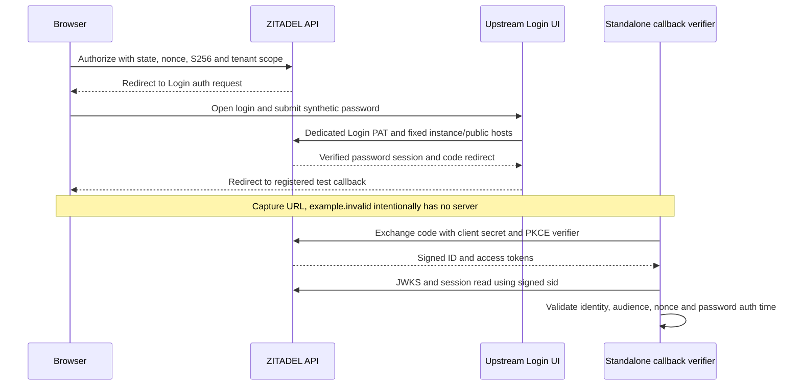

Phase 2 remains open. A real browser completed password login through the pinned ZITADEL Login UI on Railway. A standalone probe verified the resulting callback and tokens. This closes the basic browser-path gap; it does not certify SDK sessions or enterprise browser federation.

## Deployment correction

The first valid authorization request reached the Login UI but returned an internal server error. Service logs identified an instance lookup using the Login hostname instead of the API hostname. Startup credential validation and earlier API-only probes had passed despite this problem.

The verification instance now trusts the exact Login hostname. Its Login service sets fixed outbound `x-zitadel-instance-host` and `x-zitadel-public-host` through CUSTOM_REQUEST_HEADERS, using the API and Login hosts respectively. Pinned upstream code applies these overrides after inferred request headers. This is a single-instance deployment recipe, not a multi-instance routing mechanism or a new Heimdall service.

Login deployment 9bd972a7-d76d-45eb-b6dd-cb4aeefc4a49 succeeded using the existing pinned 4.19.4 image. The API deployment remained 618677e2-8c80-4453-b984-ec56cc00a53e. Exact configuration and reproduction steps are in deploy/verification/zitadel.md.

## Observed result

Run 746acba1-80d2-460b-89fd-91689cd64f72 used one disposable product client and human account. The browser reached the registered callback with code and matching state; the expected DNS failure occurred only at the deliberately nonexistent test callback. The code was exchanged successfully.

- Signature, issuer, subject, client/project audiences and nonce matched.
- The signed sid resolved to the same user and organization through the session API.
- Signed auth_time matched the password factor verification time, rounded down to seconds.
- The password factor was present, enterprise intent absent, and ID-token amr was `["pwd"]`.
- Owned sessions and organization were deleted; the protected local fixture file was removed.

Sanitized results are in tests/integration/evidence/browser-oidc-2026-11-11.json. The test helper is tests/integration/browser-oidc.mjs. Credentials, authorization codes and tokens are excluded from committed evidence.

## Limits and remaining gates

This is interactive browser verification with a separate callback verifier. It does not exercise a running product callback, cookie security, atomic durable session creation, enterprise browser SAML/OIDC, cross-account switching or SDK audit. Password authentication is not evidence of satisfying a strict enterprise policy. The separate-domain headers also require a broader routing/security review before production qualification.

Sources: [upstream Login deployment guidance](https://zitadel.com/docs/guides/integrate/login-ui/login-app), [pinned header interceptor](https://github.com/zitadel/zitadel/blob/v4.19.4/apps/login/src/lib/zitadel.ts), [pinned trusted-domain API](https://github.com/zitadel/zitadel/blob/v4.19.4/proto/zitadel/instance/v2/instance_service.proto).

## Publication proof

Source commit 432581670bf1abc9d0137b42d88bafeed529c516 passed the full local workspace gate: 863 TypeScript tests, Go race tests, formatting/lint/type/Knip checks, SDK build and 52 Quartz pages. GitHub Actions runs [42925142409](https://github.com/techsavvyash/heimdall/actions/runs/42925142409) and [42925150780](https://github.com/techsavvyash/heimdall/actions/runs/42925150780) both succeeded. Railway docs deployment f1cf1479-c64a-43c8-b2a5-5601d26fd2f3 succeeded for that exact commit; the public evidence URL returned HTTP 200 with this run and Login deployment ID. This later publication note does not change the tested probe.
