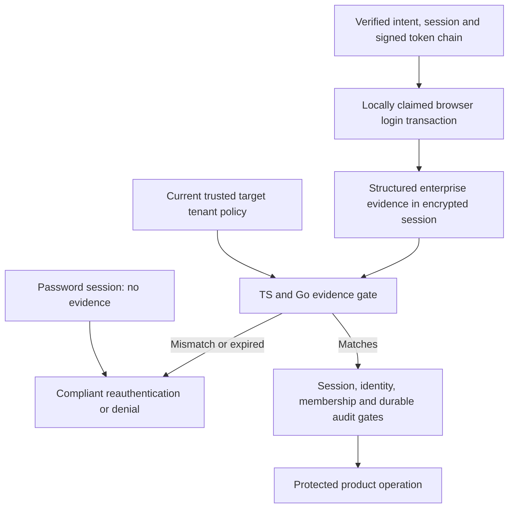

Phase 2 remains open. Live federation probes established the provider-intent/session/token chain; this amendment makes its eventual persisted representation explicit in both SDKs. It is an internal contract implementation, not live strict-SSO enforcement.

## Contract and boundaries

The session schema now accepts structured enterpriseEvidence. Required fields bind product/environment, issuer/subject, client, tenant, organization, current policy version, provider ID/protocol, upstream subject, provider session ID and authentication/verification timestamps. Raw assertions and intent credentials are excluded. A password session has no evidence and fails the strict policy gate.

Both languages compare evidence against the trusted target policy and identity. Exact age expiry, changed tenant/provider/protocol/policy, product/client/issuer/subject mismatch and absent evidence reject. Signed auth_time is converted to milliseconds and must equal the intent timestamp rounded down to seconds, matching the pinned live probes. Policy age is explicit; it does not extend session expiry or replace identity freshness. Token refresh cannot renew enterprise authentication time.

Strict pending login records additionally require selected provider ID and protocol. Callback preconditions compare them to current trusted policy so configuration changes cannot silently retarget a pending login.

This revises unreleased contract v1. It is not a rolling-compatible extension for old strict readers: old readers reject the new session field, and new readers reject strict pending logins without provider selection. No persistent runtime has shipped. Storage version compatibility must reflect the finalized format before runtime rollout; stripping evidence is forbidden.

## Verification and remaining work

Shared schema and semantic fixtures exercise both languages. Deliberately removing the tenant comparison in each implementation causes its wrong-tenantId fixture to fail; source was restored afterward. This proves those negative tests detect an actual missing boundary check.

Provider/API verification, browser callback claim and atomic persistence remain separate requirements. The helper accepts already authenticated, schema-validated evidence; it cannot prove its origin. Live strict tenant switching, browser UI acceptance, credential minimization, expiry and recovery/quiescence remain Phase 2 work. No advancement to Phase 3 follows from this checkpoint.

The full local workspace gate passed: 841 Vitest tests, Go race tests, formatting, Oxlint, TypeScript, Knip, Go vet, Rolldown/declarations and Quartz. Both deliberate missing-tenant mutations failed the intended fixture, and restored implementations passed the full gate. Publication proof is recorded after the source deployment is verified.
