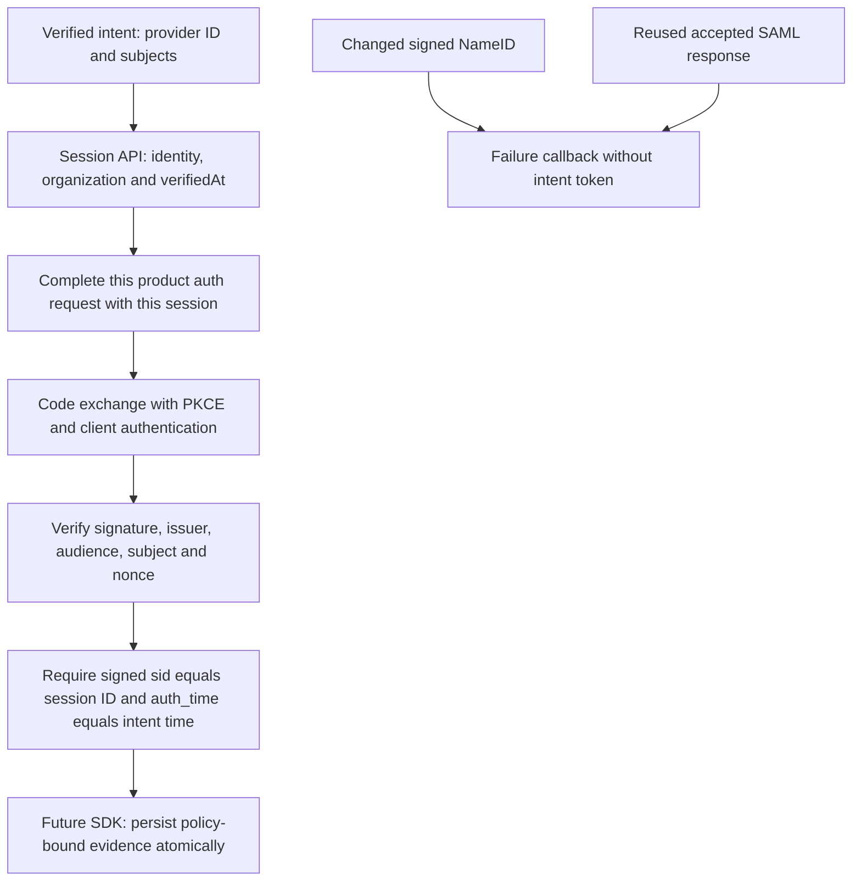

**Phase 2 remains open.** Both upstream SAML and OIDC now complete a downstream product OIDC code flow using the verified federated session. SAML tamper and response-replay checks also pass. Strict policy switching and SDK persistence remain unimplemented.

## Executed checks

The shared tests/integration/federation.mjs probe ran against ZITADEL deployment 618677e2-8c80-4453-b984-ec56cc00a53e and fixture deployment 9016caf9-0be2-4536-b763-82e427aee46a.

| Evidence | Run |
| --- | --- |
| SAML tamper, replay and downstream binding | 994aa152-fa33-47fd-8ec8-215345fd7e11; federation-saml-binding-2026-11-11.json |
| OIDC downstream binding | 9b7e4368-b0a2-4c1f-aad2-818fdc8ab4c7; federation-oidc-binding-2026-11-11.json |

For the tamper test, a fresh signed assertion's NameID was replaced with another value without recomputing signatures. The probe asserted that the XML actually changed before submitting it. ZITADEL redirected to the failure callback without returning an intent token. A separate untouched flow succeeded. After its intent had been verified and used, posting that accepted SAML response again returned HTTP 302 to the failure callback, with no intent token. These are targeted tamper/replay cases, not an exhaustive SAML security audit.

For each valid federation flow, the probe then created a confidential product client, issued an organization-scoped OIDC request with fresh state, nonce and S256, completed that request with the verified session, and exchanged the code. It verified the ID/access token signatures, issuer, subject, intended audiences and time checks, plus the ID token nonce.

The signed ID token's sid equaled the exact provider session ID. Its auth_time equaled the intent-verification timestamp rounded down to seconds. Both equality checks are explicit assertions. Neither federated token contained an amr claim in these runs; absence of pwd is not itself provider evidence.

Only the configured issuer is followed through downstream redirects. Product callback URLs use example.invalid and are captured without network requests to them. Tokens, session credentials, assertion XML and intent credentials stay in memory. Owned sessions, organizations and fixture realms were deleted after each run.

## Integration consequence

There is now live evidence for a chain from verified provider intent to signed product identity: selected provider and subjects, verified session identity/organization, explicit request/session completion, verified downstream token and matching sid/auth_time. A trusted organization hint, account link or amr alone cannot replace this chain.

The eventual SDK must additionally bind that chain to its browser login transaction, fixed product/environment, resolved workspace mapping and current policy version. Callback consumption and evidence persistence must be atomic; retries, stale policy, wrong target tenant, lost responses and session reuse must fail safely. The probe does not implement or prove those SDK behaviors. It uses the dedicated Login client credential inside the test process, which is a separate privileged capability from normal product client authentication.

**Contract refinement required before Phase 3:** the current session-payload schema stores policyVersion but has no structured field for the verified provider/session evidence established here. The earlier executable-contract phase therefore needs a reviewed schema/fixture amendment and renewed TS/Go conformance proof before strict enterprise evidence is persisted. Do not hide that evidence in an unvalidated metadata map or mark strict SSO implemented on the strength of this probe.

## Remaining acceptance work

Strict target-tenant switching, existing password-session rejection, policy-version invalidation, browser login binding, intent credential replay/expiry semantics, credential minimization, certificate rotation, alternate SAML bindings and SDK atomic persistence remain open. Recovery/quiescence and other Phase 2 service limits also remain open. No phase advancement or release certification follows from this checkpoint.

Sources: [pinned OIDC token construction](https://github.com/zitadel/zitadel/blob/v4.19.4/internal/api/oidc/token.go), [session factors](https://github.com/zitadel/zitadel/blob/v4.19.4/proto/zitadel/session/v2/session.proto), [SAML response validation](https://github.com/zitadel/zitadel/blob/v4.19.4/internal/idp/providers/saml/session.go).

## Validation and publication

The full workspace gate passed: 765 Vitest tests, Go race tests, formatting/lint/types/Knip/vet, SDK build/declarations and Quartz. Source commit 84ec7033653879ffe195b543814e2510f7877c7f passed GitHub Actions runs 42916839153 and 42916821843. Railway docs deployment 245ac81a-2f22-4c42-ad97-62543ae7e413 reached SUCCESS and remained running. The public evidence page returned HTTP 200 with the current probe ID, required contract-refinement gate and Mermaid source. Phase 2 remains open.
