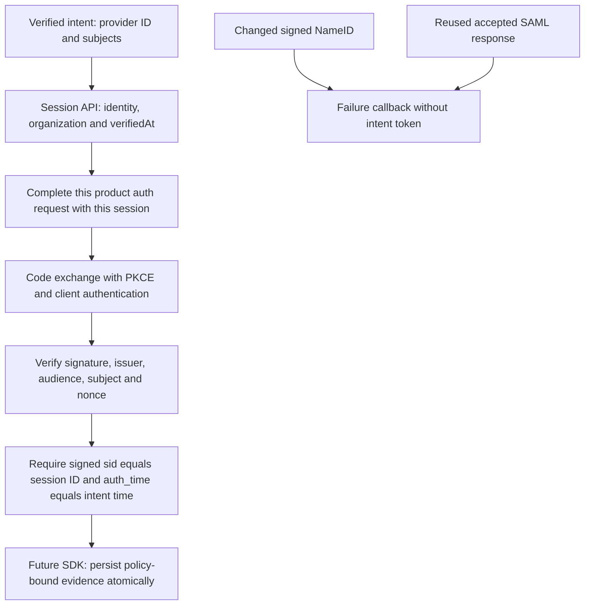
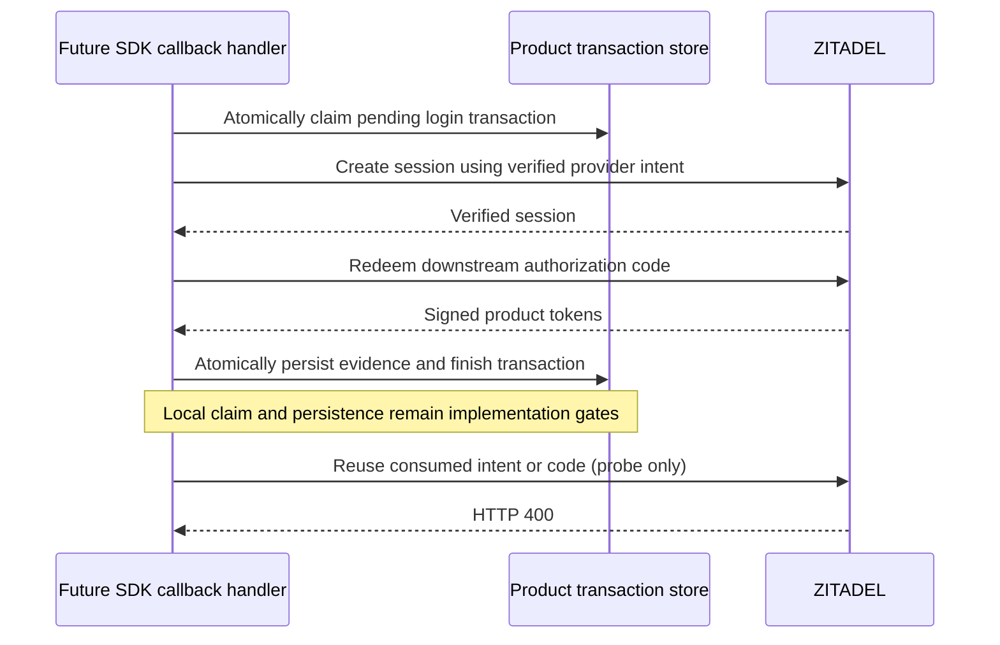
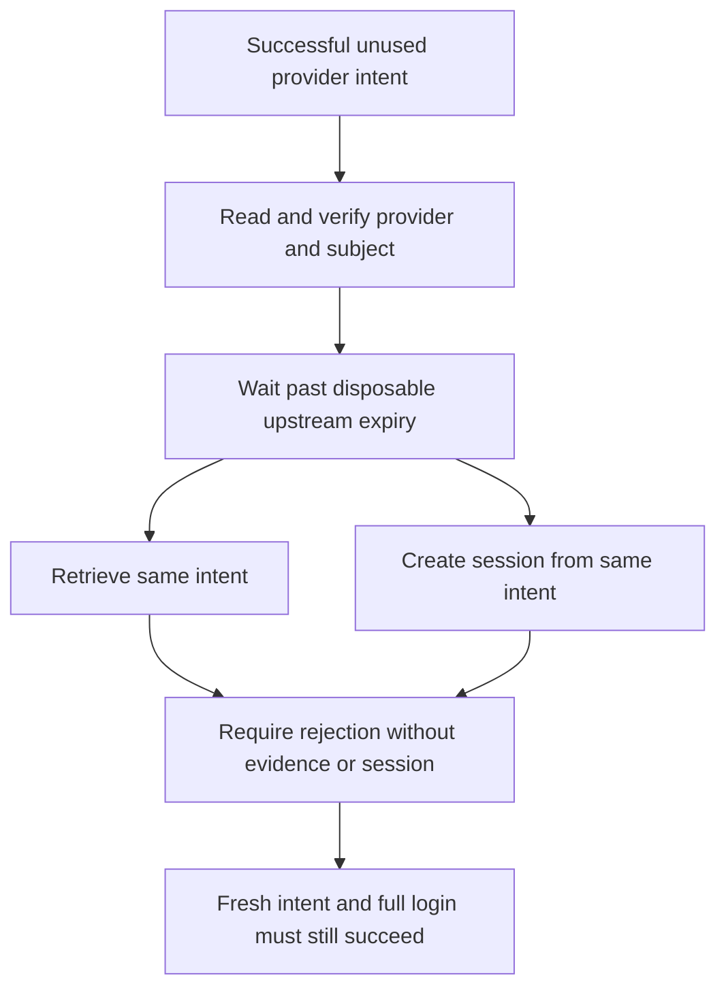

**Phase 2 remains open.** Both upstream SAML and OIDC now complete a downstream product OIDC code flow using the verified federated session. SAML tamper and response-replay checks also pass. Strict policy switching and SDK persistence remain unimplemented.

## Executed checks

The shared tests/integration/federation.mjs probe ran against ZITADEL deployment 618677e2-8c80-4453-b984-ec56cc00a53e and fixture deployment 9016caf9-0be2-4536-b763-82e427aee46a.

| Evidence | Run |
| --- | --- |
| SAML tamper, replay and downstream binding | 994aa152-fa33-47fd-8ec8-215345fd7e11; federation-saml-binding-2026-11-11.json |
| OIDC downstream binding | 9b7e4368-b0a2-4c1f-aad2-818fdc8ab4c7; federation-oidc-binding-2026-11-11.json |

For the tamper test, a fresh signed assertion's NameID was replaced with another value without recomputing signatures. The probe asserted that the XML actually changed before submitting it. ZITADEL redirected to the failure callback without returning an intent token. A separate untouched flow succeeded. After its intent had been verified and used, posting that accepted SAML response again returned HTTP 302 to the failure callback, with no intent token. These are targeted tamper/replay cases, not an exhaustive SAML security audit.

For each valid federation flow, the probe then created a confidential product client, issued an organization-scoped OIDC request with fresh state, nonce and S256, completed that request with the verified session, and exchanged the code. It verified the ID/access token signatures, issuer, subject, intended audiences and time checks, plus the ID token nonce.

The signed ID token's sid equaled the exact provider session ID. Its auth_time equaled the intent-verification timestamp rounded down to seconds. Both equality checks are explicit assertions. Neither federated token contained an amr claim in these runs; absence of pwd is not itself provider evidence.

Only the configured issuer is followed through downstream redirects. Product callback URLs use example.invalid and are captured without network requests to them. Tokens, session credentials, assertion XML and intent credentials stay in memory. Owned sessions, organizations and fixture realms were deleted after each run.

## Integration consequence

There is now live evidence for a chain from verified provider intent to signed product identity: selected provider and subjects, verified session identity/organization, explicit request/session completion, verified downstream token and matching sid/auth_time. A trusted organization hint, account link or amr alone cannot replace this chain.

The eventual SDK must additionally bind that chain to its browser login transaction, fixed product/environment, resolved workspace mapping and current policy version. Callback consumption and evidence persistence must be atomic; retries, stale policy, wrong target tenant, lost responses and session reuse must fail safely. The probe does not implement or prove those SDK behaviors. It uses the dedicated Login client credential inside the test process, which is a separate privileged capability from normal product client authentication.

**Contract refinement required before Phase 3:** the current session-payload schema stores policyVersion but has no structured field for the verified provider/session evidence established here. The earlier executable-contract phase therefore needs a reviewed schema/fixture amendment and renewed TS/Go conformance proof before strict enterprise evidence is persisted. Do not hide that evidence in an unvalidated metadata map or mark strict SSO implemented on the strength of this probe.

## Remaining acceptance work

Strict target-tenant switching, existing password-session rejection, policy-version invalidation, browser login binding, intent expiry semantics, credential minimization, certificate rotation, alternate SAML bindings and SDK atomic persistence remain open. Recovery/quiescence and other Phase 2 service limits also remain open. No phase advancement or release certification follows from this checkpoint.

Sources: [pinned OIDC token construction](https://github.com/zitadel/zitadel/blob/v4.19.4/internal/api/oidc/token.go), [session factors](https://github.com/zitadel/zitadel/blob/v4.19.4/proto/zitadel/session/v2/session.proto), [SAML response validation](https://github.com/zitadel/zitadel/blob/v4.19.4/internal/idp/providers/saml/session.go).

## Validation and publication

The full workspace gate passed: 765 Vitest tests, Go race tests, formatting/lint/types/Knip/vet, SDK build/declarations and Quartz. Source commit 84ec7033653879ffe195b543814e2510f7877c7f passed GitHub Actions runs 42916839153 and 42916821843. Railway docs deployment 245ac81a-2f22-4c42-ad97-62543ae7e413 reached SUCCESS and remained running. The public evidence page returned HTTP 200 with the current probe ID, required contract-refinement gate and Mermaid source. Phase 2 remains open.

## Verified-intent and code reuse follow-up

A further run used the same verified provider intent and token to attempt a second session creation after the first had succeeded. Both protocols rejected that attempt with HTTP 400. Repeating the exact downstream code redemption also returned HTTP 400 with invalid_request. The probe now requires intent reuse rejection and rejects any successful code replay; it permits either invalid_request or invalid_grant as the code failure category.

| Protocol | Run | Sanitized evidence |
| --- | --- | --- |
| SAML | 50042ecc-b085-483a-9629-86f7d214098a | federation-saml-reuse-2026-11-11.json |
| OIDC | 2e61948a-6477-4b91-a45a-c6e9e476be7f | federation-oidc-reuse-2026-11-11.json |

These runs used the same pinned deployments listed above and deleted their owned sessions, organizations and fixture realms. They establish sequential consumed-intent and code replay rejection for this configuration, not concurrent SDK callback safety or intent expiry. The SDK still needs an atomic local transaction claim: an upstream request can succeed while its response is lost, and an already-created provider session can exist independently of the local completion record. Upstream replay rejection must not cause retries to invent successful local evidence.

Follow-up validation: the full workspace gate passed again (765 Vitest tests and Go race tests, plus checks/builds). Source commit f6f476cea5c94f2882e990db69637e21ab7f90e5 passed GitHub Actions runs 42917964338 and 42917954200. Railway docs deployment 1c98ef9a-c20f-4b18-b21a-6e309fc6446a reached SUCCESS. The public page returned HTTP 200 with both new probe IDs, the follow-up section and Mermaid source. Phase 2 remains open.

The required schema/fixture amendment is now recorded in [[phase-2-enterprise-contract]] with renewed TS/Go conformance and publication proof. This closes the representation gap identified above; live browser/strict-policy enforcement and atomic persistence remain separate gates.

## Intent expiry and upstream lifetime precedence

The expiry probe first retrieves a successful, unused intent and verifies its provider/user. It then waits beyond a short lifetime configured only on the disposable Keycloak realm and tries both retrieval and session creation with the same intent credentials. A new intent subsequently runs the full successful federation chain as a positive control. This distinguishes expiry rejection from a generally broken provider or credential.

An initial run, 44436377-5f8a-4ec0-8860-08b296b6b778, shortened ZITADEL's MaxIdPIntentLifetime to 20 seconds and left the upstream lifetime unchanged. Retrieval still succeeded after 22 seconds, causing the probe to fail. The pinned IDPIntentWriteModel explains why: when the upstream provides an expiry, that value is used directly; the configured maximum is a fallback only when upstream expiry is absent. The test stopped before attempting session creation in this initial run and cleaned up its resources. It does not prove expired intent acceptance.

The temporary API setting was restored to the pinned one-hour default and deployed as 7ef5c76d-4911-4326-97dc-50d5614f2a55. The revised probe uses HEIMDALL_PROBE_INTENT_EXPIRY_SECONDS=20 to set the disposable realm's accessTokenLifespan and accessCodeLifespan, then waits 22 seconds. The pinned Keycloak SAML implementation uses the latter as the default assertion lifetime, while ZITADEL's SAML session returns Conditions.NotOnOrAfter as its expiry. No shared customer provider policy is changed.

The SDK must enforce its own browser transaction expiry and target policy authentication age. It must not infer a universal intent maximum from the ZITADEL fallback setting, extend local deadlines because an upstream token lives longer, or treat retrieval alone as successful authentication. Session creation and the complete signed product binding still have to succeed before evidence is persisted. This probe does not establish exact-boundary clock behavior, startup-intent expiry before upstream authentication, or callback race/crash safety.

Sources: [pinned intent expiry calculation](https://github.com/zitadel/zitadel/blob/v4.19.4/internal/command/idp_intent_model.go), [retrieval expiry check](https://github.com/zitadel/zitadel/blob/v4.19.4/internal/api/grpc/user/v2/intent.go), [session creation checks](https://github.com/zitadel/zitadel/blob/v4.19.4/internal/command/session.go), [Keycloak SAML lifetimes](https://github.com/keycloak/keycloak/blob/26.8.2/services/src/main/java/org/keycloak/protocol/saml/SamlProtocol.java).

Both final expiry runs passed on the restored API deployment: OIDC 7c176825-ee81-41ab-ae1a-4120f9d249e6 and SAML c51343c4-8706-480c-893f-213a49dc0ee7. Each expired-intent retrieval and session-creation attempt returned HTTP 400/code 9 after a prior successful retrieval and 22-second wait. Fresh intents completed the full signature/subject/provider/session/code chain afterward. Narrow-credential and replay checks also passed; owned resources and temporary instance grants were cleaned up. Sanitized evidence is in tests/integration/evidence/federation-expiry-oidc-2026-11-11.json and federation-expiry-saml-2026-11-11.json. The initial temporary 20-second API deployment was d0fb22f7-be35-4e56-bee3-181696289421; it is no longer the runtime deployment.

Expiry checkpoint validation: full workspace checks passed, including 863 TypeScript tests, Go race tests, formatting/lint/type/Knip/vet, SDK build and 54 Quartz pages.
