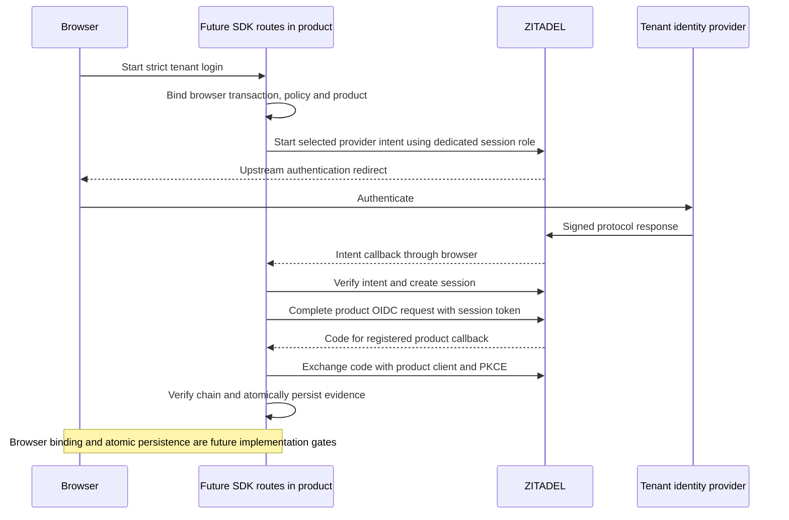

Phase 2 remains open. The pinned SAML and OIDC intent/session/product-token flow works with a dedicated machine holding only session.read, session.write and session.link. The broad IAM_LOGIN_CLIENT role is not required for this measured protocol flow. This is a tested sufficient permission set, not proof that every permission is individually minimal.

## Deployment and probe

The verification role map preserves all upstream roles and ORG_HEIMDALL_SCIM and adds IAM_HEIMDALL_FEDERATION with the three permissions. The API ran start-from-setup once to synchronize it (deployment 4bacf310-f348-4b27-a92f-868d572f9988), then returned to its ordinary start command (deployment bf5e0e6e-b355-432f-bd12-09c52328a0d9). No database bootstrap credential was restored. The pinned image remains ZITADEL 4.19.4; the existing enterprise fixture remains 9016caf9-0be2-4536-b763-82e427aee46a.

Run tests/integration/federation.mjs with HEIMDALL_PROBE_NARROW_LOGIN=true and each supported protocol. Bootstrap credentials create the disposable organization, configured provider, linked human, machine and one-hour PAT. The machine first has no administrator role; session creation is denied. Bootstrap then grants the custom instance role. The measured login operations use only that machine's PAT. The original Login PAT is retained for test cleanup, not for the measured flow. Cleanup revokes the temporary instance grant and removes owned organizations, sessions and realm.

| Operation | Result in both protocol runs |
| --- | --- |
| Session creation without role | HTTP 404 denial |
| Read an unrelated human with the role | HTTP 403 |
| Grant itself IAM_OWNER | HTTP 403 |
| Start/retrieve provider intent | Passed with selected provider and subject verified |
| Create/read verified session | Passed |
| Complete downstream product auth request | Passed |
| Token signature, audience, nonce, sid and auth_time | Passed |
| Invalid intent token, mismatched user, consumed intent/code | Rejected |
| SAML changed NameID and replay | Rejected in SAML run |

The user-token session read from [[phase-2-self-service-evidence]] also passed. It remains insufficient by itself to identify the upstream provider.

## Integration path and authority boundary

The SDK can embed a strict enterprise redirect/callback flow in the product process: resolve the trusted tenant/provider, start an upstream intent, verify its result, create the verified session, complete the product OIDC transaction and validate/persist the bound evidence. This uses ZITADEL to validate SAML/OIDC protocols and does not require a companion Heimdall service. The product mounts the SDK routes and supplies a separate server-only login credential. Provisioning credentials remain separate.

The role is **instance-scoped**. The pinned CreateSession implementation checks session.write before a user is set, and auth-request linking may require session.link. Do not advertise this as product/store isolation or a tenant-scoped credential. Its holder has session authority across the instance, although it still needs valid authentication factors and session/intent tokens for the tested flow. A compromised product backend remains inside the agreed trusted-operator threat boundary. Keep the credential outside public configuration, rotate it, and authorize SDK entry points against fixed product and tenant configuration.

The negative tests are specific checks, not an exhaustive permission audit. The role deliberately has no user-management, provider-management, administrator-grant or session-delete permission. The standard upstream Login UI retains its separately configured IAM_LOGIN_CLIENT credential; this narrower role has not been tested as a replacement for the whole UI.

## Remaining work

The protocol probe drives fixture forms through HTTP, not a browser. Strict SDK routes still need browser transaction binding, callback claims, policy rechecks, unknown-account handling without automatic email linking, deadlines and intent expiry, uncertain-result handling, atomic session replacement and audit. Existing password sessions must not bypass this strict path. No public SDK behavior or Phase 2 completion is claimed here.

Sources: [pinned session creation permission](https://github.com/zitadel/zitadel/blob/v4.19.4/internal/command/session.go), [auth-request linking](https://github.com/zitadel/zitadel/blob/v4.19.4/internal/command/auth_request.go), [upstream custom external-login flow](https://zitadel.com/docs/guides/integrate/login-ui/external-login).

Final probe runs: OIDC ce71dc97-bdb8-4a85-bbb5-46b48647f35c and SAML 32265afa-b526-476c-9e39-388d302c6219. Sanitized results are tests/integration/evidence/federation-narrow-oidc-2026-11-11.json and federation-narrow-saml-2026-11-11.json. Both completed cleanup, including revoking their temporary instance grants.

The full local workspace gate passed: 863 TypeScript tests, Go race tests, formatting, Oxlint, TypeScript, Knip, Go vet, SDK build and 54 Quartz pages.
