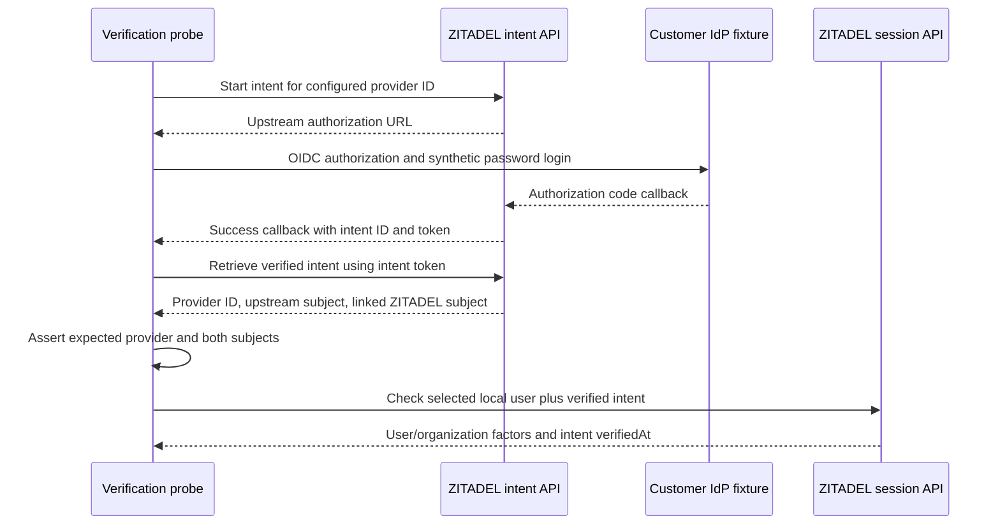

**Phase 2 remains open.** A real upstream OIDC login now produces provider-bound evidence through ZITADEL's identity-provider intent API. This is a capability proof, not the completed strict SSO integration.

## Test-only upstream provider

A pinned Keycloak 26.8.2 fixture represents a customer identity provider. It runs in Railway's verification environment, with a dedicated database and role on the existing private PostgreSQL service. This is not an additional Heimdall runtime dependency or companion auth service. The exact image digest is in deploy/verification/versions.json and the reproduction recipe is deploy/verification/enterprise-idp.md.

| Artifact | Verified state |
| --- | --- |
| Initial fixture deployment | ab9ec771-9735-4c40-b69d-5c152af03a63; initialized successfully |
| Runtime fixture deployment | 9016caf9-0be2-4536-b763-82e427aee46a; SUCCESS and running after bootstrap settings removed |
| Fixture URL | https://capability-enterprise-idp-verification.up.railway.app |
| ZITADEL deployment | 618677e2-8c80-4453-b984-ec56cc00a53e |
| Credentials | Dedicated database password; initialized fixture administrator remains protected outside the repository; bootstrap administrator environment settings absent |

The fixture is a single-instance protocol test service. It uses upstream images and test-network database transport, not a production enterprise IdP deployment recipe. Its privileged administrator creates only temporary test realms and must be removed with the fixture when verification is retired.

## Executed flow

The source is tests/integration/federation.mjs and sanitized output is tests/integration/evidence/federation-oidc-2026-11-11.json. Final run d46f3a71-a629-446d-8f11-645c677ce437 passed after the runtime deployment.

The probe creates a disposable Keycloak realm, confidential OIDC client and synthetic user. In ZITADEL, it creates an organization-scoped provider and an explicitly linked local user. Automatic account creation/update and the linking UI are disabled; matching email is not used as identity proof. The Keycloak form is exercised by protocol automation with an isolated in-memory cookie jar. No normal browser UI acceptance is claimed.

The success callback uses example.invalid and is captured without requesting that domain. Network requests are limited to the configured ZITADEL and fixture origins; the synthetic password is submitted only to the fixture origin. Each request has a 15-second timeout. Secrets, client credentials, intent credentials and upstream tokens are never included in committed evidence.

| Assertion | Result |
| --- | --- |
| Real upstream OIDC authentication | Completed through confidential client with PKCE enabled |
| Retrieved provider ID | Matched the configured organization provider |
| Retrieved upstream subject | Matched the synthetic Keycloak identity |
| Retrieved local subject | Matched the explicitly linked ZITADEL identity |
| Session creation | Verified local identity and organization plus intent timestamp |
| Local password fallback | No password factor present in the federated ZITADEL session |
| Invalid intent token | HTTP 403 |
| Intent checked against a different linked local user | HTTP 400 |
| Cleanup | Owned sessions, ZITADEL organization and Keycloak realm deleted |

## Evidence limits that affect implementation

The retrieved intent contains the provider ID and upstream/local subject binding. The session's public intent factor contains only verifiedAt. A session-intent timestamp or an account's stored provider link is therefore insufficient by itself to prove which provider authenticated this request. The pinned AMR conversion also does not emit a distinct provider identifier for an IDP method.

A candidate strict integration can verify the selected provider/organization and subjects at intent completion, then retain that evidence bound to the login transaction, resulting token/session and policy version. The downstream binding and replay rules still need live proof before this route is selected as a complete implementation. This probe used the dedicated ZITADEL Login client API credential; it is not evidence that ordinary product OAuth clients can read or complete arbitrary intents. Credential ownership and the SDK's built-in route behavior must remain explicit, without introducing a wrapper service.

Existing-session reuse, tenant switching, provider-policy changes, same-email accounts, SAML, downstream OIDC claims, SDK persistence and fault behavior are not yet covered. The successful upstream OIDC flow does not certify first-release strict SSO.

Sources: [pinned intent API](https://github.com/zitadel/zitadel/blob/v4.19.4/proto/zitadel/user/v2/user_service.proto), [intent response fields](https://github.com/zitadel/zitadel/blob/v4.19.4/proto/zitadel/user/v2/idp.proto), [session factors](https://github.com/zitadel/zitadel/blob/v4.19.4/proto/zitadel/session/v2/session.proto), [AMR conversion](https://github.com/zitadel/zitadel/blob/v4.19.4/internal/api/oidc/amr.go), [Keycloak release](https://github.com/keycloak/keycloak/releases/tag/26.8.2).
