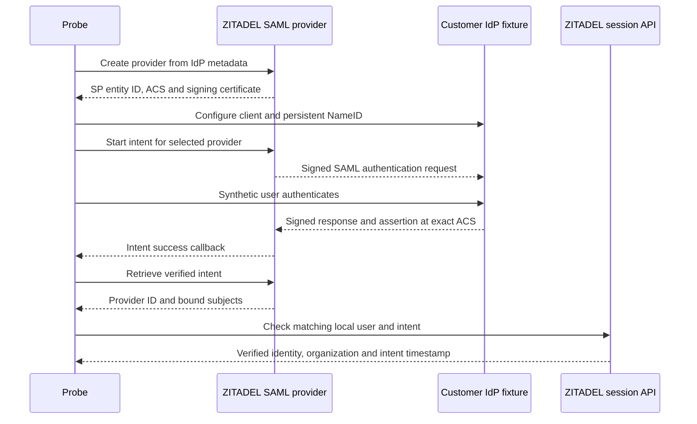

**Phase 2 remains open.** The upstream SAML flow now passes against the test-only enterprise IdP fixture, with signed authentication requests, signed responses/assertions and explicit persistent-subject binding. The existing OIDC mode also passed after the shared probe changes.

## Live configuration and results

Source: tests/integration/federation.mjs. SAML output: tests/integration/evidence/federation-saml-2026-11-11.json, run 2b05dfaf-bcc1-41dd-828d-dc9aa99e7b1f. OIDC regression output: federation-oidc-regression-2026-11-11.json, run d5157d09-7179-49d9-be4f-5e9e2da1088b.

Both ran against ZITADEL deployment 618677e2-8c80-4453-b984-ec56cc00a53e and the Keycloak fixture deployment 9016caf9-0be2-4536-b763-82e427aee46a. The fixture remains outside the Heimdall runtime architecture.

| Assertion | Observed result |
| --- | --- |
| SP metadata | Exact entity ID, POST ACS and public signing certificate read from the newly created provider |
| Authentication request | HTTP-Redirect SAMLRequest included a signature; RSA-SHA256 configured; fixture requires signed requests |
| IdP response | POST delivered to the exact metadata ACS; both response and assertion contained signatures; ZITADEL accepted the flow |
| Subject | Returned persistent NameID matched the explicitly configured upstream identity, not an email-match heuristic |
| Intent evidence | Provider ID, upstream subject and explicitly linked local subject matched |
| Session evidence | Local user and organization matched; intent verifiedAt present; no local-password factor |
| Invalid intent token | HTTP 403 |
| Different linked local user | HTTP 400 |
| Cleanup | Owned sessions, organization and upstream realm deleted |
| OIDC regression | S256 flow and all previous intent/subject checks passed |

## Reproduction and implementation implications

Use the existing protected fixture and ZITADEL credentials, set HEIMDALL_PROBE_FEDERATION_PROTOCOL=saml, and run `pnpm run probe:federation`. The full recipe is deploy/verification/enterprise-idp.md. It creates a disposable realm and organization. No assertion, intent credential, password or upstream token is committed.

The fixture explicitly enables administrator-only editing of its client-specific persistent NameID attribute, preserves the user profile during updates and reads the mapping back before login. Earlier setup attempts exposed fixture-parser and profile-mapping errors; those were corrected without relaxing subject assertions. The final run verifies the configured subject exactly.

The HTML/XML extraction is limited to pinned test-fixture forms and metadata. It is not a public SDK parser or XML signature verifier. ZITADEL performs protocol validation. The probe checks destination before forwarding the assertion and never requests the example.invalid completion URL.

SAML yields the same relevant evidence split as OIDC: intent retrieval identifies the provider and subjects, while the public session intent factor only carries verifiedAt. Preserve the selected requirement to bind verified provider evidence to the login transaction, resulting token/session and policy version. Neither a session timestamp nor a stored provider link proves the full strict-SSO policy on its own.

Tampered assertions, replay, certificate rotation, alternate bindings, provider logout, downstream token binding, policy changes and cross-tenant session reuse remain unverified. Browser Login UI acceptance and both SDKs' strict policy enforcement also remain ahead. This checkpoint does not advance Phase 2 or certify the first release.

Sources: [pinned SAML configuration](https://github.com/zitadel/zitadel/blob/v4.19.4/proto/zitadel/management.proto), [ZITADEL SAML assertion handling](https://github.com/zitadel/zitadel/blob/v4.19.4/internal/idp/providers/saml/session.go), [Keycloak persistent NameID mapping](https://github.com/keycloak/keycloak/blob/26.8.2/services/src/main/java/org/keycloak/protocol/saml/SamlProtocol.java).
