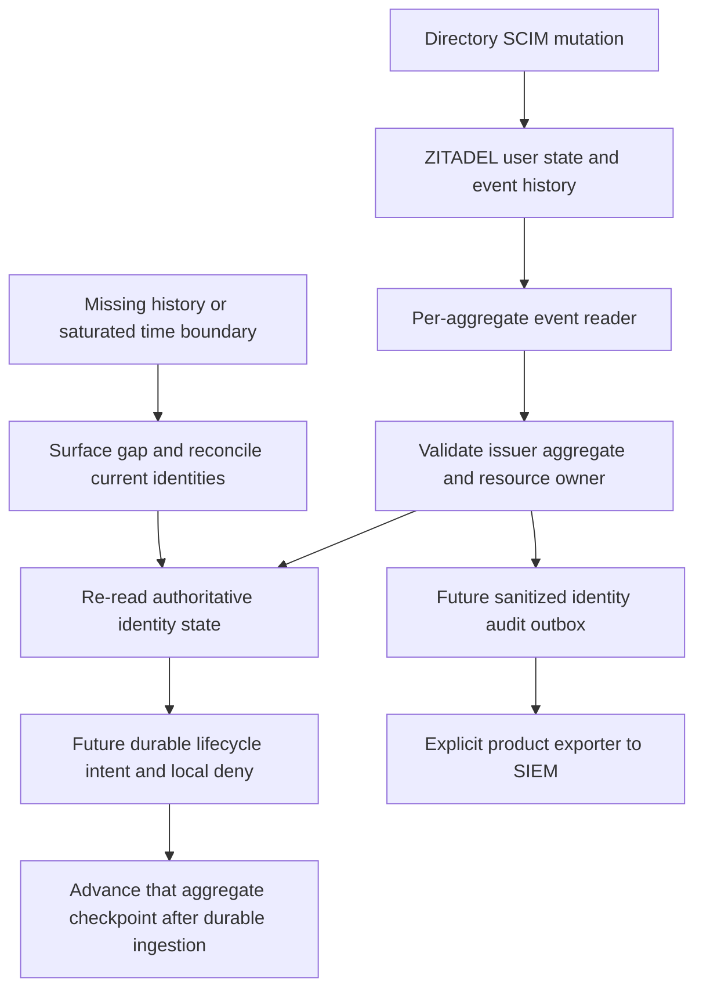

The pinned ZITADEL 4.19.4 Railway deployment exposes SCIM lifecycle events through POST /admin/v1/events/_search. A disposable IAM_OWNER_VIEWER credential read filtered events in two organizations; the organization SCIM credential received 403. The viewer's attempted user deactivation received 403. This is a tested standard read-only role, not a claim of minimal permissions: it permits broader instance reads than event collection alone.

## Observed semantics

The extended SCIM probe runs the complete create/disable/repeated-disable/reactivate/disable/delete sequence before reading its history. Six nonempty pages of two events returned twelve events for the deleted user, including user.deactivated, user.reactivated and user.removed. A checkpoint replay returned the same next event sequences. A mismatched resource owner returned no events. A historical reactivation event did not change the authoritative user read: it remained 404 after deletion.

**Sequence numbers are aggregate-local.** The second organization's user had overlapping sequence numbers. Reusing the first user's terminal sequence against that second user returned an empty page despite known events. A single organization-wide or instance-wide numeric sequence checkpoint is therefore unsafe. Event deduplication must include issuer/instance and aggregate identity as well as sequence. Preserve uint64 values as decimal strings or exact integers, never JavaScript floating-point numbers.

The [pinned handler](https://github.com/zitadel/zitadel/blob/v4.19.4/internal/api/grpc/admin/event.go) orders by creation date, caps pages at 1000, and applies sequence as an additional filter. Its date pagination does not establish a tested tie-safe, gap-free instance-wide cursor. The [pinned query implementation](https://github.com/zitadel/zitadel/blob/v4.19.4/internal/query/event.go) additionally applies configured audit-log retention. Retention or a saturated timestamp boundary cannot be repaired by simply advancing a checkpoint.

## Implementation consequences

Known-identity lifecycle enforcement can use bounded authoritative polling and per-aggregate history without relying on an unsafe global cursor. Event ingestion is a hint to reconcile current state, not authority to blindly apply historical activation. Durable per-product intents, deny propagation, checkpoint transactions, new-user discovery, retention-gap handling and the 60-second worker target remain implementation work.

A resourceOwner request filter is not a credential boundary. The tested instance viewer can read both organizations. A trusted operator collector must validate explicit organization/product routing and omit unrelated payloads before product delivery. Raw event payloads can contain personal data and are deliberately excluded from committed evidence.

Complete upstream identity/configuration export still needs a verified strategy for discovering all relevant aggregates and handling timestamp ties, retention and late visibility. This probe does not prove lossless global export or SIEM vendor compatibility. It records a concrete limitation before runtime code depends on an unsafe checkpoint design. No Heimdall wrapper service is introduced.

## Evidence and reproduction

Run tests/integration/scim.mjs with HEIMDALL_PROBE_EVENTS=true and the protected verification issuer/bootstrap PAT described in deploy/verification/zitadel.md. The existing SCIM role map is required. The probe creates an instance viewer grant only for its disposable machine, removes that grant explicitly, then removes its owned organizations. No instance role-map change is required.

Sanitized observations are in tests/integration/evidence/scim-events-2026-11-11.json. The assertions cover per-aggregate pagination/replay, overlapping sequences, unsafe cross-aggregate cursor omission, organization filtering, credential separation and authoritative deleted state. The full SCIM regression runs alongside them. Phase 2 remains open.
