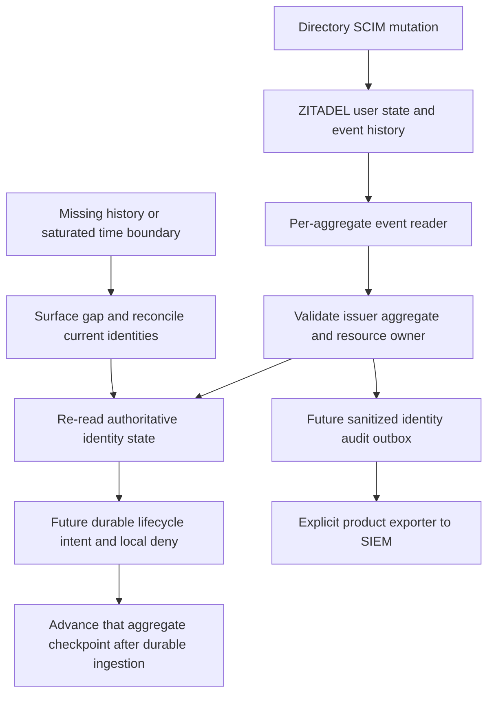
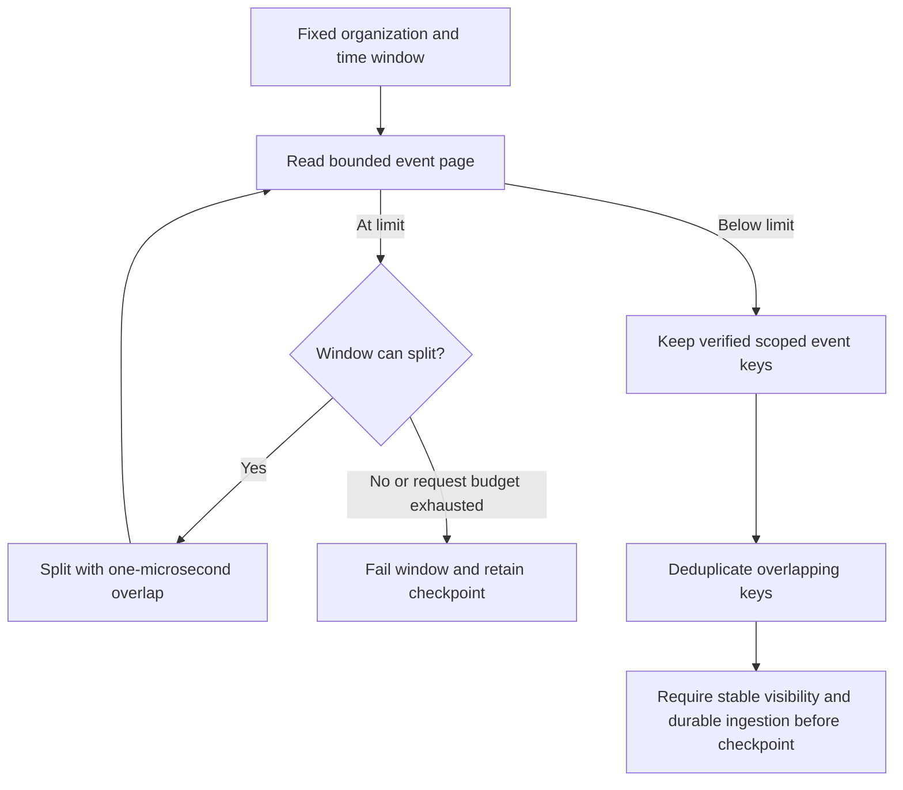
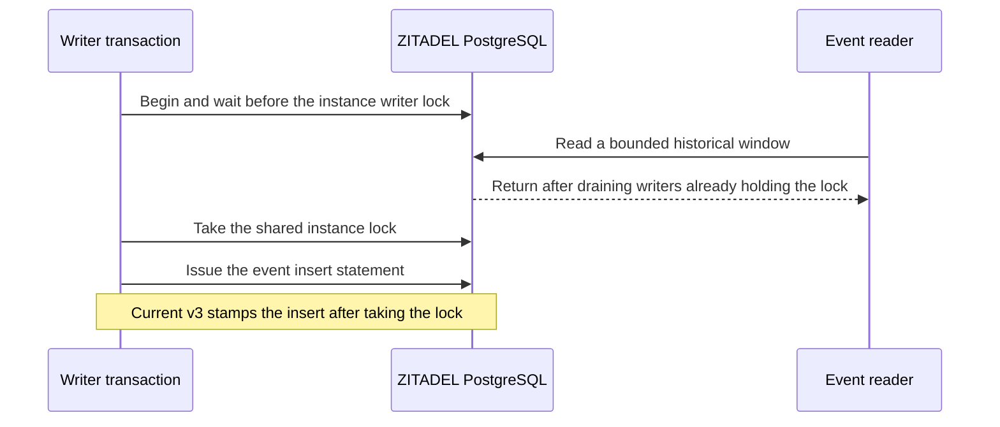

The pinned ZITADEL 4.19.4 Railway deployment exposes SCIM lifecycle events through POST /admin/v1/events/_search. A disposable IAM_OWNER_VIEWER credential read filtered events in two organizations; the organization SCIM credential received 403. The viewer's attempted user deactivation received 403. This is a tested standard read-only role, not a claim of minimal permissions: it permits broader instance reads than event collection alone.

## Observed semantics

The extended SCIM probe runs the complete create/disable/repeated-disable/reactivate/disable/delete sequence before reading its history. Six nonempty pages of two events returned twelve events for the deleted user, including user.deactivated, user.reactivated and user.removed. A checkpoint replay returned the same next event sequences. A mismatched resource owner returned no events. A historical reactivation event did not change the authoritative user read: it remained 404 after deletion.

**Sequence numbers are aggregate-local.** The second organization's user had overlapping sequence numbers. Reusing the first user's terminal sequence against that second user returned an empty page despite known events. A single organization-wide or instance-wide numeric sequence checkpoint is therefore unsafe. Event deduplication must include issuer/instance and aggregate identity as well as sequence. Preserve uint64 values as decimal strings or exact integers, never JavaScript floating-point numbers.

The [pinned handler](https://github.com/zitadel/zitadel/blob/v4.19.4/internal/api/grpc/admin/event.go) orders by creation date, caps pages at 1000, and applies sequence as an additional filter. Its date pagination does not establish a tested tie-safe, gap-free instance-wide cursor. The [pinned query implementation](https://github.com/zitadel/zitadel/blob/v4.19.4/internal/query/event.go) additionally applies configured audit-log retention. Retention or a saturated timestamp boundary cannot be repaired by simply advancing a checkpoint.

## Implementation consequences

Known-identity lifecycle enforcement can use bounded authoritative polling and per-aggregate history without relying on an unsafe global cursor. Event ingestion is a hint to reconcile current state, not authority to blindly apply historical activation. Durable per-product intents, deny propagation, checkpoint transactions, new-user discovery, retention-gap handling and the 60-second worker target remain implementation work.

A resourceOwner request filter is not a credential boundary. The tested instance viewer can read both organizations. A trusted operator collector must validate explicit organization/product routing and omit unrelated payloads before product delivery. Raw event payloads can contain personal data and are deliberately excluded from committed evidence.

Complete upstream identity/configuration export still needs a verified strategy for discovering all relevant aggregates and handling timestamp ties, retention and late visibility. This probe does not prove lossless global export or SIEM vendor compatibility. It records a concrete limitation before runtime code depends on an unsafe checkpoint design. No Heimdall wrapper service is introduced.

## Evidence and reproduction

Run tests/integration/scim.mjs with HEIMDALL_PROBE_EVENTS=true and the protected verification issuer/bootstrap PAT described in deploy/verification/zitadel.md. The existing SCIM role map is required. The probe creates an instance viewer grant only for its disposable machine, removes that grant explicitly, then removes its owned organizations. No instance role-map change is required.

Sanitized observations are in tests/integration/evidence/scim-events-2026-11-11.json. The assertions cover per-aggregate pagination/replay, overlapping sequences, unsafe cross-aggregate cursor omission, organization filtering, credential separation and authoritative deleted state. The full SCIM regression runs alongside them. Phase 2 remains open.

## Bounded time-window follow-up

Run b8277422-a3c0-4348-95b0-d1d2bb24b1f9 tested an organization-filtered time scan without supplying aggregate IDs. Eleven requests with a page limit of eight discovered four aggregates and matched all 22 events in a separate unsaturated baseline. Repeating the scan produced the same event keys. Evidence: tests/integration/evidence/scim-event-windows-2026-11-11.json.

The probe recursively splits full windows, overlaps their exclusive endpoints by one microsecond, and deduplicates by aggregate type/ID/sequence within the fixed issuer. It accepts a window only when the response has fewer events than its requested limit. An unsplittable full timestamp bucket or exhausted request budget fails without returning a completed window; it cannot advance a checkpoint. A live limit-one query at an event timestamp verified this refusal path. The initial nanosecond overlap attempt omitted the final event; the successful run uses microsecond-aligned boundaries matching the pinned PostgreSQL deployment. Production code must preserve exact provider timestamp precision and validate the supported storage granularity.

This is static-window capability evidence, not a lossless moving-watermark proof. The builder comment initially suggested filtering behind the oldest transaction. Inspection of the pinned SQL implementation corrected that interpretation: it drains instance writers with an advisory lock and applies a transaction-time position cap. See the verification below. An empty or short response alone still does not prove completeness across retention gaps or arbitrary wall-clock boundaries. A verified visibility barrier or equivalent upstream delivery/reconciliation mechanism remains necessary before a production collector can advance a global time checkpoint. The 60-second identity gate must continue to use authoritative state, independently of audit export progress.

## Writer-drain implementation correction

The [pinned SQL reader](https://github.com/zitadel/zitadel/blob/v4.19.4/internal/eventstore/repository/sql/query.go) acquires and releases an exclusive instance advisory lock before querying. Its [SQL predicate](https://github.com/zitadel/zitadel/blob/v4.19.4/internal/eventstore/repository/sql/postgres.go) caps event position at the database transaction start time. This supersedes the older builder comment about filtering behind the oldest transaction; unrelated open transactions are not themselves a global visibility cutoff.

The dedicated Railway fault probe tests both cases. An unrelated transaction sleeping in the verification database permits event retrieval. A synthetic shared instance advisory lock causes an event reader to wait; after the owned lock session is terminated, the reader completes and returns the previously committed marker. The probe modifies no event tables. It releases only its exact run-named database session and deletes its disposable organization.

An initial attempt created the marker while holding the barrier; queued service work caused that request to time out. Cleanup completed, and that attempt is excluded from successful evidence. The corrected probe commits the marker before injecting the lock, isolating reader-drain behavior. This also demonstrates why the fault is restricted to the dedicated verification instance: holding its writer barrier can delay other service operations.

Reproduce with tests/integration/event-visibility-railway.py --execute-verification-event-visibility, the protected bootstrap PAT in HEIMDALL_PROBE_ZITADEL_PAT, authenticated Railway CLI and the existing verification SSH identity. The script pins project, environment, database service and API origin. Sanitized output is recorded in tests/integration/evidence/event-visibility-railway-2026-11-11.json.

The evidence proves advisory-lock waiting and release, not every concurrent writer interleaving or database clock behavior. Production collection must choose a provider-time boundary with the verified reader barrier, retain incomplete windows, detect retention gaps, and commit ingestion before advancing its checkpoint. SDK durable checkpoint implementation and fault qualification remain later-phase work; this probe is not a running exporter or a SIEM vendor integration.

## Writer timestamps in the fully migrated pinned deployment

The installed `eventstore.commands_to_events` function uses PostgreSQL statement start time for `created_at` and wall clock time for position. The earlier setup step assigned both using transaction start time. Setup migration 77 replaces that function. The current v3 write path acquires its shared instance lock before issuing the event write statement. [Migration 77](https://github.com/zitadel/zitadel/blob/v4.19.4/cmd/setup/77.sql) · [v3 write path](https://github.com/zitadel/zitadel/blob/v4.19.4/internal/eventstore/v3/push.go)

Railway run `58a2a8ac-53c2-4423-8e6c-fa183b27f52b` verified the installed function and the following interleaving. The synthetic writer starts before a database-clock cutoff and acquires the shared instance lock after the reader returns. Its transaction timestamp remains before the cutoff. In a separate live write, a machine user created through the provider after the cutoff appears in the unrestricted query and stays outside the bounded window. The probe writes markers through the provider API and makes no direct event table writes. The database default for `transaction_timeout` was disabled. Evidence is in `tests/integration/evidence/event-visibility-cutoff-railway-2026-11-14.json`.

The reader still applies a position cap. A write can begin its statement before the chosen time boundary and assign its position later. The event response omits that position, and its audit retention filter can silently raise the lower bound. A collector needs a verified provider-time safety margin for both timestamp and position, and an effective retention bound that covers the entire read including its retries. One path to qualify is a deployment-enforced PostgreSQL writer transaction duration, bounded clock skew and a known minimum Events API retention period. A timeout reported by the probe connection alone cannot establish the production writer bound. An empty page alone cannot establish either condition. [Position predicate](https://github.com/zitadel/zitadel/blob/v4.19.4/internal/eventstore/repository/sql/postgres.go) · [Retention filter](https://github.com/zitadel/zitadel/blob/v4.19.4/internal/query/event.go)
