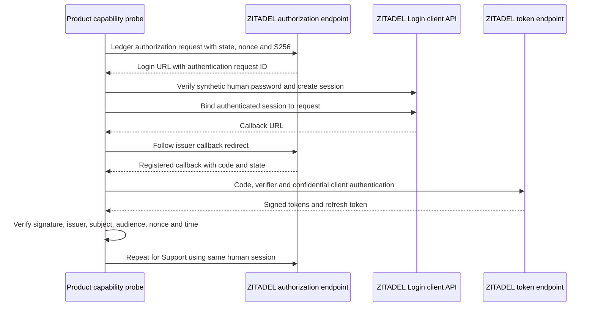
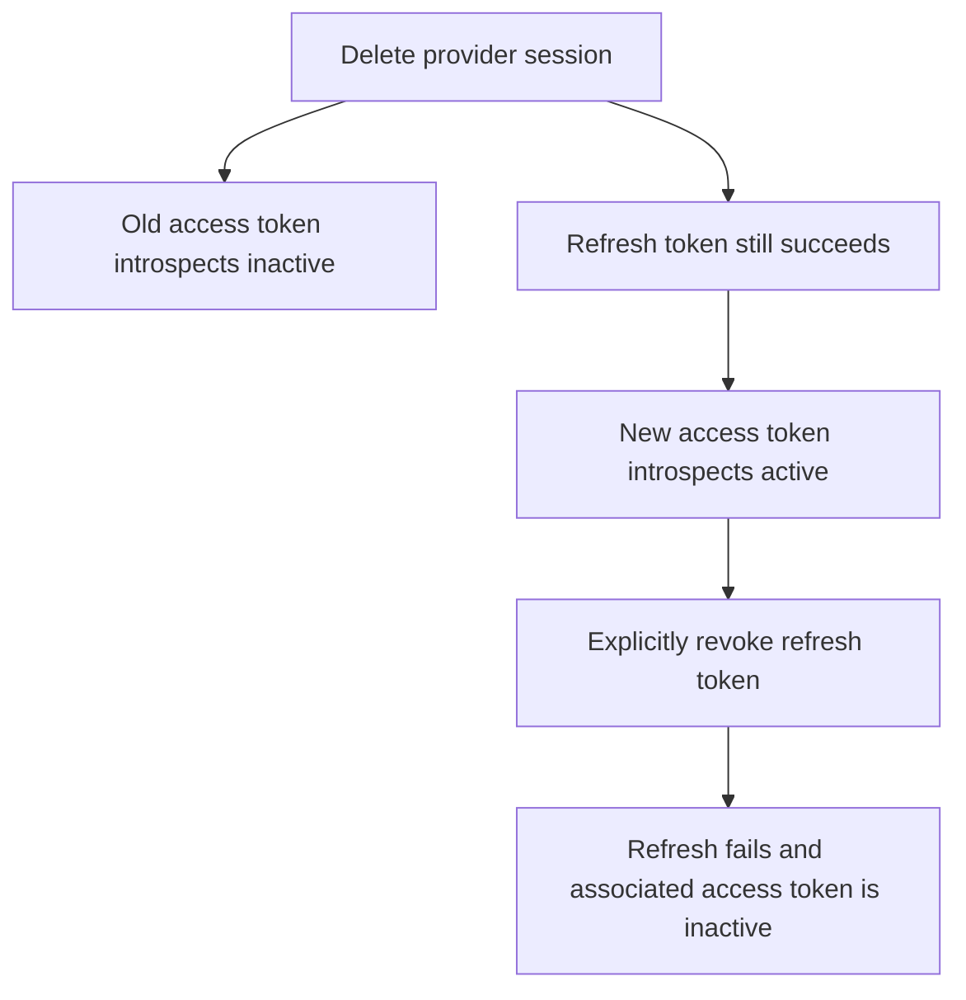

**Phase 2 remains open.** The pinned ZITADEL deployment completed authorization-code flows for two product clients using the same human identity. The probe authenticates the human's password through ZITADEL's dedicated Login client API; it does not exercise the browser Login UI or an external enterprise identity provider.

## Flow and verification

The source is tests/integration/oidc.mjs and sanitized output is tests/integration/evidence/oidc-2026-11-11.json. Run 22a95172-bd30-4a99-9d8b-d2af9c519427 used runtime deployment 618677e2-8c80-4453-b984-ec56cc00a53e. It creates one disposable organization, one synthetic human with a generated password, two projects and two compliant confidential OIDC web clients. Secrets and tokens stay in memory; only sanitized assertions are written.

The HTTPS product callback URLs use example.invalid. The probe captures the redirect and never contacts those hosts. Only issuer-origin redirects are followed. Each network call has a 15-second deadline and remote mutations are not blindly retried. Finally, owned sessions and the disposable organization are deleted. If a create response is lost, use the run ID printed before writes to identify only this probe's resources before cleanup.

| Test | Observed result |
| --- | --- |
| Human authorization-code flow | Both clients received signed ID/access tokens and refresh tokens |
| Token verification | RS256 signature, issuer, subject, intended audience, nonce and token time assertions passed |
| Product separation | Each access token included its project audience and excluded the other project's audience |
| Cross-product introspection | Own client reported active; other product client reported inactive |
| Active user's refresh | Succeeded for both products, with refreshed access tokens validated |
| Incorrect PKCE verifier | HTTP 400 invalid_grant |
| Human method evidence | ID tokens reported amr containing pwd; no enterprise SSO evidence is inferred |
| User deactivation | User API reported USER_STATE_INACTIVE; both product tokens introspected inactive; refresh returned HTTP 400 invalid_request |
| User deletion | User API returned 404 and both product tokens remained inactive |

The probe's verifier also rejects the other client audience and an absent signing key. These are local assertion checks, not implementation or rotation/fault testing of the eventual SDK verifier. Claims are not accepted merely because JWT payloads decode.

## Provider-session deletion is not complete revocation

A separate authenticated session was created for a focused deletion test. After deleting it through the session API, its access token introspected inactive, **but its refresh token still succeeded and produced an active access token**. Deleting that session did not revoke the original independent session for the same human.

Explicit revocation of the newly returned refresh token succeeded. Subsequent refresh failed with HTTP 400 invalid_request, and the associated access token introspected inactive. Explicit access-token revocation also returned 200 and left it inactive.

This reinforces the selected [[design/shared-sdk-contract|local logout contract]]: atomically delete the local session, clear its cookie and prevent a concurrent refresh from persisting it again. Optional upstream revocation must explicitly revoke the applicable tokens; deleting the provider session is not equivalent. Outage, lost-response and concurrent-rotation behavior still need runtime tests. Do not claim provider-wide logout from this endpoint alone or change local logout defaults based on this probe.

## Remaining work

The browser Login UI, external SAML/OIDC, strict provider/organization policy evidence, session-policy switching, unknown-key refresh/fault behavior, concurrent refresh/logout, and SDK identity freshness enforcement remain unverified. These are healthy sequential samples, not a measured maximum revocation SLA. Shared identity and matching organization do not grant OpenFGA membership. No first-release SDK capability is claimed by this probe.

Sources: [pinned OIDC API](https://github.com/zitadel/zitadel/blob/v4.19.4/proto/zitadel/oidc/v2/oidc_service.proto), [session API](https://github.com/zitadel/zitadel/blob/v4.19.4/proto/zitadel/session/v2/session_service.proto), [application configuration](https://github.com/zitadel/zitadel/blob/v4.19.4/proto/zitadel/application/v2/application_service.proto).

## Validation and publication

The full workspace gate passed: 765 Vitest tests, Go race tests, formatting/lint/types/Knip/vet, SDK build/declarations and Quartz. Source commit 1b34a449a91addb01e3f47a77123bba3e0750bab passed GitHub Actions runs 42913037198 and 42913022768. Railway docs deployment 1dce04a4-6a74-4030-afeb-7a21f0092381 reached SUCCESS and remained running. The public evidence page returned HTTP 200 with the current probe ID, provider-session refresh finding and Mermaid source. Phase 2 remains open.
