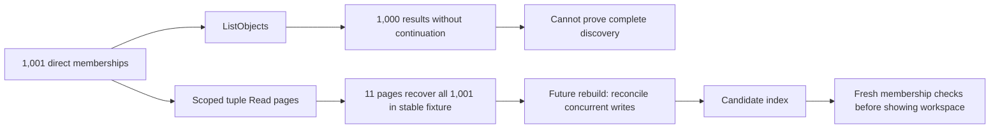

Phase 2 remains open. The expanded tests/integration/openfga.mjs probe measured the pinned deployment's listing and write limits using disposable stores and direct-user workspace memberships.

## Railway result

Run 37c6cabb-5e27-4ff3-b602-f8a9aecf6f90 exercised OpenFGA 1.22.0 deployment 2ab25f20-64e1-4e79-a4a5-7284fdb71056 with PostgreSQL 17.11 deployment 574c0fb1-1252-41cb-a02b-7f3fdd74c18b. Exact digests and datastore settings remain in [[phase-2-openfga]]. The configured environment leaves ListObjects maximum/deadline and write-size overrides unset, so pinned defaults apply. Sanitized output is in tests/integration/evidence/openfga-limits-2026-11-11.json.

| Check | Observed result |
| --- | --- |
| Write 101 distinct tuples in one request | HTTP 400; subsequent scoped read found no partial writes |
| Write 1,001 memberships in batches of at most 100 | All batches acknowledged |
| ListObjects for those direct memberships | Exactly 1,000 unique results; no continuation token |
| Paginated scoped Read with page size 100 | All 1,001 distinct expected tuples across 11 pages; no duplicates |
| Measured request time | ListObjects 228 ms; complete Read traversal 1,548 ms |
| Existing regression checks | Both products, credential isolation limits, membership gating and post-revocation HIGHER_CONSISTENCY checks passed |
| Cleanup | Both stores created by this run deleted |

The timings include network transit from the development machine to Railway. They are one observed run, not latency guarantees, load tests or throughput targets. No concurrent writes occurred during pagination. A successful traversal here does not establish snapshot isolation.

## Design consequence

ListObjects cannot be treated as exhaustive workspace discovery or proof that omitted memberships do not exist. The selected core candidate source and managed candidate index remain necessary. A scoped tuple-read rebuild can traverse more than the default list cap for the initial direct-user model, but must still reconcile concurrent SDK writes before publishing its result. Absence from a partial scan cannot revoke access or complete recovery.

A confirmed oversized-write validation error is distinct from a transport failure after dispatch. These results do not justify automatic retry of uncertain writes or splitting a required atomic multi-tuple operation into independent requests. Managed recovery still requires verified quiescence; that gate remains open.

Source: [pinned OpenFGA configuration defaults](https://github.com/openfga/openfga/blob/v1.22.0/pkg/server/config/config.go) specify 100 tuples per write, 1,000 ListObjects results and a three-second ListObjects deadline. This probe measures the count limits, not deadline behavior.

## Fresh local reproduction

A unique Compose project (heimdall-probe-08051a959662) started from the tracked deploy/verification/compose.yaml with freshly generated credentials kept only in process memory. PostgreSQL reached health, the one-shot OpenFGA migration passed, and the API reached health before the same expanded probe ran. No custom images were built.

Run d492db64-7aad-4301-820e-1eedd70d02ee reproduced all assertions, including the 1,000-result cap and complete 11-page traversal. Local timings were 3 ms for ListObjects and 23 ms for Read traversal; these are also single-run observations. Sanitized output is in tests/integration/evidence/openfga-local-2026-11-11.json. The probe deleted its stores, then Compose down --volumes removed this unique project's containers and volume. Follow-up label-filtered container and volume listings were empty. This validates fresh local OpenFGA setup only; it does not claim local ZITADEL or full enterprise-stack reproduction.

## Validation and publication

The full workspace gate passed: 841 Vitest tests, Go race tests, formatting/lint/types/Knip/vet, SDK build/declarations and Quartz. Source commit b9af3c5076688ea22d5f51a1f94cd46dced51a3e passed GitHub Actions runs 42919580471 and 42919566238. Railway docs deployment f1e14636-5eb8-4b79-939a-3b5e2e85bc2a reached SUCCESS. The public page returned HTTP 200 with both probe run IDs, phase status and Mermaid source. Phase 2 remains open.
