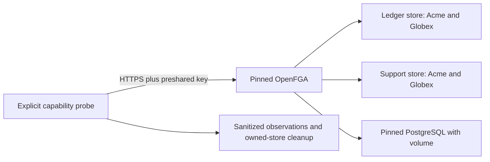

**Phase 2 in progress; not complete.** A dedicated Railway verification environment now runs pinned OpenFGA and PostgreSQL services. The production docs environment is separate.

## Deployment and observed results

| Artifact | Verified deployment |
| --- | --- |
| OpenFGA 1.22.0 | 2ab25f20-64e1-4e79-a4a5-7284fdb71056; SUCCESS and running |
| PostgreSQL 17.11 | 574c0fb1-1252-41cb-a02b-7f3fdd74c18b; SUCCESS and running; volume at /var/lib/postgresql/data |
| Environment | verification, 7bc7c286-b2dc-4415-85eb-90dd554ab2fb in the Heimdall Railway project |

Exact registry digests are recorded in deploy/verification/versions.json and match Railway deployment metadata. Version identification here is by pinned image identity; a direct SQL server_version query has not been completed. The test database role owns its OpenFGA database, traffic uses sslmode=disable on the platform private network, and the HTTP API uses Railway HTTPS with preshared-key authentication. These are capability-test settings, not a production transport/durability certification.

The committed tests/integration/openfga.mjs probe passed against the running deployment. Its sanitized output is under tests/integration/evidence/openfga-2026-11-11.json.

- Missing and incorrect API credentials returned HTTP 401.
- Separate Ledger and Support stores held Acme/Globex workspace objects with different memberships.
- Membership-gated approval succeeded only for the expected Ledger workspace.
- ListObjects returned the correct workspace in each store; tuple reads honored page_size=1 and continuation.
- Deleting the approval tuple caused the immediately following HIGHER_CONSISTENCY check to deny.
- The same preshared credential accessed both stores. This deployment does not provide per-store credential isolation; it fits only the selected trusted-backend operator boundary.
- The probe deleted both stores that it created. It does not delete unrelated resources.

## Reproduction and limitations

The deploy/verification README and Compose file describe local and Railway reproduction without committed credentials or custom images. Compose syntax was validated; a fresh local end-to-end run is still pending. The Railway CLI edit command did not apply settings, so documented API serviceInstanceUpdate and serviceInstanceDeployV2 were used and resulting state verified. A successful exited help command was not counted as a running service.

No listing maximum, load/latency bound, concurrent revocation guarantee or outstanding-write quiescence has been established by this small probe. Higher consistency is not a transaction with product storage. ZITADEL 4.19.4 is only a candidate at this point: two projects, tokens/audiences/organization claims, strict SSO evidence, SCIM Users and disable/delete semantics still need live verification. No service version is yet certified for the complete release.

Sources: [OpenFGA configuration](https://openfga.dev/docs/getting-started/setup-openfga/configure-openfga), [OpenFGA release](https://github.com/openfga/openfga/releases/tag/v1.22.0), [PostgreSQL release](https://www.postgresql.org/docs/17/release-17-11.html), [Railway service API](https://docs.railway.com/integrations/api/manage-services).

## Repository validation and publication

The full workspace gate passed: 765 Vitest tests, Go race tests, lint/format/types/Knip/vet, SDK build/declarations and Quartz. Compose configuration validation passed. Source commit 50d0d4a7de496e1bac71937c30c4ef2fcfa4df12 passed GitHub Actions run 42907238223. Railway docs deployment fc2db381-5592-4858-a45f-3381f7d8f579 reached SUCCESS, and the public evidence page returned HTTP 200 with the expected service deployment and credential-boundary findings. This checkpoint is committed and published; Phase 2 remains open.
