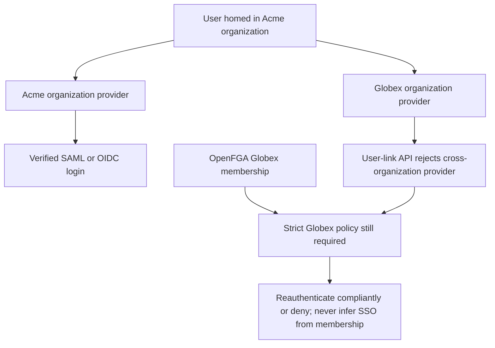

Phase 2 remains open. A cross-organization test found a constraint that must be reflected in the tenant-switching design: the pinned ZITADEL user-link APIs reject linking a user to an organization-scoped provider owned by another organization. OpenFGA membership alone cannot bypass this identity-provider boundary.

## Live tests

The federation probe ran against ZITADEL 4.19.4 deployment 618677e2-8c80-4453-b984-ec56cc00a53e and Keycloak fixture deployment 9016caf9-0be2-4536-b763-82e427aee46a. Each run created a provider organization, a different user-home organization and a disposable upstream realm. Both creation-with-link and explicit linking used the bootstrap administrator credential, so these failures are not evidence about a narrowly scoped runtime role.

| Protocol | Run | Cross-organization creation with link | Explicit link after user creation |
| --- | --- | --- | --- |
| OIDC | 0009c699-7f26-4ba8-91c1-c889d61ecfe8 | HTTP 400, code 9 | HTTP 400, code 9 |
| SAML | 96d5b4de-bf4c-49ef-98da-54981f445456 | HTTP 400, code 9 | HTTP 400, code 9 |

Each run then created a different user inside the provider's organization and completed the previously verified federation/session/downstream-token flow. Provider retrieval explicitly checked ID, active state, protocol and resourceOwner against the expected organization. Existing wrong-user, invalid-intent, consumed-intent and consumed-code checks passed; SAML tamper/response-replay checks passed too. Owned organizations, sessions and fixture realms were removed.

Sanitized evidence is in tests/integration/evidence/federation-cross-home-{oidc,saml}-2026-11-11.json. Set HEIMDALL_PROBE_CROSS_ORG_LINK=true with the normal federation probe credentials, and run each protocol using HEIMDALL_PROBE_FEDERATION_PROTOCOL.

The pinned addLink implementation calls ExistsIDPOnOrgOrInstance with the user's resource owner, rejecting the link when that lookup fails. AddUserIDPLink uses the same helper after checking user-write permission. This matches the observed failures. It does not prove that every other upstream account-linking flow has identical behavior. [User creation/link helper](https://github.com/zitadel/zitadel/blob/v4.19.4/internal/command/user_human.go), [explicit link command](https://github.com/zitadel/zitadel/blob/v4.19.4/internal/command/user_idp_link.go).

## Consequences for the design

A Heimdall workspace is still a product tenant, not a ZITADEL user-home organization. Product memberships remain independent and can span workspaces. But the design cannot promise that the same issuer/subject can authenticate through arbitrary providers belonging to independently administered organizations.

For the existing shared-organization two-product case, the same principal can still have separately granted product memberships. For different organization-scoped providers, a login with another tenant-owned ZITADEL account changes issuer/subject identity: it cannot inherit the previous principal's memberships, roles, discovery cursor or pending operation authority. Matching email does not merge the accounts.

The remaining tenant-switching spike must validate the supported account topology explicitly. Multiple providers in one user-home organization or instance-level providers are candidates for a stable principal across provider policies, but this checkpoint does not approve or verify those alternatives. Instance-level provider management also changes the administration boundary. Do not silently replace organization-scoped isolation with an instance-wide provider merely to make the test pass.

The enterprise evidence field organizationId denotes the trusted target provider-organization mapping. The probe now verifies provider ownership through the API; a user-home organization or browser org hint alone is not that proof. Runtime must also validate the actual authenticated subject and current target policy, and preserve the selected no-automatic-linking rule.

Strict SSO remains mandatory. These results add a concrete account-topology acceptance requirement; they do not weaken first-release scope or advance Phase 2.
