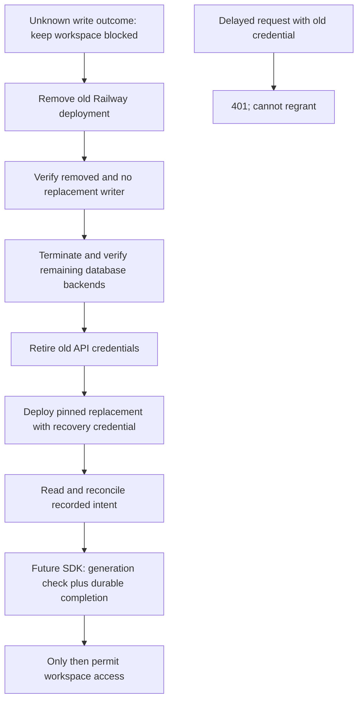

Phase 2 remains open. The committed-response-loss and database-blocked-write faults now have live evidence using Railway deployment removal, database drain and API credential retirement. This establishes a maintenance procedure for the measured verification topology, not automatic SDK recovery or per-workspace fencing.

## Executed procedure

Run 336f37c9-296e-4b73-b52c-8eb7173d2bdf used the dedicated verification environment with one OpenFGA 1.22.0 replica and PostgreSQL 17.11. The OpenFGA image digest stayed sha256:9cf9a20af32a40434cd3a788c429879439ee9ea9abf65c9c200ee17cd43f769e. PostgreSQL deployment 574c0fb1-1252-41cb-a02b-7f3fdd74c18b was retained. Its database and role settings are the test configuration recorded in [[phase-2-openfga]], not production hardening.

| Boundary | Observed proof |
| --- | --- |
| Before maintenance | Deployment 2ab25f20-64e1-4e79-a4a5-7284fdb71056; one replica and sole preshared credential verified |
| Lost response after commit | Loopback fault proxy observed upstream success, destroyed client response, and a scoped read found the committed tuple |
| Outstanding database request | Dispatched second write observed waiting on the tuple-table lock in pg_stat_activity |
| Stop old execution | Exact service/environment railway down; old deployment reached REMOVED, with no listed active/building replacement |
| Drain database path | Other OpenFGA database backends terminated and counted as zero before releasing the test lock |
| Client outcome for interrupted write | HTTP 500; treated as uncertain, never as rollback proof |
| Retire delayed requests | Old preshared key removed; replacement configured with a newly generated key before deployment |
| Restart | Deployment cfd87a9f-da43-493c-b659-72ce4a5ba98e reached SUCCESS and health; same pinned image |
| Reconcile | Interrupted tuple absent; committed tuple present and then explicitly deleted |
| Stale regrant | Old credential rejected with 401 after cleanup; deleted tuple remained absent |
| New credential | Confirmed write/read/delete/read sequence passed |
| Cleanup | Owned store deleted; replacement credential securely retained outside the repository |

The procedure relies on Railway's trusted deployment-removal control to stop the old process, plus explicit database-side verification. It does not infer process death from an HTTP outage. Railway documents removal and the distinction between overlap and draining during replacement. A rolling restart is not this proof. [Deployment actions](https://docs.railway.com/deployments/deployment-actions), [deployment teardown](https://docs.railway.com/deployments/deployment-teardown).

## Reproduction and regression

The opt-in tests/integration/openfga-recovery-railway.py probe uses exact project/environment/service IDs, Python 3 standard library, Railway CLI and the registered SSH identity. It rejects Python optimization so verification assertions cannot be disabled. See deploy/verification/recovery.md for credential handling and maintenance prerequisites. Sanitized output is in tests/integration/evidence/openfga-recovery-railway-2026-11-11.json.

After restart, the ordinary OpenFGA capability probe passed again with run 5ed5e597-7ff3-48e9-831a-3a40f6428bf1. It rechecked two stores/four workspace objects, membership gating, credential boundaries, post-revocation consistency, the 1,000-result list cap, rejected oversized writes and full 1,001-tuple pagination. Both regression stores were deleted. Its output is in tests/integration/evidence/openfga-after-recovery-2026-11-11.json.

## Release boundary

This topology has one API replica, no independent writers or credential broker, and one trusted operator. The maintenance window affects every store using that deployment. Production procedures must inventory all writers and credential paths, prevent replacements and maintain local deny gates throughout. A deployment rollback can restore old variables; do not roll back to retired credentials. Multi-replica/independent-writer topologies need their own complete proof.

The SDK still needs durable quarantine, authorized recovery records, immutable intent/generation checks, audit and atomic local completion. Those are later implementation gates; this service test cannot unblock a product workspace. Strict SSO/browser verification and other Phase 2 requirements remain open.
