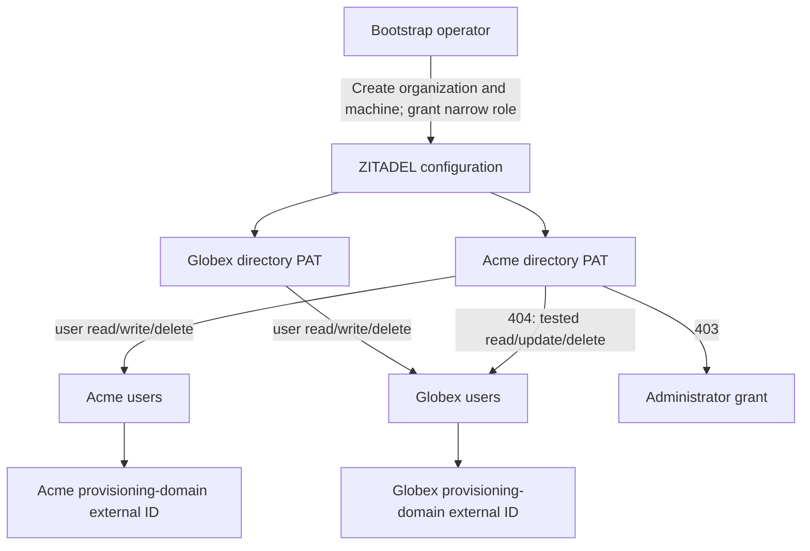

**Phase 2 remains open.** SCIM lifecycle now passes with a dedicated organization-scoped credential instead of the bootstrap owner PAT. The tested role contains only user.read, user.write and user.delete. These are user-management permissions across APIs, not a restriction to SCIM URLs.

## Credential setup and deployment

The probe creates one machine account in each disposable organization, configures its provisioning-domain metadata, grants ORG_HEIMDALL_SCIM using the pinned v2 InternalPermissionService, and issues a one-hour PAT. Organization creation, initial role grants and final cleanup use the bootstrap credential; SCIM operations use the respective directory PAT. No directory PAT is printed or persisted. The machines are removed with their owned organizations.

The role map in deploy/verification/zitadel-role-permissions.json preserves all 27 defaults from the pinned v4.19.4 configuration and appends ORG_HEIMDALL_SCIM. Railway's configured JSON was compared with the tracked map. Applying a map requires ZITADEL setup; supplying only the new role would remove the defaults. The reproduction guide records the upstream source hash and setup/runtime commands.

| Deployment | Result |
| --- | --- |
| c2f9ad6f-0bbb-4dad-a9bb-262f862b12e5 | start-from-setup synchronized the new role; healthy |
| 618677e2-8c80-4453-b984-ec56cc00a53e | Returned to runtime-only start; SUCCESS and running |
| Runtime credentials | Bootstrap database password remained absent |
| Operator regression | Discovery, public JWKS and two-project create/read/delete passed after role synchronization |

## Executed checks

The current tests/integration/scim.mjs passed after the runtime-only restart. Output is tests/integration/evidence/scim-minimum-role-2026-11-11.json, run ab8c5308-d912-4cb5-8e01-ce69b47ab422. The operator regression is recorded in zitadel-after-role-sync-2026-11-11.json.

- Each directory credential created and read its own synthetic user, including its external ID. The same external ID and email in the other organization remained a separate identity.
- Acme's credential received 404 for Globex SCIM read, update and delete requests. Globex's identity remained active.
- Acme's credential also received 404 for a direct v2 user API read of Globex's identity.
- An attempted organization-owner grant returned 403.
- A bootstrap read without the directory's provisioning-domain metadata did not expose that domain's external ID. Principal identity is still the ZITADEL user ID paired with issuer, never this directory ID.
- Acme create/disable/repeated disable/reactivate/disable/delete and authoritative state reads passed with the narrow credential. Four active-state mutation-plus-observation samples were 436, 409, 414 and 399 milliseconds. This is not a latency guarantee.
- Cleanup deleted both owned organizations. An earlier probe implementation incorrectly selected a scoped token for cleanup; its two exact run-named organizations were identified and removed using the bootstrap credential, then token selection was corrected and the full probe rerun.

The preceding ORG_USER_MANAGER comparison is retained in scim-credentials-2026-11-11.json. It passed the selected boundaries but includes many unnecessary permissions in the pinned defaults; the narrow custom role is the tested deployment configuration now.

## Boundaries and remaining work

The role permits user lifecycle operations, potentially including sensitive user-management actions outside SCIM. Give it only to the authorized tenant directory administrator; it is not a normal end-user token or a product session credential. These checks do not exhaustively audit every API or permission interaction. Provisioning domains separate external-ID lookup, not authority over users within the same organization.

On upgrades, reconcile the full role map with the new pinned defaults before setup. Do not silently retain an old map or replace it with only the custom role. The first-release deployment documentation and setup workflow must preserve this operational requirement.

Human OIDC tokens, strict SAML/OIDC policy evidence, token/session revocation, lifecycle workers, fault behavior, listing limits and uncertain-write recovery still require proof. This checkpoint does not advance Phase 2 or certify the SDK runtime.

Sources: [pinned SCIM permission checks](https://github.com/zitadel/zitadel/blob/v4.19.4/internal/api/scim/authz.go), [pinned role defaults](https://github.com/zitadel/zitadel/blob/v4.19.4/cmd/defaults.yaml), [administrator API](https://github.com/zitadel/zitadel/blob/v4.19.4/proto/zitadel/internal_permission/v2/internal_permission_service.proto), [provisioning domains](https://github.com/zitadel/zitadel/blob/v4.19.4/apps/docs/content/guides/manage/user/scim2.mdx).
