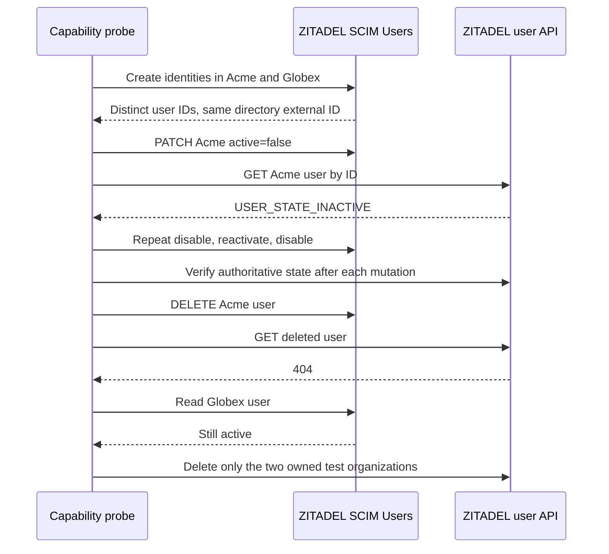

**Phase 2 remains in progress.** The pinned ZITADEL 4.19.4 deployment supports the tested SCIM Users lifecycle and exposes resulting identity state through its user API. This is upstream capability evidence; Heimdall workers, sessions and membership reconciliation are not implemented by this probe.

## Live probe

Run `pnpm run probe:scim` with the same protected verification issuer and bootstrap PAT used by the ZITADEL probe. The script creates two uniquely named organizations, creates one synthetic identity in each, performs assertions, and deletes only those organizations in a finally block. Each request has a 15-second timeout. Mutations are not automatically retried. If a create response is lost, inspect organizations named for the run ID printed before writes; confirm ownership before cleanup.

The committed source is tests/integration/scim.mjs; sanitized output is tests/integration/evidence/scim-2026-11-11.json. Run 23770f27-0dc6-40e0-9eff-1e1a139c2253 used ZITADEL deployment a95c670e-c328-4dbb-a0e2-2af6089e08ca in Railway's verification environment.

| Assertion | Observed result |
| --- | --- |
| Unauthenticated SCIM Users read | HTTP 401 |
| Same external ID and email in two organizations, distinct usernames | Separate ZITADEL user IDs; external IDs round-trip |
| Same username submitted to another organization | HTTP 409 uniqueness under this deployment's default policy |
| User from Acme requested under Globex's resource path | HTTP 404, even with the bootstrap credential |
| Filter by external ID with count=1 | Exactly the expected identity |
| Deactivate, repeat deactivate, reactivate, deactivate | SCIM active flag and user API state agree after every write |
| Delete | SCIM read and user API read return HTTP 404 |
| Other tenant after all changes | Its user remains active |
| Cleanup | Both owned organizations deleted successfully |

For the four active-state writes, mutation plus SCIM read plus authoritative user read took 438, 459, 445 and 451 milliseconds respectively. The authoritative read after deletion took 137 milliseconds; that number excludes the delete request. These are single sequential samples under healthy dependencies, not a latency guarantee. The probe bounds identity-state polling at 60 seconds; it does not measure product worker observation, local session denial or remote tuple cleanup.

## Design consequences and remaining proof

Directory external IDs and email addresses are not principal keys. The tested API accepts identical values across organizations while assigning different user IDs. Keep the selected issuer/subject identity contract. The default username uniqueness policy also means onboarding must deliberately configure naming/domain behavior; it cannot assume a duplicate login name is accepted in every tenant.

SCIM accepts a later activation after a deactivation. It does not supply the product worker's replay protection. The selected worker must still re-read current authoritative state before applying queued lifecycle work and preserve per-product pending operations. A successful repeated deactivation does not prove safety for arbitrary reordered events.

The credential used here is an instance-owner bootstrap PAT. A 404 for a mismatched resource path is not least-privilege credential evidence. Dedicated SCIM credentials, their organization boundary, provisioning-domain behavior, strict SSO, human tokens, user-API freshness under faults, session/token revocation, and SDK lifecycle reconciliation remain release gates. No group provisioning claim is added.

Sources: [pinned SCIM guide](https://github.com/zitadel/zitadel/blob/v4.19.4/apps/docs/content/guides/manage/user/scim2.mdx), [SCIM API](https://zitadel.com/docs/apis/scim2), [pinned user API](https://github.com/zitadel/zitadel/blob/v4.19.4/proto/zitadel/user/v2/user_service.proto).
