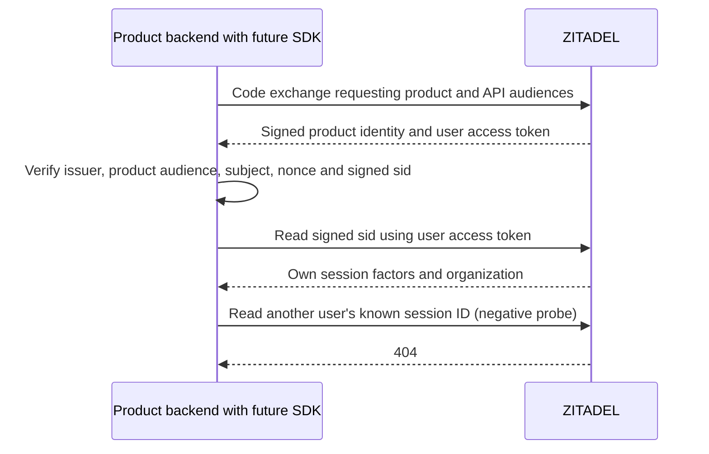

Phase 2 remains open. Product backends can read the authenticated user's own ZITADEL session and identity state using that user's access token, without a Login PAT or session token. This reduces the credentials needed for session reads. It does not provide the complete provider evidence required by strict SSO.

## Verified credential boundary

The extended tests/integration/oidc.mjs probe obtains two tokens per product: the ordinary product audience, and that audience plus the `urn:zitadel:iam:org:project:id:zitadel:aud` scope. It verifies signatures and the original product audience before using the second token against the fixed issuer API.

| Check, repeated for Ledger and Support | Result |
| --- | --- |
| Product-only token reads its signed sid | HTTP 401 |
| Product plus API audience reads its signed sid | HTTP 200; subject and organization match |
| Same token reads another user's known session ID | HTTP 404 |
| Same token reads its own identity state | HTTP 200; active |
| Other product introspects the API-audience token | HTTP 200; inactive |

The other user's session is in the same organization, making this an identity boundary check within a tenant. The extra audience does not include the other product's project. Both users are ordinary synthetic humans without administrator roles. Setup/authentication still uses separate privileged fixture credentials; the measured reads use only the user's access token.

This is self-service authority, not a universal read-only credential. The API audience makes the user's token usable against ZITADEL APIs according to that user's permissions. Keep it server-side in the browser-session adapter, use fixed issuer endpoints, and preserve product audience checks. Do not claim that the audience limits the token to these two read endpoints. A product-only externally supplied token cannot silently be exchanged for a broader token; unsupported evidence retrieval must fail safely or require the configured login flow.

## Enterprise result and important limit

The federation probe requests the same additional API audience. After verifying the product tokens, it reads the signed sid using the user token and asserts that all returned factors equal those read using the dedicated Login client. OIDC run 47744912-23a5-4ef8-afa5-86f921f862fd and SAML run cfde5768-3742-43a0-9fdb-0fd151c61e51 both passed, retaining intent/code replay checks and the SAML tamper/replay checks. Owned organizations, sessions and upstream realms were deleted.

**The intent factor contains only verifiedAt.** It does not identify the provider, protocol or upstream subject. Reading the session with a more privileged credential does not add those missing fields. The separate verified-intent API chain in [[phase-2-federation-binding]] is still necessary to construct the current structured enterprise evidence. A stock hosted Login callback plus this session read has not been shown to provide that entire chain. Membership, an organization scope, an account link or a federation timestamp must not be substituted for provider-specific proof.

This leaves strict enterprise login integration open: the implementation must obtain and bind verified intent evidence through an authorized login flow, or establish another verified upstream mechanism before relying on it. The user-token result does not justify giving IAM_LOGIN_CLIENT to every product or claiming that strict SSO works with no additional credential/integration work.

## Evidence and limits

Sanitized results are in tests/integration/evidence/oidc-self-evidence-2026-11-11.json, federation-self-oidc-2026-11-11.json and federation-self-saml-2026-11-11.json. They use API deployment 618677e2-8c80-4453-b984-ec56cc00a53e and enterprise fixture deployment 9016caf9-0be2-4536-b763-82e427aee46a, pinned in deploy/verification/versions.json. Secrets and tokens remain in memory. No public SDK runtime is implemented by these probes.

Sources: [pinned GetSession authority rules](https://github.com/zitadel/zitadel/blob/v4.19.4/proto/zitadel/session/v2/session_service.proto), [pinned intent factor fields](https://github.com/zitadel/zitadel/blob/v4.19.4/proto/zitadel/session/v2/session.proto).

Validation: password/two-product run d6336ce1-6013-4e1d-ac7d-33350fa8ae5f passed all existing OIDC regressions and the new self-service checks. The full workspace gate passed: 863 TypeScript tests, Go race tests, formatting/lint/type/Knip/vet, SDK build and 53 Quartz pages.
