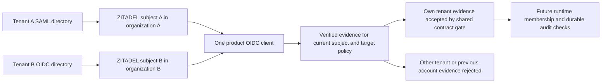

Phase 2 remains open. Two independent tenant organizations now have verified SAML and OIDC logins into the same downstream product client. Equal synthetic email addresses did not merge their identities. Shared TS/Go fixtures exercise the policy checks using evidence from those actual logins.

## Live service result

Parent run 52e88904-d130-4fb2-a50e-a304f6bb98fb created one product organization, project and confidential client. Its tenant probes created separate provider organizations and upstream fixture realms using the same synthetic email, with explicit provider/subject links and automatic linking disabled.

| Tenant protocol | Child run | Result |
| --- | --- | --- |
| SAML | cd32789e-85fa-41cb-be1e-e37f74565029 | Verified provider intent, session and signed downstream tokens for the shared client |
| OIDC | 26a9d723-8496-488b-9936-37e6b82bf720 | Same product client and issuer, distinct user subject, organization and provider |

The runs used ZITADEL deployment 618677e2-8c80-4453-b984-ec56cc00a53e and fixture deployment 9016caf9-0be2-4536-b763-82e427aee46a, with the pins recorded in deploy/verification/versions.json. Both child probes retained the existing rejection checks and verified provider ownership, active state, token signature/issuer/audience/nonce and exact sid/auth_time binding.

All tenant organizations, sessions, realms and the shared product organization were deleted. Sanitized identifiers and evidence are in tests/integration/evidence/federation-two-tenants-2026-11-11.json; there are no tokens, assertion XML, intent credentials or provider secrets in that file.

## Shared language proof

contracts/fixtures/enterprise-two-tenants-v1.json derives its evidence fields from the live result and uses a fixed evaluation time. Both language runners validate the schema, accept each tenant's matching evidence, and reject the other tenant, a previous account's subject, changed policy, password-only evidence and exact authentication-age expiry.

Deliberately removing the subject comparison in each implementation made both live-derived previous-account fixtures fail. Restoring it made each targeted suite pass. This checks that the test would detect an identity carryover bug, rather than merely mirroring a successful path.

These are internal contract checks over previously verified evidence. They do not execute an SDK login callback or durable session replacement. The service logins ran sequentially; each child's sessions were cleaned up before the next child began. This is not a browser cookie/session-switch test or proof of concurrent session safety.

## Account-model boundary

This result supports separate tenant-owned accounts authenticating to one product. It does not establish a single stable subject across independently administered directories. The product choice about cross-directory identity linking remains open; no new aliasing or account merge mechanism is approved by this test. Existing issuer/subject identity and organization isolation remain in force while that choice is resolved.

If a compliant reauthentication produces another subject, the runtime must evaluate that subject's membership and permissions, invalidate old identity-bound context, and handle session replacement atomically. An equal email, existing browser cookie or membership of the previous account cannot supply the new account's authority. Actual HTTP/session switching, membership enforcement, recovery and audit integration still require later runtime tests.

Run pnpm run probe:federation-tenants with the protected federation environment described in deploy/verification/enterprise-idp.md. The shared client secret is passed only through the child process environment; the parent deletes the product organization in its cleanup path.

## Validation and publication

The live shared-product probe passed. Both subject-check mutations failed the intended previous-account fixtures; restored implementations passed. The full workspace gate passed with 863 Vitest tests, Go race tests, formatting/lint/types/Knip/vet, SDK build/declarations and Quartz. Source commit ae5d0f4616f64821e7232d44357fd48d7294ae6a passed GitHub Actions runs 42923806305 and 42923793327. Railway docs deployment 5f25f934-4587-405d-88f9-f6b837f22fdb reached SUCCESS. The public page returned HTTP 200 with the shared-product run ID, phase status and Mermaid source. Phase 2 remains open.
