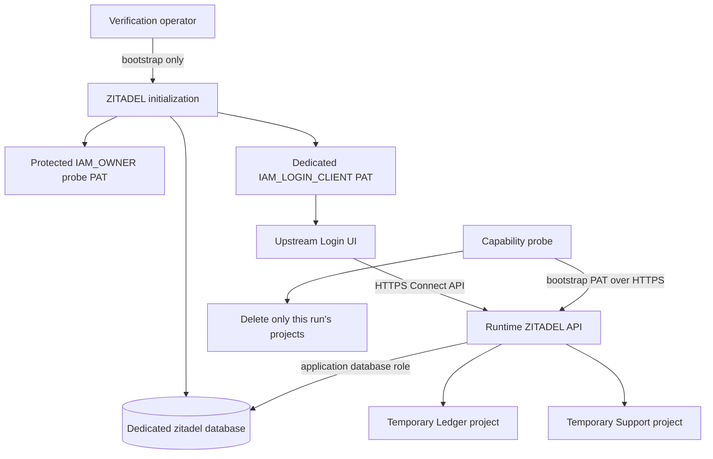

**Phase 2 remains in progress.** ZITADEL API and upstream Login UI 4.19.4 now run in the dedicated Railway verification environment. This checkpoint proves deployment and initial provisioning, not complete authentication or enterprise behavior.

## Deployed artifacts

| Component | Deployment and observation |
| --- | --- |
| ZITADEL API | a95c670e-c328-4dbb-a0e2-2af6089e08ca; SUCCESS, running with runtime-only start command |
| ZITADEL Login UI | 40074200-88b9-4485-bceb-6a4dfc6f18b5; SUCCESS and running |
| PostgreSQL | Direct SQL server_version returned 17.11 |
| Database roles | heimdall_probe is a test superuser with CREATEDB; heimdall_zitadel has neither privilege |

Exact API and UI image digests are in deploy/verification/versions.json. Setup is documented in deploy/verification/zitadel.md. The API initializes a dedicated database and application role, then switches from start-from-init to start. Bootstrap database credentials and the first human password were removed from its runtime environment; their absence was checked after deployment. Master key and application database credentials remain necessary runtime secrets.

The privileged bootstrap machine PAT and the dedicated Login client PAT are separate. PAT files and the SSH key used for verification are protected outside the repository. Privileged bootstrap material remains available for the capability phase and requires eventual revocation/removal. This is not a least-privilege SDK provisioning credential proof.

## Live assertions

The committed tests/integration/zitadel.mjs probe passed again after the runtime-only deployment. Sanitized results are in tests/integration/evidence/zitadel-2026-11-11.json, run a84a77b9-1003-4493-b904-3a989a21da80.

- Discovery returns the exact HTTPS issuer and same-origin authorization, token, JWKS and introspection endpoints.
- Discovery advertises S256, authorization-code and refresh-token support. Advertisement is not an exercised login flow.
- JWKS exposes two signing keys with no private key fields.
- Missing and invalid credentials return 401 on the authenticated self endpoint.
- A verified machine credential creates and reads distinct Ledger and Support projects through the v2 Connect API. Both owned projects are deleted afterward.
- The Login UI rejects a bare login URL without an authentication request with HTTP 400. A human login has not yet been verified.

## Remaining acceptance work

Human authorization-code flow, actual audience/organization claims, unknown-key handling, multi-organization boundaries, strict SAML/OIDC SSO evidence, SCIM Users lifecycle, disable/delete freshness, least-privilege credentials, listing limits and outstanding-write quiescence remain unverified. No pinned service version is certified for the complete release yet. No SDK runtime behavior is inferred from this bootstrap probe.

Sources: [upstream pinned deployment](https://github.com/zitadel/zitadel/blob/v4.19.4/deploy/compose/docker-compose.yml), [Project v2 contract](https://github.com/zitadel/zitadel/blob/v4.19.4/proto/zitadel/project/v2/project_service.proto), [Railway volumes](https://docs.railway.com/volumes).

## Repository validation

The full workspace gate passed: 765 Vitest tests, Go race tests, formatting, lint, TypeScript, Knip, Go vet, SDK build/declarations and Quartz. The live ZITADEL probe passed after removal of bootstrap environment credentials. Publication verification follows the source commit.
